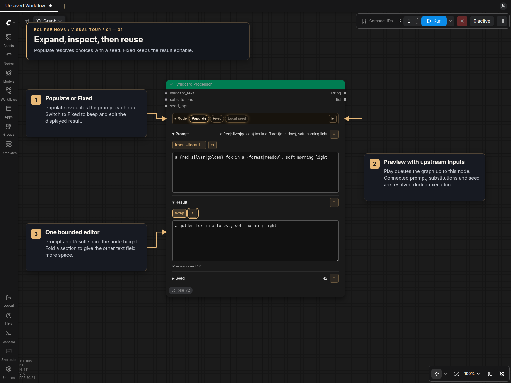

# ComfyUI Eclipse Nova

Eclipse Nova provides prompt editors, image/video/audio tools, sampling settings,
character workflows and routing utilities for ComfyUI. Its redesigned nodes use
compact panels with collapsible sections, searchable choices and resizable
previews in **classic canvas and Nodes 2.0**.

**1.0.0 is Nova’s initial release.** Nodes use `[Eclipse Nova]` IDs and the
**🌒 Eclipse Nova** menu, separate from the original Eclipse pack. Original
Eclipse workflows need their nodes replaced explicitly; Nova does not include
legacy aliases or workflow migration tools.

[](https://github.com/comfyanonymous/ComfyUI)
[](https://linuxmint.com/)
[-76b900)](https://www.nvidia.com/)
[](LICENSE)

## Explore the nodes

Start with the **[visual tour](Readme/Visual_Tour.md)** for annotated screenshots,
or use the **[documentation index](Readme/README.md)** to find a specific node.
The screenshots show the Amber theme; Neutral is the default.



| Work with… | Guides |
| --- | --- |
| Prompts and text | [Smart Prompt](Readme/Smart_Prompt.md), [Wildcard Processor](Readme/Wildcard_Processor.md), [String Multiline](Readme/String_Multiline.md), [Prompt Styler](Readme/Prompt_Styler.md), [Prompt Forge](Readme/Prompt_Forge_Panel.md) |
| Sampling and dimensions | [Sampler panels](Readme/Sampler.md), [Smart Folder](Readme/Smart_Folder.md), [Resolution Pipe](Readme/Resolution_Pipe.md) |
| Images | [Loaders](Readme/Image_Loaders.md), [Resize](Readme/Image_Resize.md), [Adjustments](Readme/Image_Adjustments.md), [Text/Image FX](Readme/Image_FX.md), [Selection and comparison](Readme/Image_Review.md) |
| Saving and metadata | [Save Images](Readme/Save_Images.md), [Save Video](Readme/Save_Video_Data.md), [Read Prompt Files](Readme/ReadPromptFiles.md), [Save Prompt](Readme/Save_Prompt.md) |
| Audio and video | [Load Audio](Readme/Load_Audio.md), [Recorder](Readme/System_Audio_Recorder.md), [Load/Preview Video](Readme/Load_Video.md), [Upscale Video](Readme/Upscale_Video.md), [Lyric Captions](Readme/Lyric_Captions.md) |
| Character and timeline workflows | [Character references](Readme/Character_Reference_Nodes.md), [Shot Planner](Readme/Character_Shot_Planner.md), [MiniMax planning](Readme/MiniMax_H3_Audio_Planner.md), [Frame timelines](Readme/Frame_Timeline.md) |
| Routing and review | [Set/Get and Bridge](Readme/Set_Get_Bridge.md), [Get First / Get All Active](Readme/GetFirst_GetAllActive.md), [Previews and Stop](Readme/DOM_Previews.md), [Utilities](Readme/Utility_Nodes.md) |

## Why the new panels?

Canvas performance was a major reason for the redesign. A panel stores its
configuration together and renders the controls it needs locally. Nova no longer
uses the old widget-visibility manager, global resize/performance helpers or
recurring canvas scans for these panels. Changes are driven by editing, loading
and execution events. Routing, pipes and dynamic-input utilities retain their
specialized controls.

The design and panel approach are **inspired by the DaSiWa node set**. Mode bars
select features; section headers show concise summaries; pins keep selected
sections open. Folding a section changes the layout, not the stored settings.
Text and preview panels fit within the node size chosen by the user.

Choose **Settings → Eclipse Nova → Appearance → Node design** for **Jade,
Neutral, Ocean, Amethyst or Amber**, plus **Neutral Jade, Neutral Ocean,
Neutral Amethyst and Neutral Amber** for lighter backgrounds and titles with
colored controls. Use **Theme editor → Edit themes** in the same settings section
to adjust colors, opacity and shadows with a preview, then **Save** or **Save As**.
You can also edit JSON themes under `themes/custom/` and reload them from settings.
Bundled themes are extracted
once from `.defaults/themes/`; edits and deletions in `themes/` survive updates.
The selected design styles panel controls and untouched node defaults, preserving
custom title and background colors across workflow reloads. **Theme regular nodes**
and **Theme groups** are separate Appearance options, both off by default. Turning
either off restores the previous colors. Preferences are stored in this pack’s
`config.json`. The optional **Link Nova themes** button keeps installed SmartLLM
Nova and Smart Model Loader Nova packs on Eclipse's theme, so future selections
apply to all three. See [Node designs](Readme/Node_Design.md) for details and colors.

Enable **Settings → Eclipse Nova → General → Use Sliders** to add sliders to
bounded numeric fields in the redesigned panels. The setting applies immediately
to existing and new nodes in both renderers. You can still type exact numbers;
seed fields retain their exact integer text controls.

## Install

From your ComfyUI directory:

```bash
git clone https://github.com/r-vage/ComfyUI_Eclipse_Nova.git custom_nodes/ComfyUI_Eclipse_Nova
python -m pip install -r custom_nodes/ComfyUI_Eclipse_Nova/requirements.txt
```

Use the **same Python environment that runs ComfyUI**. For Windows portable,
run this from the portable installation’s root instead:

```powershell
python_embeded\python.exe -m pip install -r ComfyUI\custom_nodes\ComfyUI_Eclipse_Nova\requirements.txt
```

Restart ComfyUI and reload the browser. Search for `[Eclipse Nova]` or open the
**🌒 Eclipse Nova** menu. Character and MiniMax tools have their own submenus.

Some features need additional runtimes: the [Advanced Detailer](Readme/Integrated_Detailer.md)
has optional YOLO, SAM2 and matting backends; video, audio and caption tools also
have their own requirements. The diffusion detailer engine is included in Eclipse.
Check the relevant guide
before using those features. Wildcard Processor uses Nova’s own engine and does
not require Impact Pack.

## Optional companion packs

**[Smart Model Loader Nova](https://github.com/r-vage/ComfyUI_SmartModelLoader_Nova)**
provides diffusion-model loading, CLIP/LoRA tools, model presets and the Download
Manager. Model source/integrity fields and download-to-loader integration belong
to that pack, not Eclipse Nova.

**[SmartLLM Nova](https://github.com/r-vage/ComfyUI_SmartLLM_Nova)** provides language-model
and detection tooling. Follow its setup guide. Companion packs own their node IDs, settings, model registries
and credentials; Eclipse does not install or configure them.

## Pipes and connected overrides

Nova’s `PIPE` is a dictionary of related values. **Smart Sampler Settings**
contributes only enabled settings; **Smart Folder** supplies paths and dimensions;
**Generation Data** carries information for metadata and saving. Context and
pipe tools combine or extract those values.

A `PIPE` is not interchangeable with every other pack’s tuple-based
`BASIC_PIPE` or custom context type. Follow the input labels and each node’s
guide. The Detailer, for example, takes its model/conditioning from `basic_pipe`
and optional sampling overrides from `pipe_opt`.

Where a panel has explicit input sockets, its guide explains their priority.
For example, Image Resize can use connected width/height values, and the samplers
have a **Use pipe settings** switch. Loading a file or metadata does not
implicitly replace every downstream setting: use the relevant Include controls
or pipe inputs to choose what travels through the workflow.

## Your files and settings

User-editable data lives inside this repository:

| Location | Purpose |
| --- | --- |
| `prompts/` | Smart Prompt folders and Prompt Forge tag lists |
| `styles/` | Prompt Styler CSV/JSON/TXT libraries |
| `wildcards/` | Packaged wildcard examples; the engine also reads ComfyUI wildcard folders |
| `patterns/` | Save Prompt content-rating terms |
| `themes/` | Editable JSON themes and `custom/` overrides; extracted once |
| `config.json` | Private Eclipse Nova configuration |
| `.defaults/` | Distributed `.example` sources and their manifest |

Startup extracts new defaults. An updated default replaces its extracted copy
only if that copy still matches the previously shipped hash. Edited files and
intentionally deleted known files stay untouched. Edit the extracted files in
`prompts/`, `styles/` and the other data folders, rather than `.defaults/`.

The `models/wildcards/smart_prompt_nova` link exposes Nova’s prompt files to
wildcard expansion without duplicating them. Startup preserves a real directory
at that location and leaves the original Eclipse `smart_prompt` link untouched.
Nova reads a working original prompt link while that checkout is available;
links to removed or disabled checkouts, or an old link pointing back into Nova,
are ignored. Use `__smart_prompt_nova/...__` for Nova’s prompt library. Back up
your custom data and workflows before reinstalling or removing a checkout.

## Help and contributing

If nodes are missing, check the ComfyUI startup log and install dependencies into
the environment actually running it. After updating Python code, restart
ComfyUI; after updating frontend code, reload the browser as well.

For a [bug report](https://github.com/r-vage/ComfyUI_Eclipse_Nova/issues), include
the ComfyUI/frontend versions, renderer (classic or Nodes 2.0), traceback and a
small reproducible workflow. Remove private paths, prompts and credentials
before sharing it.

Contributions to the nodes and [documentation](Readme/README.md) are welcome.
Licensed under [Apache 2.0](LICENSE).
