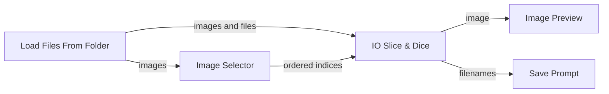
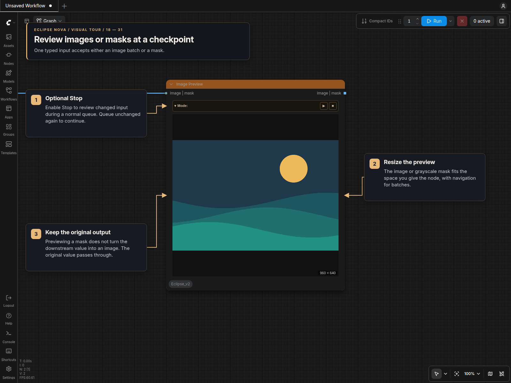

# Batch Selection, Slice & Dice, and Review

This workflow turns a folder into a visually reviewed, ordered subset without losing the relationship between each image and its filename. It combines four Eclipse nodes:

1. **Load Files From Folder** uses Step selection to load a bounded frame range and can apply an aspect-preserving resize policy.
2. **Image Selector** pauses on a contact sheet and returns the indices in selection order.
3. **IO Slice & Dice** applies those indices to every connected batch or list.
4. **Image Preview** displays the result and can pause the workflow for a final review.

The important wiring choice is to connect the loader's `images` and `files` outputs directly to IO Slice & Dice, then use only the selector's `indices` output to drive the slice. Images and filenames therefore remain aligned in the exact order you select them.

## 1. Resize the source batch

In [Load Files From Folder](Image_Loaders.md), choose **Step** in the Selection
bar. Enable **Resize**, then choose **Custom**, Target **Longest**, Size **1024**
and Aspect **Original**. Each image keeps its aspect ratio while its longest
edge targets 1024 pixels. A divisor of 16 aligns both edges to multiples of 16.

The loader applies its controls in this order:

- Build a sorted catalog for each path line, optionally including subfolders.
- Select the inclusive Start–End window; −1 means the final frame.
- Shift the window by its length times Batch index.
- Apply the enabled resize policy to each selected image and mask.

The relevant outputs are list-shaped:

- `images`: the individually resized images; their dimensions can differ because original aspect ratios are retained.
- `files`: their corresponding source paths in the same order.
- `masks`: alpha-derived masks when a later branch needs them.

When `batch_index` advances the start of this window beyond the available
source, the loader returns silent execution blockers and shows a warning instead
of attempting to load nonexistent frames. If Run Instant, Run on Change, or the
legacy Auto Queue control was active, Eclipse also turns off that automatic
continuation. It does not interrupt the current execution, remove manually queued
jobs, or reject a final partial batch; stopping occurs only on the following
queue when no frames remain.

## 2. Select images visually

The themed [Image Selector](Image_Review.md#image-selector) provides an ordered selection grid in standard canvas and Nodes 2.0.

With automatic mode disabled, the first execution displays the source images and interrupts the workflow at Image Selector. Click images in the order you want them downstream; the numbered badges show that output order.

- Click toggles one image.
- Shift-click selects or clears a range from the last clicked image.
- Ctrl+A selects all; Escape clears the selection.
- Double-click opens the large in-node preview.
- **Auto confirm**, in the Mode bar, selects every image on future queues and lets the workflow continue without pausing at Image Selector.
- **Confirm** stores the ordered indices, updates the internal execution trigger, and automatically re-queues the workflow.
- **Discard** clears the current decision and disables **Auto confirm**, so the next queue opens a fresh selection.

Enabling **Auto confirm** immediately selects every image in the displayed grid, so a manually paused selector only needs **Confirm** to continue. Changing the button never starts, cancels, or interrupts the current queue; its enabled state takes effect the next time the node executes. While it remains enabled, each different incoming image set is displayed with every image selected and sent through the `images` and `indices` outputs immediately.

Automatic mode lasts only for the current live node session. Saving a workflow leaves it active in that session, but does not save the enabled setting. Reloading the page or loading a workflow always starts with **Auto confirm** off. Your saved image selection still restores normally.

Disabling the option performs a discard-like reset: it clears the visible and stored automatic selection without interrupting work that is already running. The next queue pauses for a new manual selection, including when the incoming images have not changed.

**Layout** can adapt automatically or hold the grid at one through six images per row. The node keeps the grid inside its chosen dimensions and scrolls when more images are available.

The full grid and your selection order survive a page reload while ComfyUI remains running. Picks are saved with the workflow, including an empty or unconfirmed selection. Reloading does not confirm selections or queue execution; use **Confirm** when ready. Continuation retains the seed and index values used for the displayed images, and confirmation keeps every grid thumbnail available.

This uses temporary preview references, without embedding images in workflow JSON. If ComfyUI restarts, the previews disappear, or the upstream inputs change, the selector shows **Run workflow to reload images**. Run the workflow again to create a fresh grid.

Image Selector also has an `images` output, but this workflow intentionally leaves it unconnected. The `indices` output is enough to apply the same decision to several related streams in IO Slice & Dice.

## 3. Slice images and filenames together



Connect the workflow as follows:

| From | Output | To | Input |
|---|---|---|---|
| Load Files From Folder | `images` | Image Selector | `images` |
| Image Selector | `indices` | IO Slice & Dice | `indices` |
| Load Files From Folder | `images` | IO Slice & Dice | `image_list` |
| Load Files From Folder | `files` | IO Slice & Dice | `filenames` |
| IO Slice & Dice | `image` | Image Preview | `images` |

IO Slice & Dice accepts optional image batches, image lists, latents, positive and negative conditioning, prompt text, filenames and generation-data pipes. Every connected value is mapped through the same ordered indices. Its main image forms are:

- `image`: one stacked image batch, convenient for ordinary IMAGE inputs.
- `image_list`: the selected items as a list for list-aware nodes.
- `filenames`: the matching selected source paths.
- `indices`: the original decision passed through for another branch.
- `pipe`: generation-data records in the same order as the selected images.

When only `image_list` is connected, the node also constructs the stacked `image` output. List-aware branches retain each loader result as an individual image. The stacked `image` output fits differing shapes to one batch geometry when that representation is needed.

Connect the complete sampler or loader PIPE list to `pipe` before selection.
One pipe broadcasts to every selected image. Multiple pipes can describe one
image each or one original batch each: the node uses source batch lengths or the
images carried by sampler pipes, including unequal batches. Metadata-only pipes
can also describe equally sized batches when the complete image count is known.
An ambiguous count raises an error instead of guessing. PIPE fields remain the
original generation records; use the separate image and latent outputs for
selected media. Extract sampler settings from the selected pipes for saving,
so changing the selection does not leave the metadata list at its old length.

### Example consumer: Save Prompt

[Save Prompt](Save_Prompt.md) is one practical consumer of the preserved image–filename relationship. In a captioning branch, send the selected images through a vision or caption model and connect its ordered text output to Save Prompt's `text` input. Connect IO Slice & Dice's matching `filenames` output directly to `filename_opt`:

```text
IO Slice & Dice image_list → vision/caption model → Save Prompt text
IO Slice & Dice filenames ───────────────────────→ Save Prompt filename_opt
```

As long as the captioning branch preserves list order, Save Prompt receives each generated caption beside the full path of the image that produced it. Its default `filename_prefix=%source_filename` derives the original name from `filename_opt`; with `use_source_folder=true`, the prompt can be saved alongside the corresponding source image.

## 4. Add a review checkpoint



**[Image Preview](DOM_Previews.md)** renders all selected images inside the node. Its **Mode** bar has a **Stop** button:

- Disabled (default): preview and continue normally.
- Enabled: render the preview, then interrupt the current execution at this checkpoint.

Its `IMAGE` output preserves the original batches and list order, so the same review node can sit in the middle of a larger workflow. Queue again with unchanged inputs to continue through the cached result. Changed images trigger another review; disable **Stop** to run unattended.

## Practical notes

- Keep filenames or other metadata connected to IO Slice & Dice whenever their relationship to the images matters.
- Selection order is significant. Choosing source items 1, 4, then 2 produces indices `[0, 3, 1]` and slices every connected list in that order.
- Changing the upstream image content invalidates the stored selection and opens the selector again.
- Leave `Auto select and confirm` enabled when stepping unattended through several loader batches; disable it when the next queue should become a manual review checkpoint.
- Run Instant and other automatic queue modes stop after the loader reports that its stepped range is exhausted, preventing repeated empty submissions.
- The saved `method=lanczos` plus `device=gpu` combination falls back to bicubic because this node's GPU path does not support Lanczos. Choose `device=cpu` when actual Lanczos interpolation is required.
- The loader requires a backend-visible folder path. Absolute paths are supported; remote browser paths that the ComfyUI server cannot access are not.
- Use End **−1** to include everything through the final file.
