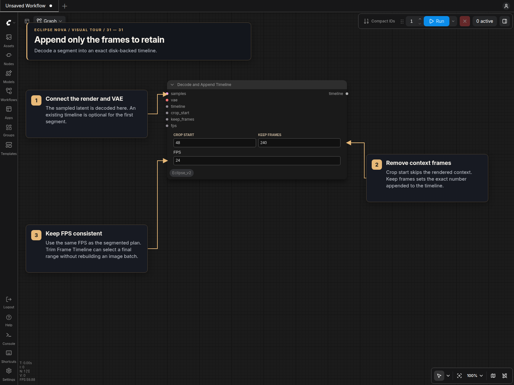
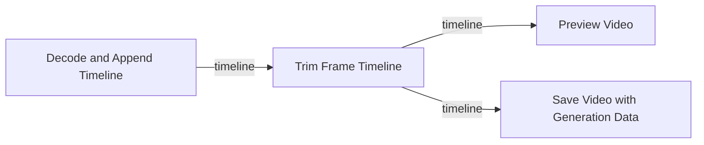
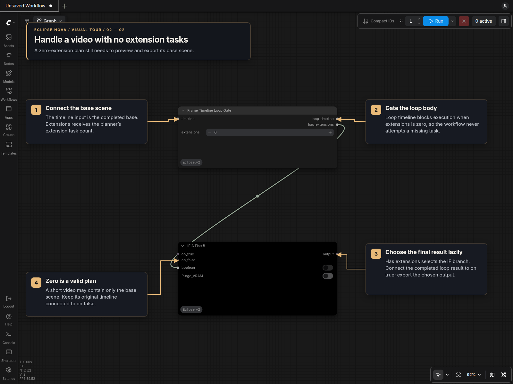

# Exact frame timelines

## Visual tour

### Append, trim and preview exact frames

Keep the timeline connected through the workflow. Preview files are viewing
copies; trimming and final export continue to use the exact stored frames.

### Handle a base-only plan

When no extension tasks are needed, use the gate's Boolean output with a lazy
IF A Else B to select the original base timeline instead of the loop result.

## Wiring and storage

`Decode and Append Timeline [Eclipse Nova]` uses the native VAE decode, retains the
requested frame range, and stores those pixels in NumPy chunks or CPU RAM. Its
`ECLIPSE_FRAME_TIMELINE` output carries chunk ownership, ranges, dimensions,
dtype and FPS. Appending never loads or concatenates earlier scenes.

Connect the base timeline to the loop's carried value, and connect the extension
node's `timeline` input to that carried value. Each extension returns a new
immutable descriptor sharing the earlier chunks. Decode memory still depends on
the size of one generated scene; this node does not introduce temporal tiling.

`MiniMax H3 Audio Plan Step` accepts optional `timeline` instead of
`previous_frames`. It validates accumulated counts and FPS, and reads only the
last 22 exact frames when generated continuity is requested. Original IMAGE
workflows remain supported.

### Wan InfiniteTalk and image-change warmup

`WAN LipSync Plan Step` also accepts a disk timeline in `previous_frames`.
Connect its small `previous_frames` output and `audio_start` to
`WAN LipSync Conditioning`, which delegates to ComfyUI's native InfiniteTalk
conditioner while preserving the absolute audio clock. Use 25 FPS. This avoids
passing the accumulated image batch into every sampler call.

Connect the sampler latent directly to `Decode and Append Timeline`. Its
`crop_start` must come from **Plan Step → trim_image**, and `keep_frames` from
Plan Step. Feed the carried disk timeline to the append node's `timeline` input.
Use a second Decode and Append Timeline for the base render, with crop start 0
and the planner's `base_keep_frames`.

The planner's **Transitions → Warmup seconds** controls a hidden generated
lead-in at image changes. It uses preceding real audio and the new reference,
then discards that lead-in before appending. The cut remains at its planned
frame; the soundtrack is neither shifted nor padded. Start with 1 second.
Zero preserves the previous blend behavior, including in older configurations.
Warmup is limited by the available past audio and render window. It reduces the
visible frames retained from that pass and can add sampling calls, but does not
increase the fixed render length. Perceptual lip-sync improvement still depends
on the model and needs visual review.

Keep the original soundtrack connected to previews and the final saver;
Demucs vocals can remain the sampling guide. Captions and saving consume the
disk timeline directly. Keep the loop gate and lazy base-only fallback, as in
the MiniMax layout.

`Preview Video` accepts the timeline in its existing source socket. It streams
**all completed scenes**, uses stored FPS and the separately connected audio,
and returns the same timeline. Preview MP4s are viewing copies; generation and
final rendering never decode pixels from them.

Unchanged previews use ComfyUI's execution cache with Stop enabled or disabled.
Requeueing a completed timeline, or changing only downstream caption styling,
can reuse generation and loop results while those results remain cached. Change
the style in the final caption renderer after the loop. Changes in a review
branch connected before sampling remain upstream changes and can invalidate
generation. In temporary or RAM mode, backend restarts or cache eviction require
generation again.

For reuse after a restart, choose persistent storage and reload the saved run as
described below. RAM and temporary storage rely on the current execution cache.
**Video Loop Start** deliberately creates a fresh run/revision each queue. Select
**Load saved run** for downstream caption or export edits that should reuse its
completed output without sampling.

`Trim Frame Timeline` selects an exact frame range without copying pixels. It
also returns width, height and frame count. Connect its output directly to
`Render Lyric Captions` or `Save Video with Generation Data`.
Caption FPS must match timeline FPS. Caption background frame zero corresponds
to the beginning of the already selected audio excerpt; retain the existing
full-song caption trim offset. The saver retains its CRF, preset,
metadata and audio controls. Duration trimming works without reconstruction;
loop matching/blending is not supported for timelines.

For a plan with no extensions, `Frame Timeline Loop Gate` blocks a legacy loop
body. Connect its `has_extensions` output to a lazy `IF A Else B`, choosing the
loop result for true and the original base timeline for false. This lets the base
preview and final export complete without attempting a nonexistent extension.
Eclipse **Loop Start / Loop End** handle a zero total directly: connect the base
timeline as `initial_value`; End returns it without executing the body.

Float16, bfloat16, float32 and float64 round-trip exactly. Bfloat16 is stored as
its unchanged 16-bit representation. No intermediate pixel quantization, lossy
compression, precision changes or frame interpolation are introduced.

Without a storage input, chunks live under ComfyUI's temporary directory. Four minutes at 512×896,
24 fps, RGB float32 requires about **29.5 GiB**, plus preview files. Cumulative
preview encoding still grows in work as the video gets longer. Each read mapping
closes after use; interrupted or failed chunk writes remove their incomplete
files. Shared chunks stay alive while any cached timeline, loop state or output
references them, and are removed when their final owner is released. Clearing
execution caches releases ownership only if no other references remain.

Temporary mode is execution-local storage. Abrupt process termination
can leave temporary files for normal ComfyUI temp cleanup. Keep sufficient disk
space and restart ComfyUI after updating Eclipse to register the new nodes.

## RAM, disk and saved runs

Connect **Video Run Storage → storage** to **Decode and Append Timeline**,
**Append Video Clip**, and optionally **Scene Analysis Plan**. Existing nodes
without this input retain their temporary-disk behavior.

| Controls | Retained video parts | After restart |
| --- | --- | --- |
| Disk off | Exact decoded parts in CPU RAM | Generate again |
| Disk on, Keep files off | Temporary files owned by cached outputs | Generate again |
| Disk on, Keep files on | A unique folder under Output directory | Load `run.json` |

RAM mode increases CPU RAM use; it does not keep the accumulated video in VRAM.
Preview and final export still write video files. Native VIDEO consumers may
materialize the accumulated RAM frames when requesting all components. Scene
Analysis Plan uses the same RAM/disk selection for sampled images; its disk
cache remains temporary, and diagnostic response JSON is written in either mode.

Persistent folders contain ordered parts, `run.json`, the selected soundtrack
when connected, and workflow/API-prompt snapshots when available. Connect the
full selected soundtrack to the append node's **soundtrack** input. Each
successfully appended part updates the manifest, so a failed later iteration
does not discard completed parts. The append node also outputs **run_path**.
Saved files remain until you remove their folder; they are not automatically
deleted by cache cleanup. Incomplete writes are excluded from the manifest.

**Load Video Run → saved_run** lists saved manifests under ComfyUI's output
folder, including partially completed runs. **Refresh runs** discovers newly
saved or moved runs without changing the current selection. The list reads only
manifests, so opening it does not load the stored frames into RAM.

The dropdown is the loader's only run selection. To reuse a moved run, place
its complete folder under ComfyUI output and click **Refresh runs**. If the list
is empty, generate with **Disk** and **Keep files** enabled, then refresh.
When sharing a workflow, an unavailable saved-run selection does not block
**New run** mode through the lazy selector. **Load saved run** requires a local
run; if it is unavailable, the loader explains how to refresh and select one.
It never silently substitutes another run.
The loader validates the recorded files, frame ranges, dimensions and FPS.
Move the whole run folder together;
part paths are relative. The loader returns a frame timeline or native VIDEO,
the saved soundtrack, dimensions, FPS and frame count. Disk loading reads the
existing parts; RAM loading copies their decoded frames into CPU memory.
Native runs without a master soundtrack retain generated audio in their VIDEO.
Loose `.npy` files alone do not identify their order, frame rate or soundtrack.

Select the generated or loaded source **together with its matching soundtrack**
through a lazy **IF A Else B**. Use **Video Run Storage → generate** as its
condition. Use **prepare** to gate independent analysis, source and planning
previews/reports: it is true only for **New run**. Use **generate** for outputs
that should also run during resume. Place **Video Run Gate** before these outputs;
they otherwise request their upstream work
even when the final selector chooses the loaded branch. A disabled gate returns
an execution blocker without requesting its source. Get/Set can carry these
controls between groups. **Video Run Info** provides the selected media's actual
dimensions and FPS for captions/export, plus retained-part ranges and size.

## Resume or replace the remaining parts

**Video Loop Start → Loop End** supports native H3 Clip Plans and lip-sync Audio
Plans without a third-party loop pack. Connect Video Run Storage to Start, then
use Start's resolved outputs for conditioning and append. Connect Load Video
Run's **source** and **run_path** to Start's **previous** and **run_path**. The
loader dropdown remains the only run selector.

**New run** captures the resolved plan, prompts, resized reference images,
canvas, reference mode, master audio and conditioning audio before sampling.
Persistent runs store them in `checkpoint.json` with separate NumPy assets.
**Resume saved run** restores those inputs without requesting fresh analysis or
planning. **Restart part = 0** continues after the last completed part.
**Restart part = N** retains parts 1 through N−1 and replaces N onward. Use the
one-based part numbers in Video Run Info; do not delete original part files.
A completed run with Restart part 0 returns the saved result without sampling.

Start's **index** is already absolute. Connect it to conditioning and Video Part
Seed. Its **previous** carries the accumulated media; its **storage** output
identifies this run/revision. **Parts per queue = 0** renders everything remaining;
a positive value limits the number of new completed parts in this queue.

Keep **Append → accumulated Preview Video → Loop End** connected in that order.
The preview includes the retained prefix and new part, so lip-sync warmup trims
and transitions remain visible. **Stop after current part** saves and previews
the current result before returning a partial run. Completed parts are saved
before preview; an immediate ComfyUI cancellation may skip the preview but
retains the last committed parts. Use a separate final preview for completed
runs that need no new iterations.

Put **Seed → Video Part Seed → RandomNoise** in the rendering group. Feed the
absolute index to Video Part Seed. **Different seed per part** adds that index
to the base seed with exact 64-bit wraparound; off uses the same base for every
part. Keep this seed separate from loaders, analysis and conditioning. The
append nodes' optional **generation_seed** input records the actual seed for
each saved part. Existing native conditioner seed outputs remain supported.

To change an unsatisfactory result, stop the job, select its saved run, choose
**Resume saved run**, set the restart part, change the render seed and queue again. The
retained prefix is loaded media, so its earlier samplers do not execute.
Persistent storage creates a new run folder, sharing immutable retained files
with hard links when possible and copying otherwise. It never edits the original
run. RAM and temporary output are also supported, with their usual lifetimes.
Changing a widget during a running job does not change its queued settings.

Resume restores resolved render inputs, not loaded models. Keep the matching
lip-sync/native mode and model/LoRA preset selected; sampling settings and the
render seed remain editable for new parts. Old media-only runs can still be
loaded/exported, but cannot resume without a resolved checkpoint. No inputs are
guessed from old workflow snapshots. An interrupted sampling pass restarts that
part from the beginning. See [Eclipse loops](Loops.md) for full wiring.

Part ranges use zero-based **[start, end)** frame numbers. A capacity split can
create several parts within one scene. This resumes from whole-part boundaries;
an arbitrary In/Out replacement that keeps a later suffix needs a separate
splice operation and matching motion context.

## If disk space runs low

Finishing a run does **not** immediately delete its exact frames. ComfyUI can
keep them cached so you can change captions or export again without repeating
generation. Accumulated preview MP4s also take space until temp cleanup.

Timeline storage errors show the **actual storage folder**. In temporary mode this
is `ComfyUI/temp`; it can differ when a custom temporary directory is configured.
Check that folder's drive, which may differ from the drive holding final exports.

To reclaim space manually:

1. Keep any final videos you want from `output`. Finish or cancel the current
   job, then **stop the ComfyUI backend**, not just the browser tab.
2. In the temporary folder, remove the following only when no longer needed:

   | Temporary item | What deleting it removes |
   | --- | --- |
   | `EclipseFrames_*` folders containing `frames.npy` | Exact cached timeline pixels, usually the largest files. Later caption changes or re-exports require generation again. |
   | `EclipseVideo_temp_*.mp4` | Accumulated viewing previews. Exact frame chunks remain separate. |
   | `EclipseLyrics_*.mp4`, `EclipsePreview_*.mp4` | Temporary caption renders and VIDEO preview copies. Keep the final exported copy from `output` first. |
   | `EclipseLyricsBackground_*` folders | Temporary background-video excerpts left behind by an interrupted process. |

3. Restart ComfyUI before queueing again. Do not delete live frame chunks while
   the backend is running: cached nodes may still point to those files.

Leave `input`, `models`, and final videos in `output` alone. Clearing execution
caches can release exact chunks automatically when their last reference goes
away, but unloading models or merely completing the queue does not guarantee
that the temporary data is gone. Temporary files do not provide restart recovery,
and preview MP4s cannot restore the exact timeline pixels.

For long runs, reserve about 30 GiB per four-minute float32 timeline at
512×896/24 fps, plus previews and export space. You can configure ComfyUI's
`--temp-directory` on a drive with more space before starting another run.
