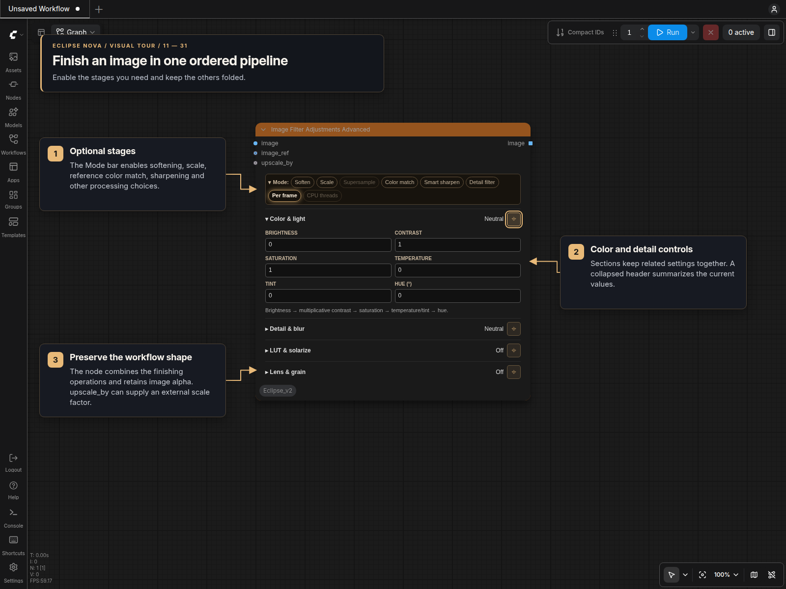

# Image Filter Adjustments Advanced

One compact panel combines softening, scaling with or without an upscale model,
reference color matching, manual adjustments, LUTs, sharpening and finishing
effects. Find it under **🌒 Eclipse Nova → Image → FX & Color**.

The Mode bar and pinnable sections use your selected Eclipse Nova design in both
classic canvas and Nodes 2.0. Click a section to open it; pin sections to keep
several open. Disabling a stage retains its settings in the workflow. No preset
or additional setting sockets are needed.

Hover over a field, its label, or a Mode switch for its purpose, neutral value
and interactions with other controls. Collapsing or pinning a section changes
only its visibility; the Mode switches enable or disable optional stages.

## Inputs and output

| Socket | Purpose |
| --- | --- |
| `image` | Required target image, batch or list. This is also the bypass source. |
| `image_ref` | Optional Color Match reference image, batch or list. Needed only when Color match is enabled with strength above 0. |
| `upscale_by` | Optional FLOAT from 0 to 16. While Scale is enabled, a non-None value overrides its local target. |
| `image` output | Processed images. Batches remain batches; image lists may contain different sizes. RGB effects preserve alpha separately. |

`upscale_by` is the only added control input. A positive value multiplies the
**original image dimensions**, even when the chosen model has a different native
scale. For example, a 4× model with `upscale_by = 2` produces a 2× result.
Zero keeps the native model output, or the original dimensions without a model.
Scale off ignores this input. None uses the local target. Local target controls
are disabled while connected, but retain their values for disconnection.

## Processing order

Sections follow the execution order:

| Stage | Controls |
| --- | --- |
| **Soften** | Gaussian, bilateral, wavelet, median, anisotropic or edge blur. Positive strength softens; negative strength sharpens. Radius appears for the spatial methods; iterations appears for anisotropic diffusion. |
| **Scale** | Optional upscale model, factor/fixed/native target, five resampling methods, dimension divisor and optional 2×/4×/6×/8× supersampling. |
| **Color match** | Nine transfer algorithms, strength and reference pairing. |
| **Color & light** | Brightness → multiplicative contrast → saturation → temperature/tint → hue. Neutral defaults leave the image unchanged. |
| **Detail & blur** | PIL sharpness → blur passes → Gaussian blur → edge enhancement → optional Detail filter. Sharpness 1 is neutral. |
| **LUT & solarize** | Solarize, followed by a 3D `.cube` LUT with adjustable strength. Solarize 0 is off. |
| **Smart sharpen** | Sharpen amount/blend, bilateral noise radius and edge preservation. Independent of the simpler PIL Sharpness control. |
| **Lens & grain** | Vignette and its center → chromatic aberration → film grain. Grain is last and changes on each run when enabled. |

Soften, Scale, Color match, Detail & blur and Smart sharpen are off initially.
Their Mode buttons show the corresponding section. The other three sections
start collapsed.

**Detail & blur** in Mode enables or disables the entire section. Turning it off
hides the section and bypasses its sharpness, blurs, edge enhancement and extra
Detail filter. Turning it back on restores all those settings, including after
saving and reloading the workflow. A pinned section is also hidden when disabled.
The separate **Detail filter** button is inside the section and enables the extra
PIL DETAIL operation without disabling the other controls. Existing workflows
with active detail settings keep those settings and show the section automatically.

## Smart sharpen

Smart sharpen mixes two versions of the image: the original with a fixed **3×3
sharpening filter**, and the original with bilateral noise reduction. It runs
after scaling and grading, at the final output resolution.

- **Amount** above 1 increases fine edge contrast. 1 is neutral, values between
  0 and 1 soften, and 0 skips sharpening. Increasing Amount strengthens the same
  small filter; it does not widen its radius or restore missing detail.
- **Blend** selects between noise reduction at 0 and sharpening at 1. At 0,
  Amount has no effect. At 1, Noise radius and Preserve edges have no effect.
  At 0.75, the output is 75% sharpened original and 25% noise-reduced original.
  This is not an overall effect opacity: disable **Smart sharpen** in Mode to
  bypass the entire stage. Amount 0 alone can still leave noise reduction active.
- **Noise radius** changes the bilateral smoothing neighborhood. 1 skips that
  smoothing. Increasing it can soften the result; it is not a sharpening radius.
- **Preserve edges** reduces smoothing across color boundaries as it increases.
  It does not add sharpening. Its influence becomes smaller as Blend approaches
  1, and the strongest protection is reached at 0.95.

For a controlled comparison, keep the source and other settings fixed, set
**Blend to 1**, then compare **Amount 1 and 6** at **100% zoom**. A fitted preview
of a large image can hide changes to details only a few pixels wide. Add noise
reduction by lowering Blend afterward. The separate **Detail & blur → Sharpness**
control and **Detail filter** also affect detail, so hold them fixed during the
comparison. Sharpening before a later sampling pass may be altered by that pass;
use the final adjustments node to judge output sharpening.

## Scaling

Choose an installed model from `models/upscale_models`, or **None** to use only
resampling. Supported single-image RGB model formats are loaded through Spandrel;
models with extra architectures can use the optional `spandrel-extra-arches`
package. Model inference uses tiling and releases its model after processing,
including failures or interruption.

- **Factor** multiplies the original dimensions.
- **Fixed size** sets width and height directly, stretching to that size.
- **Native model size** keeps the model output, or the original size without a model.

Factor/fixed targets round each axis to the nearest selected divisor, with ties
rounded up and a minimum of one divisor. **Supersample** temporarily resamples
above that target before the final resize. It is skipped for native output,
including a connected factor of 0. Supersampling processes small regions on
demand, so even 8× does not create a complete intermediate image with 64 times
the target's pixel count. Higher factors still take more processing time.

Resizing checks **Interrupt/Cancel** between regions and filter passes. A stop
request discards the incomplete result and releases a loaded upscale model.
The final output still needs RAM; requests that exceed the available working
memory fail before allocating that output, with guidance to reduce its size.

Alpha follows the final dimensions through resampling; it is neither inferred by
the model nor color graded. Grayscale input is expanded to RGB for processing.

## Color matching and batches

Available methods: `mkl`, `hm`, `reinhard`, `mvgd`, `hm-mvgd-hm`, `hm-mkl-hm`,
`reinhard_lab_gpu`, `wavelet` and `scattersort`. The first six use `color-matcher`;
the others use Torch/Kornia on ComfyUI's selected device. Numerical checks keep
invalid matcher results from propagating; a failed numerical transfer logs a
warning and keeps that frame's target colors. Inputs and references are not mutated.

Reference pairing is independent of processing options:

- **First reference for all frames** is the default.
- **Match frames; repeat last reference** pairs by index and reuses the final
  reference when targets outnumber references.

**Per frame** defaults on and finishes each frame before starting the next.
When disabled, **CPU threads** can process eligible CPU stages across up to four
frames. Model inference and GPU stages stay serial, so threading does not start
parallel model loads. Reference pairing and output order stay the same.

## Files

Place 3D `.cube` LUTs in `models/luts`. Domain bounds are honored; 1D LUTs are not
supported. Model and LUT menus are searchable. Refresh ComfyUI's node definitions
after adding files. A missing saved selection remains visible as unavailable and
reports its filename when used. A disabled stage does not require its file; LUT
strength 0 skips the LUT. Changed files invalidate cached results.

Install or update this repository's `requirements.txt` for `color-matcher`,
Kornia and Spandrel. The seven former standalone filter, color-match, soften,
rescale and image-upscale implementations have been replaced by this node.
