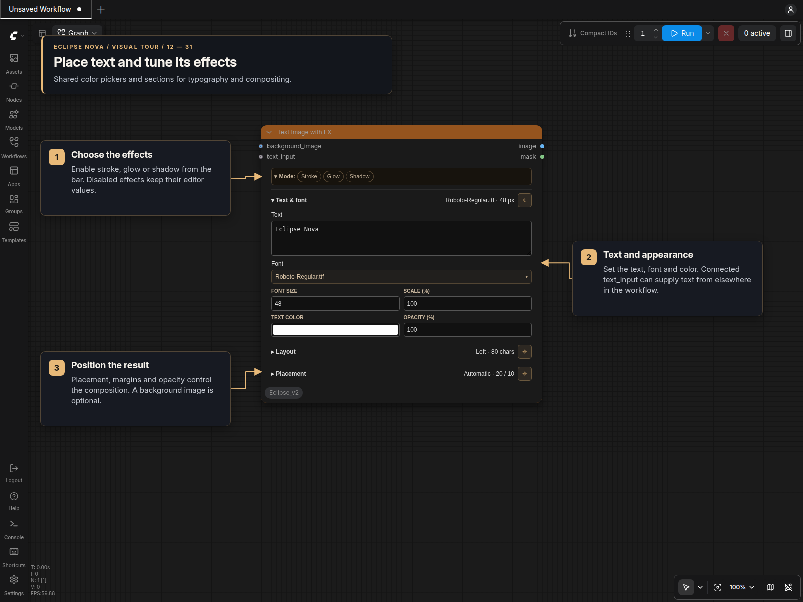

# Image and text FX

**Image with FX** and **Text Image with FX** use the selected Nova panel design in standard canvas and Nodes 2.0. Both are registered under **🌒 Eclipse Nova → Image → FX & Color**.

## Image with FX

Connect a background to `background_image` and a logo, signature, or watermark to `input_image`. The first source image is composited onto every frame in the background batch.

- **Image** controls scale and overall opacity. A scale of 100% fits the source inside the background while retaining its aspect ratio.
- **Placement** selects the anchor and horizontal/vertical margins.
- An optional `mask` replaces the source alpha as the shape. Connecting it reveals **Invert mask** in Image; inversion defaults on for ComfyUI transparency masks. Without a mask, the source alpha is used unchanged. Transparent padding is cropped before scaling.

## Text Image with FX

Enter text under **Text & font**, select a font, and set its size, scale, color, and overall opacity. The font picker searches the TTF/OTF files in ComfyUI's `models/fonts` directory. Refresh ComfyUI after adding fonts to update the list. Missing fonts remain selected and produce an explicit error when run.

- **Layout** controls multiline alignment, character wrapping, and line spacing.
- With a background image or batch, **Placement** provides anchor and margin controls.
- Without a background, the canvas fits the text and effects. Placement then shows padding controls.
- Optional `text_input` takes priority when its value is non-None. An empty connected string intentionally renders no text. Disconnecting it restores the retained panel text.

## Effects and panel controls

The collapsible **Mode** bar enables **Glow** and **Shadow**. Text also offers **Stroke**. Each enabled effect has its own section:

| Effect | Controls |
|---|---|
| Glow | Intensity, range, blur, inner color, outer color |
| Shadow | Horizontal/vertical offset, grow, blur, color, opacity |
| Stroke | Width and outline color; text node only |

Every color field opens a color picker. Disabling an effect removes it from execution and keeps its settings in the workflow for later use. Collapsing a section only changes its presentation. Use the pin button to keep multiple sections open; all sections can also stay closed.

Both nodes return an RGB `image` and a shape `mask`, with one result per background frame. The mask describes the source or text shape and excludes glow and shadow. Text without a background produces an RGB image on black plus its shape mask. Overall opacity affects the rendered image, including standalone text, and does not change the shape mask.

Settings, inactive effect drafts, section pins, and collapsed bars survive workflow save/reload, cloning, and canvas switching. Edits participate in undo/redo. Each node uses one DOM configuration widget with local sizing updates.
