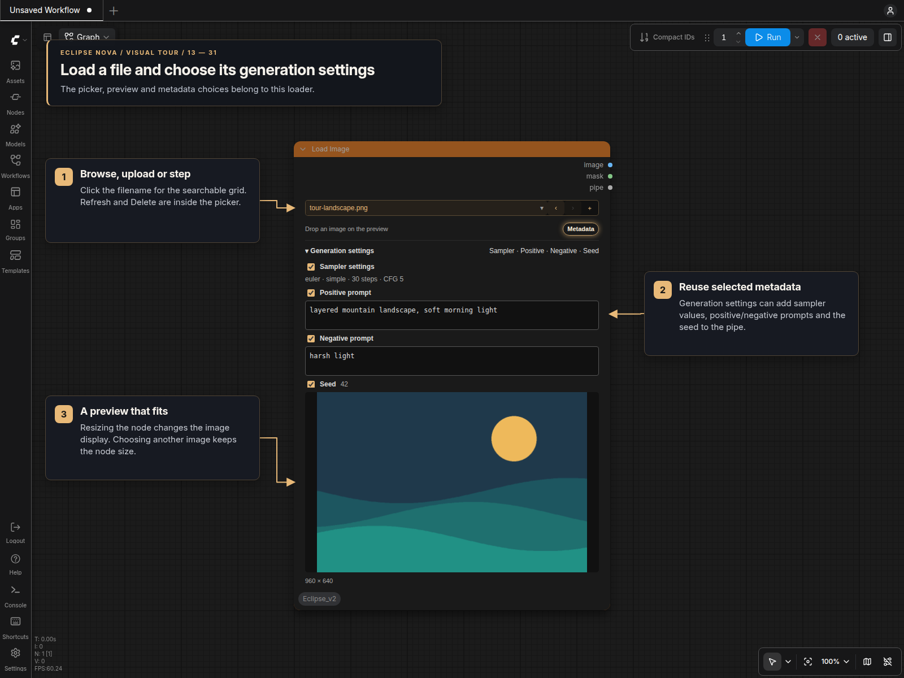
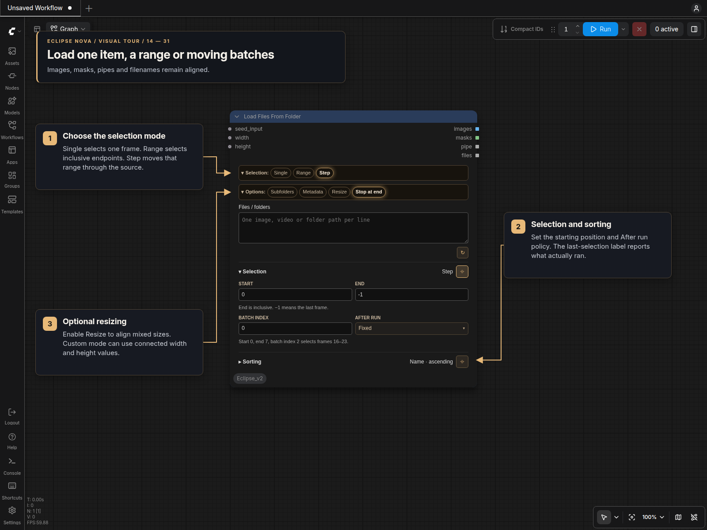

# Image loaders

Eclipse Nova provides two image loaders with the shared node design in classic
canvas and Nodes 2.0. Both produce RGB images, matching alpha-derived masks and
source information in a PIPE.

## Load Image

Use this node to select one file from ComfyUI's input or output directory.
Click the filename to open the searchable picker. Input/Output, grid/list view,
ordering, Refresh and Delete are inside that window. The grid adjusts the number
of columns to its width and preserves thumbnail aspect ratios.

Previous/next and Upload remain beside the filename. Images can also be dropped
onto the preview or pasted while the node is selected. Deletion asks for
confirmation and chooses an adjacent file afterward. A saved file that is missing
stays named in the node instead of silently selecting another image.

Metadata includes embedded generation information in the pipe when available.
The selected image is always previewed below the controls. Resize the node to
resize the preview; the image fits the available space without cropping or
stretching. Opening another image preserves the node's size, including after
workflow reloads. Right-click the preview to open or save the image, or edit its
mask with ComfyUI's Mask Editor.

Enable **Metadata** to show the collapsible **Generation settings** section.
Its checkboxes choose which values enter this loader's pipe:

- **Sampler settings:** sampler, scheduler, steps and CFG.
- **Positive prompt** and **Negative prompt:** independent prompt selections.
- **Seed:** the exact saved seed, including 64-bit values.

Values are read-only. Unavailable groups are disabled; an explicitly empty prompt
remains selectable so it can clear a downstream prompt. Seed zero and CFG zero
are valid values. Unchecked groups are omitted from the pipe, and disabling
Metadata omits all generation settings. Denoise and model, CLIP or VAE names are
not imported by this section. The pipe's width and height describe the loaded
image, including any upscale already applied to that file.

Selections and section state are saved per loader. Changing the file reads its
metadata; **Refresh** inside the picker rereads an overwritten file. There is no
background polling. Parameter blocks supply recorded values, and saved ComfyUI
connections can recover missing values when the relevant sampler is identifiable.
Ambiguous or unavailable seeds stay unavailable rather than choosing an unrelated
seed elsewhere in the workflow.

| Output | Value |
| --- | --- |
| `image` | RGB image; supported animated images remain one image batch. |
| `mask` | Inverted alpha, or a zero mask matching the image dimensions. |
| `pipe` | Image, mask, width, height, filename, full filepath, source name and optional metadata. |

There is no separate files output. Use **IO Load Image** to expose filename and
other pipe fields downstream.

## Load Files From Folder

Enter one folder, image or video path per line. Absolute paths and paths relative
to ComfyUI's input directory are supported. Paths are processed in line order;
Sorting applies within each folder. Subfolders enables recursive image discovery.
Add videos as explicit paths; folder scans discover images only.

| Selection | Behavior |
| --- | --- |
| Single | One frame at Index. After run supports Fixed, Next, Previous, Random and Shuffle. |
| Range | Every frame from Start through End, inclusive. Negative positions count from the end; −1 is the last frame. |
| Step | The same range shifted by its length times Batch index. After run supports Fixed, Increment, Decrement and Random. |

For example, Start 0, End 7 and Batch index 2 select frames 16–23. A final
partial batch is returned normally. Animated images and explicit videos contribute
their frames to the cumulative index and count.

Single and Step advance when the node executes. Index and Batch index are the
starting positions, and the last selected frame or range appears in Selection. Saving,
cloning or serializing a workflow does not advance the loader. Changing selection
settings or refreshing the source restarts iteration at the configured position.

| Optional input | Behavior |
| --- | --- |
| `seed_input` | In Single mode, keep the same automatic selection while the seed is unchanged; a changed seed advances once. |
| `width` | Supplies a target width or side length when Resize uses the Custom size policy. |
| `height` | Supplies a target height or side length when Resize uses the Custom size policy. |

Frame Index and Batch index stay in the Selection panel. Connect dimensions from
**Image Resize**, for example, to size the loaded frames using an earlier image.
With **Size policy → Custom**, the Target choice determines how inputs are used:

| Target | Connected dimensions |
| --- | --- |
| Custom | Width and height override their respective panel values independently. |
| Width | Width supplies the target side length; height is ignored. |
| Height | Height supplies the target side length; width is ignored. |
| Longest | Use the larger connected value, or the only value if just one is provided. |
| Shortest | Use the smaller connected value, or the only value if just one is provided. |
| Pixels | Use the panel's pixel count. |

Unconnected or `None` inputs leave the corresponding panel setting in use.
Zero uses that source dimension for each loaded frame. Width, Height, Longest and
Shortest calculate the other dimension from the selected aspect ratio. Fit and
Divisible by still apply, and masks follow the resulting image dimensions.
Other size policies and Resize off ignore both inputs.

Stop at end blocks downstream execution and disarms automatic queuing when no
frames remain. Disable it to wrap Single/Step iteration. It does not cancel the
current run or remove manually queued jobs. Image Selector confirmation fixes a
local automatic selection to the displayed frame or batch, so continuation uses
the reviewed images.

### Options and sections

- **Metadata** reads embedded generation information once per selected source.
- **Resize** enables Match first, Match largest, Match smallest, Require same size
  or Custom. Automatic policies stretch to the selected target dimensions. Custom
  uses Image Resize's aspect, size, fit, padding color, resampling, divisor and
  device controls. Masks follow the same transformation. With Resize off, each
  frame keeps its original dimensions.
- **Refresh source** rescans changed folders and resets their iteration position.

Selection, Sorting and Resize sections can be collapsed or pinned.
Inactive resize choices and section state remain in the saved workflow.

The `images`, `masks`, `pipe` and `files` outputs are aligned lists, one item per
selected frame. Repeated video/animation frames repeat their source filepath in
`files`. Each pipe also records `current_index`, `total_count`, `base_path`,
`folder_index`, `folder_count`, `local_index`, `local_count` and `source_frame`.
Connect directly to ordinary image consumers for per-frame execution, or use
list-aware nodes such as **Image Selector** and **IO Slice & Dice**.
Connect **Image Preview** to `images` to inspect the loaded frames.

Folder catalogs cache paths and frame counts, not decoded image tensors. No
background folder polling or canvas-wide scanning is used.

See [Batch Selection, Slice & Dice, and Review](Batch_Selection_Slice_Dice.md) for
selecting and captioning images while preserving the matching filenames.
