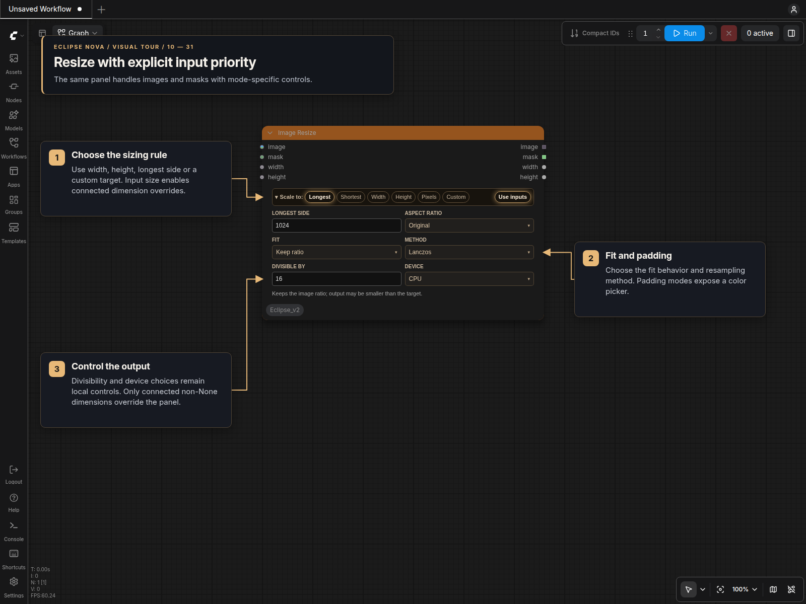

# Image Resize

Resize images or masks with one compact themed editor in standard canvas and Nodes 2.0.
Find it under **🌒 Eclipse Nova → Image → Transforms → Image Resize**.

## Controls and visibility

| Selection | Visible controls |
| --- | --- |
| **Use inputs** | Enables connected width/height overrides. On by default; turn off to use the panel size. |
| **Longest / Shortest / Width / Height** | Side length and aspect ratio. Original uses the input ratio. |
| **Pixels** | Pixel area in thousands and aspect ratio; `1000` means 1 MP. |
| **Custom** | Width and height; `0` keeps that source dimension. |
| **Keep ratio** | Scales proportionally within the target. The actual output may be smaller. |
| **Crop** | Position controls where excess image is cropped. |
| **Solid padding** | Position and a color swatch that opens the color picker. |
| **Edge color / Edge pixels / Blurred background** | Position; padding is generated from the image. |
| **Stretch** | Resizes directly to the target dimensions. |
| **All modes** | Fit, interpolation method, divisor and CPU/GPU device. |

The Scale to bar can collapse after selection. Hidden settings are retained in
the workflow and return when their mode is selected; they do not affect execution
while inactive. Changing modes does not change the node's sockets.

The initial settings use the longest side at 1024 pixels, the original aspect
ratio, Keep ratio, Lanczos on CPU and divisibility by 16. GPU-selected Lanczos
uses Bicubic, as indicated in the panel.

## Connected dimensions

The optional **width** and **height** integer inputs work in every scale mode
when **Use inputs** is enabled in the Scale to bar (the default).
Each non-`None` input replaces its corresponding calculated target dimension.
An unconnected input, or a connected input returning `None`, leaves that axis's
panel setting in effect. A connected `0` uses the source dimension.

Disable **Use inputs** to ignore both dimension inputs without disconnecting them.
The collapsed bar shows **Panel size** while they are disabled. This switch does
not affect the image or mask inputs.

For example, Custom **512 × 768** with a width input of **1024** targets
**1024 × 768**. Connecting `None` to height keeps **768**. Panel values remain
editable because a connected node can return `None` at execution time.

**Divisor alignment and fitting still apply.** Keep ratio can produce an image
smaller than the target. Use Crop, a padding mode or Stretch when both target
dimensions must be filled. The width/height outputs report the actual result.

## Images, masks and lists

Connect an image or mask to **image**. An optional **mask** input is resized and
positioned with the image. Without a mask, the mask output is empty (zeros).
With a mask as the primary input, both tensor outputs contain the resized mask.

Batches stay batched; image lists stay lists. For a list with different image
sizes, the scalar width/height outputs describe the first result. Pixel values
are clamped to the normal 0–1 range after interpolation.

[Resolution Pipe](Resolution_Pipe.md) · [Eclipse Nova](../README.md)
