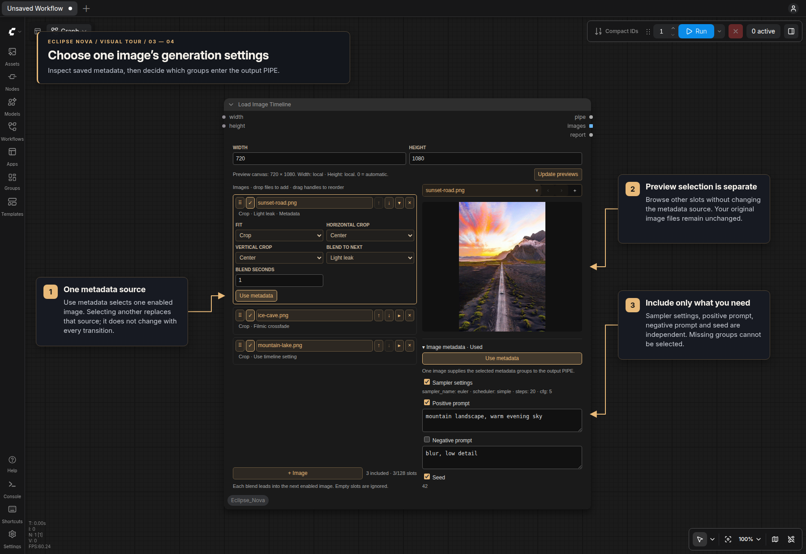
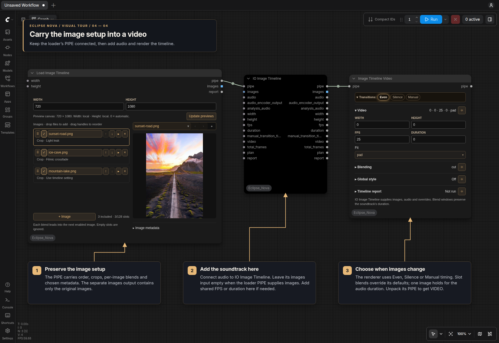

# Image Timeline Video

**Eclipse Nova → Video → Image Timeline Video** turns selected still images into a native VIDEO before caption rendering or saving. It holds each still image between optional visual transitions.

The renderer has only a **PIPE input and output**. Use **IO Image Timeline** to assemble images, the original soundtrack and optional shared settings, or to unpack the completed video. Images play once in their incoming order. One image fills the complete audio duration and skips transition analysis.

Two image sources are available:

- **Image Selector → IO Image Timeline (images) → Image Timeline Video** keeps an existing selection workflow.
- **Load Image Timeline (pipe) → IO Image Timeline (pipe) → Image Timeline Video** lets you add files directly in a separate loader. Connect audio and shared FPS/duration values to the IO node; connect shared width/height directly to the loader.

For a shared canvas, connect width/height directly to Load Image Timeline's optional **width** and **height** inputs. Each non-None input overrides its matching local value; zero selects automatic sizing from the first enabled image. Add audio, FPS, duration and silence-analysis inputs with the IO after the loader. Leave that IO's **images** input disconnected: the loader's PIPE already contains the ordered images, resolved size and per-image options.

Connect the renderer's output to another **IO Image Timeline** to obtain `video`, `duration`, `total_frames`, `plan` and `report`. The PIPE also retains incoming data, including selected generation metadata.

| Transition mode | Behavior with multiple images |
| --- | --- |
| Even | Divide the timeline evenly among the images. |
| Silence | Search around each evenly spaced target for a quiet gap. Choose the gap start or sustained activity resume. If no gap qualifies, keep that target. |
| Manual | Enter increasing, comma-separated switch times in seconds, one per image after the first. Three images need two times, for example `10, 22.5`. Cuts round to the nearest video frame. |

Silence uses the same activity-gap helper as the Wan/MiniMax planners. Optional **audio_encoder_output** reuses Wav2Vec2 features from the same recording. Without it, the node measures waveform energy; connect isolated vocals to **analysis_audio** to find gaps between sung lines. The analysis track must share the soundtrack's time zero and duration. Activity gaps are not a speech classifier, so continuous music may keep the evenly spaced targets. Neither analysis input replaces the original soundtrack. The IO node skips connected analysis branches for one image. For multiple images, connected encoder features take priority over analysis audio; leave these disconnected when using Even or Manual to avoid computing unused analysis.

The **Video** section controls width, height, FPS, duration and fitting. Non-empty width/height/FPS/duration fields in the PIPE override the panel, making shared Smart Folder settings suitable. Connected IO inputs replace inherited fields; zero and empty text are intentional overrides, while None retains the inherited value. Zero duration uses the complete audio; a positive value limits the excerpt from time zero. Two zero dimensions use the first image's size; one zero preserves its aspect ratio. Pad keeps the full image with black borders, Crop fills the canvas from the center, and Stretch changes its aspect ratio. Alpha is composited against black.

The **Blending** section offers the visual effects shared with Image Batch Extend With Overlap and Load Video: linear, eased, filmic or perceptual crossfades, fixed 50/50 average, deterministic dissolve, pyramid blending, clockwise/counterclockwise and directional wipes, **Morph**, and the editing effects below. Cut is the default. Blend duration is measured in seconds and centered on each planned cut; short image intervals limit the duration so windows cannot overlap. Blending never adds frames or shifts the audio. Frame-matching and trimming modes from the batch node do not apply here.

| Editing transition | Effect |
| --- | --- |
| Ghost zoom | Enlarged, offset translucent copies create a double exposure. |
| Flash / light leak | Two soft, warm-white flashes brighten the crossfade. |
| Block glitch | Displaced blocks, scanlines and split RGB edges surround the cut. |
| Zoom blur | A radial zoom/blur pulse masks the image change. |
| Dip to black | Fade the first image to black, then reveal the next. |

The **Global style** section changes the complete sequence, including a single held image, every image interval and all transitions. **Cool desaturated** applies a constant colour grade. **Ghost zoom**, **Light leak**, **Block glitch**, **Zoom blur** and **Black pulses** repeat throughout the video. **Black pulse flash** pairs two soft, warm-white flashes with a black dip in each cycle. **Ghost edit** combines the grade, ghost zoom and flashes; **Glitch edit** combines the grade, blocks, zoom blur, flashes and black dips. **Style strength** controls the amount; **Style period** is the number of seconds per cycle. The clock continues across image changes and is not automatically matched to musical beats. Styling defaults to **Off**; zero strength also leaves the frames unchanged. Styles run after fitting and transitions, before captions, and never move the audio or cut times. These are editing effects; they do not generate subject movement.

**Morph** estimates motion in both directions with [OpenCV optical flow](https://docs.opencv.org/4.x/d4/dee/tutorial_optical_flow.html), warps both images toward an intermediate shape, then blends them. Select `morph` here or in an image slot's **Blend to next** menu. It uses the existing OpenCV dependency and needs no model download. Motion is calculated on CPU at up to 512 pixels on the longest side, once per still-image pair, then reused while rendering full-resolution frames. It is slower than a crossfade and works best with similar framing, poses and backgrounds; large scene changes can stretch or ghost. In Image Batch Extend With Overlap, motion is calculated separately for each corresponding frame pair.

## Load Image Timeline

### Arrange, crop and blend

Use **+ Image**, then browse the input/output image folders or upload a file. Drop one or several image files into the left-hand list to append new slots in drop order. Dropping onto the preview replaces the selected image with the first file and adds any remaining files as new slots. Drag the handles or use the arrows to reorder. The mouse wheel scrolls the file list while hovered, including at its edges, without zooming the canvas. Disable slots to keep them for later; removing a slot does not delete its file. Empty slots are ignored. Each slot loads one still frame, including animated image files.

New image slots default to **Crop**, centered horizontally and vertically. Expand **Image settings** to choose Pad, Crop, Stretch or the renderer's fit setting. Crop has independent left/center/right and top/center/bottom positions. The preview uses the local canvas; connected width/height values take priority when executed. With inherited fit, the preview shows Pad until the renderer applies its choice. The slot's **Blend to next** and **Blend seconds** apply to the next enabled image. The last image's outgoing blend is unused. Choose **Use timeline setting** to inherit the renderer's blend and duration.

The shared **Update previews** button refreshes the canvas for all image crops while keeping the selected image. With neither size input connected, it updates locally without queueing a workflow. When width or height is connected, one partial run resolves those inputs and loads the enabled images; downstream rendering stays idle. The size label shows whether each dimension comes from an input or the local controls. A connected input returning None falls back to its local value. Changing local dimensions or crop positions immediately updates the preview using the last retrieved input values. Click Update previews again after changing upstream dimensions. Editing crop controls or dropping files does not automatically queue the workflow. The loader is a preview output node, so it also participates in normal queues even without a downstream connection.

### Select generation metadata

The selected slot appears on the right. **Image metadata** reads its generation settings on demand. Enable **Use metadata** for one image and select the sampler settings, positive prompt, negative prompt and seed groups to include in the output PIPE. Choosing a different metadata source disables the previous source. Metadata is not automatically changed at each transition, and image files are never modified. Exact 64-bit seeds are preserved. The screenshot uses sample metadata to demonstrate the group selection.

### Keep per-image settings in the PIPE

Connect **Load Image Timeline → pipe → IO Image Timeline → pipe → Image Timeline Video**. Add the soundtrack to the IO's **audio** input, leaving its **images** input disconnected. The renderer controls when images change; its blend settings apply only to slots set to **Use timeline setting**. Connect another IO after the renderer to extract the completed **video** for captions or saving.

The **images** output supplies one batch of enabled, nonempty slots in their displayed order. Each image is resized to the resolved canvas width/height using its own Pad, Crop or Stretch choice and crop alignment. **Use timeline setting** uses Pad on this output, matching the loader preview. It contains one still per slot, without blends, transitions or video styling. Alpha is preserved; RGB images receive opaque alpha when batched with RGBA images. Use this output for image previews, MiniMax/WAN planners or other image-processing nodes.

The **pipe** output retains the original images together with their per-image settings, so Image Timeline Video can frame them at its final dimensions and apply the selected blends during rendering. Leave the IO's images input disconnected to use this route. Forwarding the same original PIPE images through an IO preserves their options; supplying the loader's resized images output, or otherwise replacing, reordering or processing the images, clears inherited crop/blend settings to avoid applying them twice or to different images.

## Rendering and outputs

The renderer's report also appears in a collapsible section. The JSON plan includes image intervals and actual blend windows. Frames cover the audio through its end; the last frame can extend the video by less than one frame, with silence beyond the excerpt. The temporary video uses lossless RGB8 and retains the original soundtrack. Fitted images and blends stream to disk, retaining only the active image pair instead of a full decoded video batch. The cached VIDEO owns the temporary file.

For captions, unpack **video** with IO Image Timeline and connect it to **IO Lyric Captions → background**, together with the original audio and reviewed lyrics/timing. Use the same FPS and canvas size on both nodes. For an export without captions, connect the unpacked **video → Save Video** directly. Save Video performs the final delivery encode.
