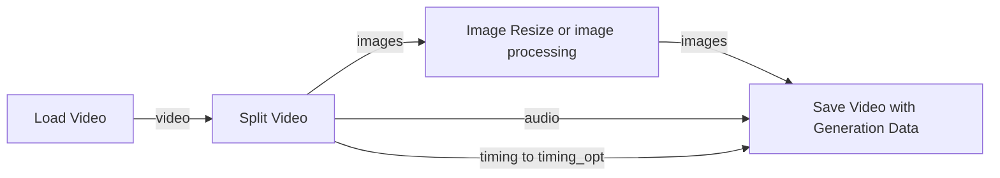

# Load Video, Preview Video and Split Video [Eclipse Nova]

**Load Video** builds an ordered playlist with a player inside the node. Trim each
clip by its original frame numbers and join its audio with the same cuts into
native VIDEO. Find these nodes under **Eclipse Nova → Video**.

## Panel and inputs

**Load Video** and **Preview Video** use the selected Nova design in classic
canvas and Nodes 2.0.

Load Video puts **Source / Fixed FPS** in a collapsible Timing bar. Its
collapsible **Output size** section contains Width, Height, and **Pad / Crop /
Stretch** fit buttons. The local FPS field appears for Fixed timing. Optional
`width`, `height`, and `fps` input sockets override the corresponding local
values; connected fields are disabled and retain their local settings for reuse
after disconnection. A connected dimension of `0` explicitly selects automatic
sizing. Source timing retains the original timestamps even with FPS connected.

The playlist occupies the **left column**, with the shared player on the **right**.
Click **+ Video** to add an empty slot, then its filename field to browse Input /
Output or upload a local video. Each slot has its own include toggle, ordering
arrows, remove button and collapsible settings for **Start frame**, **Load cap**,
**Mute**, **Use metadata**, **Blend to next**, **Blend seconds** and duplication.
Drag the **⠿ handle** at the left to reorder a clip, even when its settings are
collapsed. The adjacent up/down arrows also move clips; a focused handle supports
**Alt + Up / Down**. Each clip keeps its trim, blend and metadata choices when moved. Only
one included clip can supply generation data. Empty slots remain in the workflow
but are ignored during preview generation and execution; at least one filled,
enabled slot is required to run.

Clip summaries stay visible when settings are expanded and show the shared
**Crop / Pad / Stretch** output fit, that clip's **Blend to next** choice, trim
and duration. Inherited blending shows **Use global blend**; explicit choices
show their mode, such as **Morph**. Labels update immediately when these settings
change. Slot padding matches Load Image Timeline.

Dropping multiple local videos fills empty slots first, then adds more slots, up
to 128. The file browser also allows reusing a video with different trims. A
slot's upload follows that slot when reordered; selecting another file while the
upload finishes keeps the newer selection.

The filename button opens a resizable video browser. Its thumbnail grid uses the
same aspect-aware layout as the image browser, adapting to portrait or landscape
clips and the available window space. Posters keep their proportions; List view
remains available for compact browsing.

Hover the clip list to scroll it independently of the player without zooming the
canvas, including at the top and bottom of the list. Resize the node to change the
player's available area; expanding clip settings does not enlarge the node.
Saved configuration, open clip settings, playlist order and node size survive
workflow reloads. Use **Source / Joined / GenData** above the player to switch
between the selected clip, rendered result and that clip's saved metadata.

**Preview selected trim** and **Build joined preview** use connected numeric
primitives when their values are available before execution. For inputs computed
by other nodes, queue the workflow to build the output using their resolved
values. These explicit preview actions do not run the workflow themselves.

Preview builds show a progress bar across the top of the panel, with the current
stage and percentage below the player. Queued builds use ComfyUI's native node
progress bar. Completion includes finalizing the video file; cancelling a
preview clears its progress without interrupting an unrelated queued build.

Queueing after **Build joined preview** reuses the built video when the source
files, enabled clips, trims, audio, size, timing, blends and style still match.
If an identical build is already running, the second request waits and reuses
its result instead of encoding another copy. Metadata selection alone does not
require a new encode. Reuse is temporary: changed media settings, an expired or
deleted preview, or a server restart can require rebuilding.

The **Blending** section sets the default transition and duration for all clips.
Each clip's **Blend to next** can inherit that global setting or override it;
the last enabled clip has no outgoing transition. Crossfades, wipes, dissolve,
Morph, ghost zoom, flash/light leak, block glitch, zoom blur and dip to black
share the same engine as [Image Timeline Video](Image_Timeline_Video.md).
Cut is the default, and zero seconds also keeps a hard cut.

Fades are centered on existing clip boundaries without shortening the playlist.
Before the cut, the incoming clip's first frame is held over the moving outgoing
clip; after it, the outgoing last frame is held while the incoming clip moves.
Short clips limit the window so adjacent fades cannot overlap. Source timing,
audio cuts and mute settings stay intact; these transitions blend the picture,
not the audio. Morph recalculates optical flow for each changing frame pair and
is more expensive than a crossfade.

**Global style** applies a consistent grade or repeating effect across the entire
playlist. Choose a cool desaturated grade, ghost zoom, light leak, block glitch,
zoom blur, black pulses, or the combined **Black pulse flash / Ghost edit / Glitch edit** styles.
**Black pulse flash** pairs two soft, warm-white flashes with a black dip each cycle.
**Style strength** controls the amount and **Style period** sets the cycle in
seconds. The style clock continues across clips; it is time-based rather than
automatic beat detection. Styling defaults to Off. **Build joined preview** and
queued execution use the same fades and styling. **Source** shows the original
file, while **Preview selected trim** applies the global style to that trim alone.
Frames stream to disk with bounded working memory, including when effects are on.

Preview Video accepts IMAGE frames, native VIDEO, or an exact frame timeline
and passes the same type through. Its local FPS field and optional `fps` input
control IMAGE playback. VIDEO keeps its own audio, timing and dimensions;
timelines keep their own FPS. Optional `audio` accompanies IMAGE or timeline
input. The player fills the space left by the controls as the node is resized.

The right-aligned **Play (▶)** button in its Mode bar runs Preview Video and its
required upstream nodes once, leaving downstream work idle. Stop does not need
to be enabled, and Play keeps its current setting. Play remains available when
the bar is collapsed, beside the Stop status summary.

The **Stop (■)** toggle enables review during normal queues: a changed run
shows the preview and interrupts before downstream work. Queue unchanged again
to continue from the cached result. With Stop off, loop executions continue to
refresh the preview. The adjacent **×** stops the current execution immediately.

## Visual tour

### Direct video upscaling with Eclipse

Connect **Load Video → Upscale Video [Eclipse Nova] → Save Video with Generation
Data** directly. The upscaler's model selector switches between PyTorch models
and compatible TensorRT engines while keeping the same VIDEO connections.
Audio and timing travel inside VIDEO; this route needs no splitter.

See the [direct Eclipse chain tour](Upscale_Video.md#direct-eclipse-video-chain-pytorch-or-tensorrt)
for backend requirements and the optional generation-data connection.

### Split Video: process images while retaining their timing

Connect the loader's `video` to Split Video. This example routes `images`
through a 2× spatial resize while `audio` and `timing` go directly to the saver.
Keep frame count and order unchanged. This route holds the complete IMAGE batch
in RAM; for long videos use the [streaming Upscale Video tour](Upscale_Video.md#visual-tour).

## Add and trim clips

1. Click **+ Video**, then the slot's filename field. Search the Input/Output grid
   and click a thumbnail to choose that file, or use **Upload video** for a local
   file. Dropping several local videos on the node uploads them into slots.
2. Select another slot's filename to replace its file. The slot retains its trim
   and options. Expand its arrow to edit those values independently.
3. **Start frame** is zero-based; **Load cap** is the number
   of source frames to retain. Both default to `0`: start at the beginning and
   retain every remaining frame. A cap beyond EOF retains the available frames;
   a start beyond EOF reports an error. Changing either value seeks the Source
   preview to the selected start; playback stops at the cap. This quick preview
   uses the clip's reported FPS. Use **Preview selected trim** for frame-exact
   review of variable-frame-rate sources.
4. Use **Include**, **Mute**, **Duplicate**, **Remove**, the arrow buttons, or drag
   rows to arrange the join. Disabled clips contribute neither frames nor audio.

For example, start `20`, cap `100` retains source frames `[20, 120)`. Every clip
has independent values, and its audio uses that exact time interval. Missing
audio, leading/trailing audio gaps, and muted clips become silence. The first
audio track is normalized to **48 kHz stereo**, without changing its tempo.

The editor exists immediately when the node is added. Playlist slots, trims,
metadata choice, active source, and browser preferences are serialized
with the workflow and survive a page reload before the first queue. Uploads
must finish before their files can be added. A built preview is temporary and can
be rebuilt after a reload or expiry.

Resize the node to suit your workspace. Its outer size stays the same when you
change options or previews, and the saved size is restored with the workflow.

## Global size and timing

`width` and `height` apply to every clip. Both `0` use the first included clip's
displayed size. With one dimension `0`, it follows that clip's aspect ratio.
`pad` fits inside the size with black borders; `crop` fills and center-crops;
`stretch` fills both dimensions directly. Encoded VIDEO pads an odd dimension by
one edge pixel for H.264.

`timing_mode = source` preserves each frame's presentation duration. Joining one
second at 25 FPS with one second at 16 FPS produces **41 frames over 2 seconds**.
The 16 FPS section keeps its original playback speed. The resulting VIDEO has
variable frame timing.

`timing_mode = fixed` exposes `fps` and duplicates/drops frames on that output
grid. Its last frame may extend the result by less than one output frame; audio
is padded to that boundary. The `duration` output describes this encoded result.

## Preview and outputs

**Source** plays the original file within the selected range. Editing a trim
returns to that clip even when a joined result was being previewed.
**Preview selected trim** and **Build joined preview** explicitly
render a playable MP4, shown under **Joined**. Editing the
playlist marks that result stale. **Cancel preview** stops an active request.
Browsing, inspecting metadata, and restoring a workflow never encode a video.

Queuing always produces VIDEO, including the joined audio. For separate images
or audio, connect **Split Video** or ComfyUI's **Get Video Components**.

| Output | Contents |
| --- | --- |
| `video` | Native file-backed VIDEO with the chosen timing and soundtrack. |
| `generation_data` | Prompt/sampling PIPE from the selected metadata source, or `None`. |
| `duration` | Duration of the joined VIDEO in seconds. |
| `report` | Per-file media properties, ranges, A1111 text, parsing status, and result details. |

Frame counts remain in the report. A count node can also read extracted images.

## Upscale before saving

For long videos, connect:

`Load Video → Upscale Video → Save Video with Generation Data`

[Upscale Video](Upscale_Video.md) includes model selection, a bounded batch size,
PyTorch support for non-NVIDIA devices, and optional TensorRT engines. Audio and
source timing stay inside VIDEO. Connect `generation_data` directly to the
saver's `pipe_opt` if wanted; leave `audio` and `timing_opt` disconnected.

For shorter videos that fit in RAM, connect `video` to **Split Video**, then:

- `images` → image upscaler → **Save Video with Generation Data** `images / video`
- `audio` → saver `audio`
- `timing` → saver `timing_opt`
- optionally, Load Video's `generation_data` → saver `pipe_opt`

Connected timing overrides the saver's FPS, trim, and loop settings; those controls
remain visible but do not apply while it is connected. This preserves mixed frame rates through a
spatial upscale. Frame count and order must remain unchanged. The saver rejects
a different count; it cannot detect a reorder with the same count. Selection,
interpolation, duplication, or temporal trimming needs matching timing/audio
changes and is not supported by this connection.

**Split Video** provides IMAGE, AUDIO, and timing outputs for VIDEO from
this loader or ComfyUI's built-in nodes. It has one VIDEO input and no manual FPS
or timing input. File-based videos retain their timestamps and native trim/crop
views; component videos use their stored frame rate. Native concatenations are
handled clip by clip. Unsupported third-party VIDEO representations report an
error rather than guessing their timing. `report` describes the extraction.
The splitter materializes the complete IMAGE batch; using it before an ordinary
image upscaler does not provide streaming or solve the full-video RAM limit.

ComfyUI's **Get Video Components** also exposes images and audio, plus a single
FPS value. It works for ordinary constant-rate workflows. For a join with mixed
frame rates, use Split Video's `timing` connection to preserve the individual
frame durations through an IMAGE processing pass.

## A1111 generation metadata

**Use metadata** selects at most one included clip as the downstream source.
Selecting another clears the previous choice. Preview selection is independent;
duplicating a row does not copy this flag, and excluding its row clears it.

Only the container's A1111 `parameters` tag, as written by **Save Video with
Generation Data** for Civitai, is read. The PIPE contains positive/negative
prompts and available sampling settings: seed, steps, CFG, sampler, scheduler,
denoise, CLIP skip, and dimensions. Model, VAE, LoRA, embedding, and hash fields
are not restored. Workflow graphs and JSON sidecars are not read.

**GenData** previews the active clip's parsed prompts/settings. If the selected
source has no usable A1111 tag, the PIPE is `None`; another clip is never selected
automatically. The debug `report` includes bounded original A1111 text, which can
contain resource names that were excluded from the PIPE.

## Resource use and limits

VIDEO frames stream into a temporary H.264 MP4. Audio is held as joined PCM;
the loader checks available RAM for audio and frame processing. Exact frame
ranges require an initial timestamp scan. Cached scans and still-live media can
be reused when only the metadata choice changes.

Extracting images with a component node requires a complete batch in RAM:
approximately `frames × width × height × 3 × 4` bytes before downstream upscaling.

Loading decodes SDR frames to 8-bit RGB. HDR and alpha inputs require
explicit conversion/compositing first. Source timing is preserved, but compressed
pixels are not bit-identical: VIDEO is encoded, and a saver can encode it again.
Use the streaming Upscale Video route for longer videos. Joined previews also
render at the configured size.

Playlists support up to 128 videos, with optional transitions and global styles.
Motion interpolation, speed changes, multiple soundtrack mixing and remote URL
downloads are not included. For still-image sequences, use
[Load Image Timeline and Image Timeline Video](Image_Timeline_Video.md#load-image-timeline).
Original source files are unchanged.
