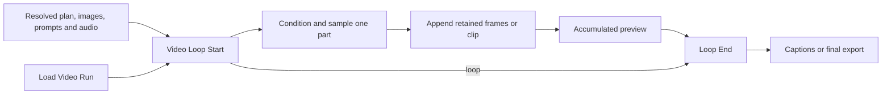

# Eclipse loops

**Loop Start**, **Video Loop Start** and **Loop End** execute sequential work using
ComfyUI graph expansion. They do not require Easy-Use. They carry one value,
including an intact list, tuple, PIPE, frame timeline or VIDEO.

## Analysis and other sequential work

Connect Start's **loop** to End's **loop**, its **index** to the iteration's work,
and its **previous** to the input that accumulates results. Feed the completed
iteration result to End's **value**. End expands another iteration or returns the
accumulated value, next index and completion status.

- **total** is the exclusive ending index. Zero returns the initial value.
- **start_index** is absolute. Provide matching **initial_value** when starting later.
- **parts_per_queue** limits completed iterations; zero means all remaining.
- **cache_iterations** reuses unchanged work. Disable it to rerun every queue.
- End's **block downstream** prevents partial results reaching a consumer that
  requires complete coverage, such as Save Scene Analysis.

Only dependency paths between Start and End repeat. Connect any per-iteration
preview or side effect before End; an unrelated output is not automatically
part of the loop. Get/Set routing works after normal frontend link resolution.

## Video rendering and recovery

Use **Video Run Storage** to choose **New run**, **Resume saved run** or
**Load saved run**, and RAM, temporary disk or persistent output. For resumable
runs, enable **Disk** and **Keep files**.
New run creates a new run on each queue; choose Load saved run for downstream
caption or export changes that should reuse completed media.

Connect Load Video Run's **source** and **run_path** to Start's **previous** and
**run_path**. It is requested only on resume. The saved-run dropdown is the sole
selection control. Connect fresh resolved inputs for New run, then use Start's
outputs for downstream conditioning, dimensions, prompts, reference images,
audio, reference mode and storage. These outputs come from the saved checkpoint
on resume. Start's **index** includes retained parts and goes directly to both
the conditioner and **Video Part Seed**.

Feed **Seed → Video Part Seed → RandomNoise** independently of loaders and
conditioning. Changing it before the next queue affects new/replacement parts.
Model, LoRA and sampling settings remain those selected in the workflow; choose
the matching lip-sync/native mode. Loaded model objects are not checkpointed.

The append node commits each completed part before the accumulated preview runs.
Keep the full soundtrack on the lip-sync preview. This shows the join between
the retained prefix and new part, including the frames left after warmup trimming.
Connect Start's **render** through Video Run Gate to independent body previews
so a completed resume with no new parts does not request sampling.

**Stop after current part** finishes that save and preview before returning.
For a loop inside a subgraph, put **Loop Control** on the main canvas and connect
its **control** output to Start's optional **stop_control** input. Get/Set can
carry this connection between groups and into the subgraph. Connect it before
queueing, then click the external button while the loop runs. Both it and the
button on Start show the stop request; either can be used. This is a live request,
so it does not require queueing again or changing a generation input. Use one
control per independently running loop. An idle button has no effect, and stop
requests do not carry over to the next queue.

**Parts per queue = 1** provides the same review point after one new part. Select
the resulting saved run and choose Resume for the next queue. **Restart part = 0**
continues; **N** keeps parts 1 through N−1 and replaces N onward. Persistent resume
creates a new revision and leaves the original files intact. End reports its
saved path. A completed resume returns the existing result without sampling.

### Edit the prompt for one render part

Connect Load Video Run's **run_path** to **Part Prompt Editor → run_path**, and
the editor's **prompt_edits** to Start's optional **prompt_edits** input. Both
connections can use Get/Set, including when Start is inside a subgraph. The editor
uses the loader's existing selection; it has no second run picker.

1. Select the saved run, then click **Read selected run** in the editor. This reads
   prompt text and part ranges without loading models, references or audio arrays.
2. Choose the **Render part** and edit its prompt. Numbers match **Restart part**;
   a long scene may span several render parts with independently editable prompts.
3. Enable **Apply edits**, choose **Resume saved run**, and set **Restart part**
   to the earliest completed part you changed. Leave it at `0` for upcoming parts.
4. Set **Parts per queue = 1** to review the replacement and its transition, change
   the render seed if desired, then queue.

The field contains the combined global and scene text for that part. Its edit
**replaces the full prompt**, so conflicting original instructions are not added
back. Keep any global direction or native H3 sound instructions you still want.
Reference-image conditioning, timing, audio selection and lip-sync warmup remain
as saved. Unedited parts keep their original prompts. Replacing part N still
retains only parts before N and renders from N onward; it does not splice a new
part into a retained ending.

The edited plan is saved with the new persistent revision, including changes to
upcoming parts. Select that revision to continue; the corrections remain even
when Apply edits is off. Reading its prompts again clears edits already saved
there. **Reset this part** restores the text read from the selected revision;
**Clear edits** discards all pending edits and switches Apply off. Neither changes
saved files. Clear drafts before reading a different run, or disable Apply to use
that run without them. New run and Load saved run do not apply this editor.

Queueing captures the edits. Stop first to change a prompt for the next queue.
Editing the ordinary upstream prompt boxes affects New run; use this editor to
change a saved run. Older media-only runs need a render checkpoint for editing,
as they do for Resume.

### Routing saved results

Route **Load saved run** around Start directly to final output. Use Storage's
**generate** output for the generated-versus-loaded selector and its **prepare**
output to gate independent source/analysis/planning outputs. Otherwise those
outputs can request work even when Start restores saved inputs. Get/Set can carry
these values between groups without physical cross-group connections.

Video Loop Start also blocks its outputs in Load mode without requesting fresh
inputs, so an independent loop preview cannot start planning. For Load Audio's
own output/preview, connect Storage's **prepare** to **enabled**. Video Run Gate
accepts a missing optional value and passes `None` while enabled, allowing muted
optional vocals to remain connected to a consumer's optional input.

For captioning an excerpt, connect the complete recording and its excerpt start
to Start's **caption_audio** and **caption_start**. They are saved with persistent
checkpoints. Select **caption_context** from Loop End or Load Video Run along
with the selected video, and feed it to **IO Lyric Captions → pipe**. Connect the
video as **background** and its actual duration as **duration**. The full recording
is trimmed once; current source controls cannot change a resumed run's offset.
Without a supplied soundtrack, IO Lyric Captions reads the VIDEO's generated
audio. Older checkpoints without this context use the saved soundtrack from zero.

Each persistent run contains `checkpoint.json`, resolved input arrays and
`run.json` with the committed media parts. Move the whole folder under ComfyUI
output and refresh the run list to reuse it. Old runs without a render checkpoint
remain loadable/exportable; their resume inputs are not reconstructed from
workflow snapshots. An interrupted sampling pass restarts the unfinished part.
RAM and temporary runs retain their normal cache lifetimes.

Generic analysis loops do not save partial LM progress across restarts. Video
checkpoints save the resolved prompts after analysis has completed. See
[scene analysis](Scene_Analysis.md) and [saved media](Frame_Timeline.md) for details.
