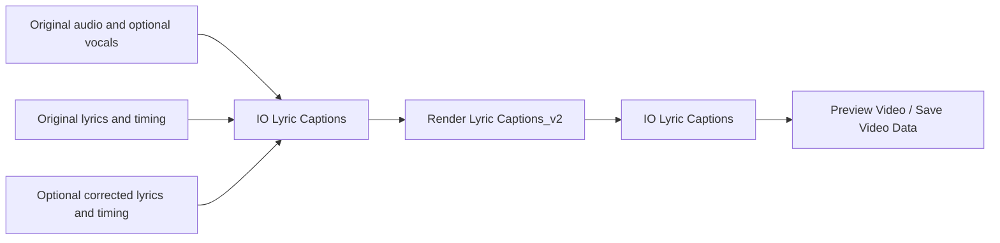
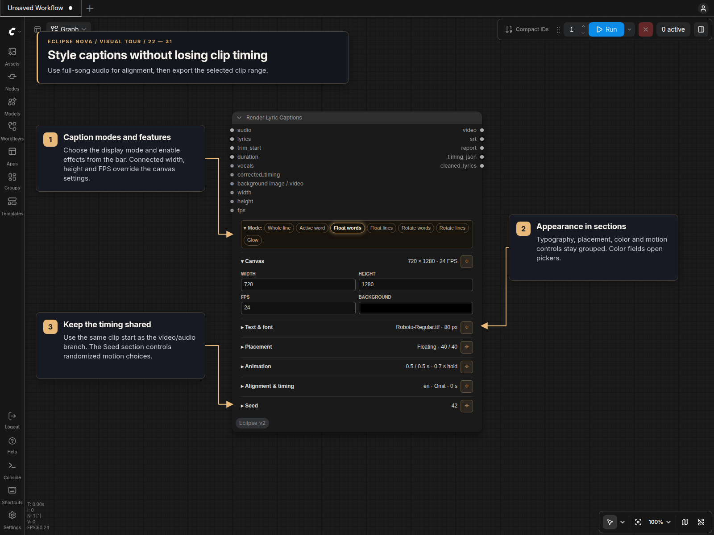

# Lyric captions

## Pipe version

**Render Lyric Captions_v2 [Eclipse Nova]** has one PIPE input and one PIPE
output. **IO Lyric Captions [Eclipse Nova]** assembles its inputs and extracts
the results. The existing Render Lyric Captions node remains available.



Connect full-song `audio`. Optional `vocals` supplies a separated vocal stem for
analysis; the video keeps the original audio as its soundtrack. Both recordings
must start at the same time and match in duration within 50 ms.

| IO field | How the renderer uses it |
| --- | --- |
| `lyrics` | Original complete lyrics, song JSON or Transcribe Audio's text. Blank uses the timing reference's text, or automatic transcription. |
| `timing` | Original full-song timing JSON, normally from Transcribe Audio. Blank creates the same reference internally. |
| `corrected_lyrics` | Optional complete edited lyrics. Copy the original lyrics and correct the words that need changing. Blank keeps the original. |
| `corrected_timing` | Optional manually edited timing JSON. Takes priority and must match the selected lyrics and full audio duration. Blank or `{}` means no manual timing override. |
| `background` | IMAGE, VIDEO or frame timeline for the rendered clip. Without it, the renderer uses its background color. |
| `width`, `height`, `fps` | Override the local canvas dimensions and frame rate. |
| `trim_start`, `duration` | Override the excerpt in seconds; duration 0 uses the remainder of the recording. |
| `seed` | Override the placement seed for repeatable floating captions. |
| `video`, `srt`, `report` | Extract the rendered video, clip-relative subtitles and timing/rendering report. |

The IO node keeps media, lyric/timing data, dimensions, FPS, trim and seed.
Appearance, animation, fonts, glow and alignment choices stay in each renderer's
panel. They are not overridden by inherited pipe fields, so a timing preview and
the final overlay can use different styles while sharing the same resolved timing.

Unconnected or `None` IO inputs retain inherited pipe fields. Connected empty
strings clear inherited text/correction fields; zero remains a valid trim/seed
override. No fallback switch or `{}` marker is needed for empty manual
inputs in this flow.

With the default Whisper timing, unchanged lyrics reuse their original timing. Recognizable wording edits keep
unchanged lines fixed and align the changed phrases inside their reference
windows. Insertions, reordered phrases and ambiguous repetitions use bounded
alignment recovery. If word refinement fails, an existing phrase interval can
still show the corrected line without inventing word timestamps. Inspect the
report and preview when correcting lyrics; manual timing is available for exact
adjustments.

Transcribe Audio and this pipe renderer share the same transcription helper and
bounded in-memory cache. A workflow with a separate Transcribe Audio node and a
workflow that supplies lyrics directly therefore use the same reference approach
for the same audio, vocals and language settings. Text edits can reuse that
reference; changing appearance does not repeat recognition or alignment. Cache
entries do not retain models or audio tensors and reset when the server restarts.

The output pipe preserves other fields and adds `video`, `srt` and `report`.
Its `lyrics` and `timing` fields contain the cleaned lyrics and full-song timing
actually used, alongside the resolved settings and seed. Extract these with a
second IO node, or pass the pipe to another caption renderer with a different
background. A blank-background timing preview and the final video can reuse the
same timing. SRT timestamps are relative to the rendered clip; timing JSON stays
on the original full-song clock.

The themed panel retains the caption modes and sections described below.
**Alignment & timing** also contains local **Trim start (s)** and **Duration (s)**
controls; duration 0 renders the remainder of the recording. Both values can be
overridden through IO Lyric Captions.

## Existing panel version

**Render Lyric Captions [Eclipse Nova]** uses the shared themed panel in
standard canvas and Nodes 2.0.

- **Mode** selects whole-line, active-word, floating or rotating captions and
  enables Glow. Collapsing the bar keeps a summary of the selected mode.
- **Canvas** holds width, height, FPS and background color. Optional `width`,
  `height` and `fps` inputs override these values individually; unconnected or
  `None` inputs use the saved local values. Dimensions must be even, from 16 to
  4096 pixels; FPS supports 1–120, including fractional rates.
- **Text & font** provides searchable font selection, font size, color pickers,
  outline and transparency. Active-word color appears in active-word mode.
  **Max words** splits long lines into successive timed phrases in Whole line,
  Active word, Float lines and Rotate lines; **0** keeps the complete line.
- **Placement**, **Animation** and **Glow** expose the settings used by the
  selected mode. Hidden controls retain their values. Pin a section to keep it
  open while editing another.
- **Alignment & timing** contains language, device, unmatched-passage handling
  and caption timing adjustment, including full-song analysis, corrected-timing
  bypass and lazy isolated vocals.
- **Seed** is the last section, with exact 64-bit entry, −/+, randomize, use-last
  and fixed-random actions. It controls floating positions; other modes ignore
  it. The existing −1/−2/−3 shortcuts select random/increment/decrement queues.

Keep connecting full-song `audio`, `lyrics`, `trim_start` and `duration`.
The optional vocals, corrected timing and background sockets, and all five
outputs, are preserved. Preview the VIDEO through **Preview Video**, then export
with **Save Video with Generation Data**.

## Visual tour



### Connect the song and select the excerpt

Use full-song audio and lyrics, then connect both trim values in seconds.
The VIDEO output can feed Preview Video and Save Video with Generation Data directly.


### Configure floating captions

Floating modes reveal movement, phrase grouping, fades and simultaneous-caption
controls. The seed makes their placement repeatable.


### Configure rotating captions

Rotating modes use a fixed position and either a turning-sign or flipping-card
axis. Their speed follows the lyric timing.


## Inputs and outputs

The node accepts full-song `audio`, socket-only
`lyrics`, required FLOAT sockets `trim_start` and `duration`, optional full-song
`vocals`, and optional socket-only `corrected_timing`.
Lyrics may be plain text, YuE2 `{"style": "…", "lyrics": "…"}`, MiniMax
`{"caption": "…", "lyrics": "…"}`, or either splitter's public lyrics output.
Recognized section/production headings, including Final Chorus and Chorus Reprise,
are removed. Bracketed singer and delivery cues such as `[singer A]`,
`[distorted male voice]` and `[Chanting. Clear vocals]` are excluded from caption
alignment, including inline cues immediately before sung words. This only cleans
the caption input; generation text is unchanged. Original wording, punctuation,
line boundaries, repeated sections and unknown sung asides are retained.

Set **unmatched_passages → transcribe** to use recognized words only in passages
whose supplied lyrics could not be matched. Matched passages retain their supplied
wording and timing, including partially timed lines. The default **omit** keeps
the supplied-lyrics behavior. This selection is under
**Alignment & timing → Unmatched passages**.

This partial fallback first uses the existing full-song recognition pass on the
selected analysis audio. With connected vocals and unresolved lyric gaps, it also
runs one full-song recognition pass on the original mix. Accepted vocal-stem
phrases take priority over overlapping mix phrases; separate transcripts are not
spliced together. No extra mix pass runs when transcription is disabled or there
are no unresolved gaps. It accepts observed word times inside gaps with unresolved lyrics,
excludes matched occurrences and exact repetitions, and filters low-confidence,
silence-flagged, repetitive or excessively stretched recognition. It cannot fill
every gap and does not distribute text over instrumental sections. Recognition
can still mishear singing; review the added wording before exporting.

Added phrases appear in **transcribed_passages** in the report and timing JSON,
with `text_source: "speech recognition"` and an `audio_source` in JSON. The report's
`alignment.transcription_fallback.sources` lists accepted counts per audio source;
discarded recognition segments are also labeled by source. The original `lines` array and
`cleaned_lyrics` output remain intact; no one-to-one relationship between changed
sung phrases and unresolved reference lines is assumed. All caption modes and SRT
include the additions. Edit their text and word spans together, use `words: []`
for line-only corrections, or delete unwanted entries and feed the JSON back into
`corrected_timing`. Corrected JSON bypasses inference regardless of the selector.

The outputs are **video, srt, report, timing_json, cleaned_lyrics**, in that order.
The VIDEO is file-backed with captions burned into the original soundtrack.
Timing JSON always describes the full song; SRT describes the rendered clip.
Connect VIDEO directly to **Save Video Data [Eclipse Nova]**, or use **Preview Video
[Eclipse Nova] → Save Video Data [Eclipse Nova]** for review. Preview and Save accept IMAGE or
VIDEO through their existing `images / video` socket.

VIDEO inputs keep their own frame rate and duration; the FPS and frame trim/loop
controls are for IMAGE input. By default they retain their soundtrack. Save Video's
**Audio input** button explicitly replaces it with connected AUDIO from time zero,
trimming excess audio or padding a short track with silence. Saving honors CRF/preset and
streams file-backed sources without expanding the complete video into tensors. Outputs pass through
VIDEO for VIDEO input and processed IMAGE frames for IMAGE input. Native Save
Video is also compatible. **Avoid GetVideoComponents for long videos:** four
minutes at 720×1280/24 fps require about 59 GiB for float32 IMAGE frames alone.

The renderer has one optional **background image / video** socket (`background`):

- Unconnected: use `background_color`.
- One IMAGE: hold it throughout the clip.
- An IMAGE batch or list of images/batches: play every frame in order at caption `fps`.
- One VIDEO: stream its timestamps, sampled at caption `fps`.

Background playback starts at the rendered clip's beginning, even when the song
is trimmed. Short backgrounds hold their last frame; frames beyond the rendered
duration are discarded. The supplied AUDIO remains the soundtrack; background
VIDEO audio is ignored. Width and height are explicit, even pixel dimensions.
Images of different sizes resize individually, and conversion/encoding proceeds
incrementally without concatenating the sequence or decoding an entire VIDEO
into tensors. Existing input tensors remain owned by their upstream nodes.

An image list executes the caption node once and produces one VIDEO. Other inputs
(audio, vocals, lyrics, corrections and settings) must each contain one value.
Empty/malformed images, mixed IMAGE/VIDEO lists and multiple VIDEO objects are
rejected.

## Muting captions

Use **Any Multi-Switch Mixed [Eclipse Nova]** in `Eclipse Nova > Router`:

1. Connect Render Lyric Captions `video` to the switch's first input, `any_1`.
2. Connect the background IMAGE to `any_2`.
3. Connect the switch output to Save Video Data [Eclipse Nova] `images / video`.
4. Connect the trimmed master AUDIO to Save Video with Generation Data's `audio` input.

With the renderer active, Save uses the captioned VIDEO and its embedded
soundtrack. Mute the renderer to save the IMAGE with the connected AUDIO.
A single background image is held for the audio's full duration. Keep the
fallback audio's start and duration aligned with the renderer's trim settings.

Use **Mute**, rather than Bypass, for this fallback. The switch's sockets accept
independent types; the destination must support whichever type is selected.
Preview Video [Eclipse Nova] also accepts both types and ignores separate AUDIO for
VIDEO input. For a still image held across the complete song, connect the switch
directly to Save Video with Generation Data.

For a native VIDEO fallback, enable **Audio input** in Save Video to use the
connected soundtrack even when the loaded clips have muted or different audio.
This keeps the background video's duration; it does not extend footage to match
a longer song. The captioned VIDEO already contains the renderer's soundtrack.

## Transcribing audio without supplied lyrics

**Transcribe Audio [Eclipse Nova]** in `Eclipse Nova > Audio` recognizes words from speech
or singing. It uses the same local Whisper large-v3 files and dependencies as
the renderer. No additional model or package is needed for transcription.

Both share audio preparation, language detection and the initial recognition
settings. Transcribe Audio returns the words it recognizes. Automatic caption
alignment matches supplied lyrics and adds recovery passes for unresolved lines;
those reference-based retries do not run in Transcribe Audio.

Connect the complete recording to `audio`. Optionally connect isolated vocals
to `vocals`; they must share the recording's time zero and duration, within
50 ms. Select a language explicitly when known, or use `Auto`. Outputs are
**transcript, timing_json, srt, report**, in that order. Text follows recognized
order, including recognized repetitions; it does not require reference lyrics.
The report includes language detection, recognition scores, discarded segments,
and unresolved timing. Singing recognition can omit or invent words, so review
the result before using it for captions or lip-sync prompts.

Connect `transcript` through **Show Any Stop** to the renderer's `lyrics`,
and `timing_json` to `corrected_timing`. Supply the same full audio to the
renderer, then use its existing trim controls. This reuses recognition timing
without a second alignment pass. JSON and transcription SRT use full-audio
seconds; the renderer's SRT uses the selected clip's seconds. Word timestamps
support all six caption modes. Segments without usable word timing retain
observed phrase bounds when available; missing/conflicting timings remain
unresolved. Combined sentences are never divided into guessed timings.

Use **Play** on Transcribe Audio to inspect its transcript before continuing
downstream. Its **Stop** toggle pauses normal queues after a changed result;
queue unchanged again to continue. To edit wording, copy the transcript into
**String Multiline** and connect it to `lyrics`. Supply `{}` to `corrected_timing`
to align those edited words automatically, without manually changing timestamps.
The preview renderer outputs matching `cleaned_lyrics` and `timing_json` for the
final renderer to reuse.

With a fallback switch, keep `{}` in the enabled **Manual timing JSON** field.
It passes through a switch that skips empty strings. Muting the manual inputs
lets the switch select the original transcript and timing again. Leaving the
manual timing field blank would also select the original timing, which does
not match edited lyrics. Without a fallback switch, a blank or disconnected
`corrected_timing` input also requests automatic alignment.

To adjust timestamps manually, replace `{}` with the current `timing_json` and
edit it, retaining matching transcript text. Editing wording inside populated
timing JSON requires updating word character offsets too. Keep the same source audio.
After saving text and timing separately, mute unused transcription preview
nodes if you want the corrected run to skip transcription entirely.

The recognition model unloads after completion, failure or cancellation.
Automatic recognition filters the recurring “Satsang with Mooji” attribution
artifact, including its word timestamps, with case and punctuation variations.
The transcription report records removals in `filtered_artifacts`. Surrounding
words keep their observed timestamps; manually supplied lyrics and timing are
not filtered. Re-run transcription after updating to replace previously saved
results containing that phrase.
ComfyUI can reuse the transcription node's outputs when only downstream caption
appearance or trim changes. This node can also supply text and subtitles to
other audio/video setups; it does not generate lip movement itself.

## Setup

Install Eclipse's `requirements.txt` in the ComfyUI environment. Alignment uses
`stable-ts==2.19.1` and `faster-whisper>=1.2.1,<2`; glyph validation uses fonttools.
These imports are lazy: corrected timing works without loading an alignment
model. Whisper requires the manual model setup below; optional Qwen downloads
missing files on its first requested alignment. Schema discovery downloads neither model.

Place the following official CTranslate2 model files in
`ComfyUI/models/whisper/large-v3/`: `model.bin`, `config.json`, `tokenizer.json`,
`vocabulary.json`, and `preprocessor_config.json`.
Use [Systran/faster-whisper-large-v3, pinned revision
edaa852ec7e145841d8ffdb056a99866b5f0a478](https://huggingface.co/Systran/faster-whisper-large-v3/tree/edaa852ec7e145841d8ffdb056a99866b5f0a478).
The node verifies all five files against that revision before loading. The
model.bin SHA-256 is
`69f74147e3334731bc3a76048724833325d2ec74642fb52620eda87352e3d4f1`.
A different conversion must be qualified before changing this provenance policy.
Choose `cpu` (int8), `cuda` (float16), or `auto`. The model unloads after inference.

Fonts come from `ComfyUI/models/fonts/` (`.ttf` and `.otf`, including uppercase
extensions), shared with Text Image with FX. Empty font folders receive Eclipse's
bundled defaults. Captions initially select Quicksand Bold when installed,
falling back to the existing font discovery. Other nodes keep their font defaults.
Select a font covering the song's script. Missing fonts/glyphs raise an actionable
error before encoding. Pillow must include RAQM for shaping and RTL layout.
Arabic and CJK require suitable fonts; Roboto does not cover every script.

## Optional Qwen word timing

**Word timing** is available in Transcribe Audio and in both renderers under
**Alignment & timing**. Whisper large-v3 still recognizes the words. Qwen3
ForcedAligner accepts that text and the audio to estimate word timestamps; it
does not need an instruction prompt and does not correct transcription errors.

- **Whisper** keeps the established timing path and is the default for new and
  saved nodes.
- **Qwen3 · compare only** leaves timing JSON and captions unchanged. The
  report's `word_timing.phrases` contains the original words, candidate words,
  onset disagreements of at least 0.5 seconds, and rejection reasons. Raw
  `predictions` are relative to each reported `window`; candidate word times
  use the full recording's clock. These are model disagreements, not accuracy scores.
- **Qwen3** applies valid candidate phrase timings. Zero-length, overlapping,
  out-of-window or incomplete predictions keep the existing phrase timing.
  Partially supported reference lines and unresolved lines retain their existing
  timing; Qwen is not asked to force missing lyrics into the recording.

Qwen runs on the connected vocal stem, or on the original mix when no stem is
connected. Phrases use bounded audio windows, so long recordings need not fit
in one inference. Whisper unloads before Qwen loads. Timing caches hold JSON
only, and an unchanged output pipe reuses its resolved Qwen timing in the final
render. Appearance changes do not reload either model. Explicit
`corrected_timing` remains authoritative and bypasses Qwen, including compare mode.
For an initial comparison in the pipe flow, leave Transcribe Audio on Whisper
and select the comparison in the renderer after any lyric corrections.

Install the optional backend using **ComfyUI's Python**, then restart ComfyUI:

```sh
python -m pip install -r requirements-qwen.txt
```

When you execute **Qwen3** or **Qwen3 · compare only** for the first time, Eclipse
checks `ComfyUI/models/qwen3_forced_aligner/Qwen3-ForcedAligner-0.6B-hf` and downloads
missing files from the official pinned checkpoint (about 1.85 GB for a complete
installation). The console shows download progress. Later runs reuse verified
local files without checking the network. Interrupted or failed downloads can be
retried; completed files are reused. Selecting Whisper or supplying manual timing
does not download Qwen. Dependencies are installed separately with the command above.

For an offline installation, download the files in advance with the actual
models-folder path:

```python
from huggingface_hub import snapshot_download

snapshot_download(
    "Qwen/Qwen3-ForcedAligner-0.6B-hf",
    revision="c07281df297b9905d24a508279258cccf987a064",
    local_dir="/path/to/ComfyUI/models/qwen3_forced_aligner/Qwen3-ForcedAligner-0.6B-hf",
    allow_patterns=["config.json", "processor_config.json", "tokenizer_config.json",
                    "tokenizer.json", "chat_template.jinja", "model.safetensors"],
)
```

All six runtime files are verified before loading, including the weight SHA-256
`00568245ceca5af1991d28562a75fe1ddc9bfeb041c27fda66947ea05c47fb86`.
Model loading and inference use only the verified local files. A present file
with a mismatching hash produces an error; Eclipse does not silently replace it.
This uses native Transformers support; the separate `qwen-asr` package is not required.

Supported languages are English, Chinese, Cantonese, French, German, Italian,
Japanese, Korean, Portuguese, Russian and Spanish. Japanese additionally needs
`nagisa`, and Korean needs `soynlp` in the same environment. Auto uses the
reference transcript's detected language; unsupported languages produce an
explicit error rather than switching silently. CUDA uses BF16 where supported
and FP16 otherwise; CPU uses FP32.

The [official model card](https://huggingface.co/Qwen/Qwen3-ForcedAligner-0.6B-hf)
documents forced alignment for speech. Singing, sustained vowels and separated
stems need review. This option is experimental for lyrics: a faster run or a
different timestamp does not establish better timing, and a clipped recording
cannot recover lyrics that occur after its end.

## Language and timing

New caption nodes select English (`en`) and automatic device selection.
`language=Auto` examines vocal candidates across the recording, with distributed
later windows when speech VAD misses most singing. The report includes detected
language, confidence, sample offsets, VAD coverage, and uncertainty. Silence has
no English fallback. Manual overrides use Whisper's supported language codes.
Auto chooses one predominant language and never translates the supplied lyrics.
Mixed-language singing needs manual qualification.

An ASR pass finds vocal-text matches across the **full song**. The matcher scores
continuous candidate windows for each supplied line, then selects the best
non-overlapping sequence across all lines. Earlier imperfect repetitions can
remain matched alongside later cleaner repetitions. A single long transcript
match cannot consume the first chorus and strand the rest of the lyrics.
Candidate scoring rewards supported original text and penalizes unrelated
recognized characters. Short missed sections first receive a confined recognition
retry, including an unmatched opening or ending beside a supported lyric. This
can recover corrected words missed by the full-song pass without lowering the
matching threshold. If that fails, the decoder hears up to 30 seconds including
neighboring lyrics, while accepted timestamps must still fit inside the missing interval.
Missing spans longer than 30 seconds receive overlapping 30-second windows,
with each unresolved section getting a turn before further windows in the same
gap. Accepted matches remain inside their unresolved interval and cannot reuse
another occurrence's audio. When connected vocals do not provide a match, the
original soundtrack also receives confined short-section retries before the
broader context check. Recovered words are aligned using the same source that
provided their matching phrase, preserving supported vocal-stem timing. Nearby gaps reuse
decoded context. Recognition and boundary repairs share a budget of at most
12 local passes; this budget can leave part of a long gap unchecked. The report
lists the attempted windows. These checks cannot recover lyrics that lack
sufficient recognition evidence.

Established matches stay supported. Remaining lines can recover from unused
recognized occurrences outside their supplied order, requiring at least 80%
character coverage and 80% precision. Candidates rank by coverage, precision,
matched characters and earliest time. Remaining identical source lines receive
distinct occurrences chronologically. Adjacent distinct recognized words may
share a midpoint boundary when they overlap by at most 100 ms and both resulting
intervals stay positive; larger conflicts remain unresolved.

Extra sung repetitions of a complete supplied line are captioned only with an
exact normalized recognition match (at least three words and 12 letters/numbers).
They retain the supplied spelling and punctuation. Timing JSON keeps the original
`lines` array and records these separately in `extra_occurrences`, each with a
one-based `source_line`. Remove an unwanted extra occurrence from corrected JSON
to suppress it. Recognition can still hallucinate repeated lyrics, so review
these entries in the report. These repetitions reuse supplied wording. Recognized
wording is added only when the partial transcription option is enabled; timestamps
are never divided evenly to fill an unresolved gap.

A tail repair cannot move an
already timed opening word earlier. Caption endings retain the recognized
lyric-window end rather than cutting off at an earlier word-suppression result;
word highlights still use only valid forced timings. If an accepted phrase has
no usable forced word timings after retries, its recognized start/end remain as
line timing. The report lists these in `alignment.phrase_only_lines`, and timing
JSON marks them with `timing_source: "recognized phrase"`.

If lines remain unmatched after word-window retries, a separate full-song pass
runs with **word timestamp extraction disabled**. It matches the supplied line
against complete recognized segments and uses the decoder's sentence timestamps.
This avoids losing a whole sentence because its ASR word timestamps were missing,
zero-length, or inaccurate. Existing supported lines keep their timing;
at most 0.5 seconds of decoder overlap is clipped against each neighboring line.
The sentence check keeps the 65% lyric-character coverage requirement and requires
75% recognized-character precision. It never divides a segment into guessed word
or line times. The report's `alignment.sentence_boundary_check` records whether
this check ran, which lines were checked and which were recovered; recovered
windows identify `boundary_source: "sentence timestamps"`.

Sentence timestamps can include silence and remain approximate. They are a
recovery path, not a guarantee that all supplied lyrics were found. The original
words are then aligned inside the recovered sentence window. If that refinement
fails, the full line still appears with unresolved words left unhighlighted.

Both `whole-line` and `active-word` modes display the full original line,
including unresolved words. In `active-word`, only words with valid timings
inside the line are highlighted; unknown word timing never removes text. A
phrase-only line remains visible with no highlighting. This fallback requires
an accepted recognition window; it cannot restore a phrase that recognition
never matched. Both modes share the same cached alignment.

Original lyric
characters are matched in sequence, including repeated sections; recognized
text is never substituted for the supplied wording. Stable-ts then aligns the
original words within those observed vocal windows. Each continuous match is
scored separately: distant coincidental characters cannot reject an otherwise
well-supported local window, and disconnected fragments cannot combine to meet
the coverage threshold. Unsupported or overlapping matches remain explicitly
unaligned instead of forcing lyrics into instrumental passages. ASR on music can still miss or hallucinate
vocals even after separation and needs review.
Sustained notes, backing vocals, repetitions, dense production, very long intros,
and incorrect lyrics can still produce inaccurate or incomplete results.
Zero-duration/missing words have null timing and explicit unaligned spans. Lines
with some valid word timing start at the first timed word and remain visible
through the observed lyric-window ending, preserving sung tails;
only timed words receive highlighting. Completely unaligned lines are excluded
from rendering/SRT until corrected. The report lists partial lines and their
unresolved words separately from completely unaligned lines. No missing word
timestamps are interpolated. Always inspect the report and review a singing
alignment before publishing.

The renderer's `caption_duration` is the sum of caption-visible intervals, not
the video length or the timestamp of the last caption. It counts supported line
intervals, excluding floating fade tails and overlaps. `duration` is the output
length. Skipped-line numbers refer to the cleaned lyrics, including blank lines.
The report's `alignment.unanchored_lines` lists rejected lyric windows with line
numbers, original text, reasons, and match scores. `alignment.word_alignment_failures`
separately lists accepted windows with missing or partial forced word timings.
`alignment.text_match_coverage` is the fraction of nonempty lines with accepted
windows, **not a timestamp accuracy score**. Unmatched lyrics remain unresolved;
ASR evidence alone does not establish that they are absent from the recording.

The report identifies the algorithm revision, analysis source, and alignment
cache-hit status. Auto language uncertainty lists low aggregate score separately
from disagreement between samples. Zero VAD coverage means detection failed on
the analyzed audio, not that the recording contains no vocals.

An independent process-local LRU cache retains at most eight alignments and
16 MiB of serialized timing/report data. Audio content/sample rate, cleaned
lyrics, language, device, model identity and algorithm revision determine its
key. Font, colors, glow, transparency, layout, background and trim changes reuse it. Returned data
are independent copies. Exceptions and interruptions are not cached; model
resources unload after inference. Restarting ComfyUI clears this cache.

## Appearance

New nodes default to **Floating words**, Quicksand Bold at **80 px**,
**720 × 1280 at 24 fps**, white text, yellow active-word highlights,
**#616161** outlines at **3 px**, a black background, **40 px** margins, and
zero timing adjustment. Fixed modes default to bottom-center positioning.

**Caption transparency (%)** is available in every mode. **0%** keeps the full
caption effect, **50%** halves its opacity, and **100%** hides it. Text, outlines,
highlights and glow fade together, multiplied by the selected animation fades.
Background image/video/color and the supplied soundtrack remain unchanged.

**Enable glow** is initially off and available in all six modes. Enabling it
reveals the same controls as Text Image with FX:

| Control | Default | Range |
| --- | --- | --- |
| `glow_intensity` | 5 | 2–20 buildup steps |
| `glow_range` | 25 px | 1–500 px expansion |
| `glow_blur` | 15 | 0–500, scaled by each expansion step |
| `glow_inner_color` | #2ec0ff | Color picker |
| `glow_outer_color` | #006eff | Color picker |

The expanding, blurred two-color glow screen-blends behind the text. In all six
modes, margins protect letters and outlines. Glow can extend into those margins
and clips at the video edge; it does not reduce font size or shift text anchors.
The requested font size is a maximum: each single-line caption shrinks only when
its text and outline need room, including perspective clearance for rotation.
Excessive glow settings are still rejected before allocating large effect rasters.
Glow is prepared once per active caption shape, reused through highlights and
fades, and released when that caption ends.

## Shorter phrases from long lines

In **Text & font**, set **Max words** (`line_max_words`) to limit how much of a
lyric line appears at once. For example, **4** divides a twelve-word line into
three successive phrases. Each next phrase appears at its first timed word, so
the text can keep a larger font instead of squeezing the entire sentence across
the frame. The setting supports **0–50**; **0** is the default and keeps full lines
in existing workflows.

This applies to **Whole line**, **Active word**, **Float lines** and **Rotate
lines** in both caption nodes. Active-word highlighting follows the word inside
the current phrase. Rotate lines turns each phrase and changes to the next one
at its sung onset. Float lines retains its fade and simultaneous-item settings.
The word modes retain their separate **Words per phrase** setting under Animation,
which groups fast words according to Minimum hold.

The renderer uses existing word timings: it does not transcribe again or divide
a sentence evenly in time. Untimed text stays attached to nearby timed words;
an indivisible timed span or a line with only sentence timing may exceed the
limit. No words are discarded. Phrase boundaries are set before trimming, so a
clip starting midway through a line shows the same phrase as the full render.
SRT, cleaned lyrics and timing JSON retain their original lines for correction
and downstream reuse.

## Floating captions

Select **Floating words** (`floating-words`) or **Floating lines**
(`floating-lines`) in `mode`. The existing `whole-line` and `active-word` modes
remain available. Floating words combines quickly sung words into short phrases;
slower words can appear individually. Floating lines moves the complete original
line, or its successive phrases when **Max words** is enabled. Both use the
selected font, text color, outline and background.

Untimed text attaches to neighboring timed phrases without changing wording or
punctuation. When only sentence timing is available, the entire sentence appears
as one item. Entirely unresolved lines remain omitted. The word limit controls
automatic grouping; an indivisible timed span, attached untimed text or a
sentence-only item stays intact even when longer than that limit. Floating modes
do not invent word timings or alter the exported timing JSON.

Floating modes show the controls below. Rotating modes share fades, minimum
display and word grouping, as described in the next section:

| Control | Default | Meaning |
| --- | --- | --- |
| `circle_radius` | 30% | Radius of the centered circle containing item centers, measured against the shorter canvas dimension. |
| `float_distance` | 1.5% | Maximum gentle drift, measured against the shorter canvas dimension. |
| `fade_in` | 0.5 s | Incoming opacity ramp. |
| `fade_out` | 0.5 s | Outgoing opacity ramp. |
| `min_display` | 0.7 s | Minimum readable time at full animation opacity, excluding fades; also the fast-word grouping target. |
| `max_words` | 4 | Automatic phrase word limit; visible in Floating words and Rotating words. |
| `max_simultaneous` | 5 | Maximum visible items, including outgoing fades. |
| `seed` | 42 | Repeatable positions and drift directions. |

Each item starts at its audio timestamp. Fade-in, the minimum readable hold and
fade-out are separate parts of its lifetime: 0.5-second fades and `min_display`
of 0.9 seconds give a short phrase 1.9 seconds on screen when slots are available.
Long sung phrases stay until their observed ending before fading out. A following
word or line does not cut off an older caption while slots remain. The
`max_simultaneous` setting is a ceiling, not a target count; if a new onset needs
a slot, the older item's hold and fades shorten without delaying that onset.
Captions can linger into a pause for the configured hold/fade; they never extend
the exported clip. Caption transparency still applies throughout.
Candidate positions stay near
the preceding item and favor less overlap, including their movement paths.
Dense text or a small circle can still overlap. Text and outlines stay within
`margin_x`/`margin_y`; long items shrink to fit those margins. Placement and
collision avoidance use text and outline bounds; glow halos may overlap or cross
the margins. The circle controls text centers, so long lines may extend outside
it. `position` applies to the
fixed and rotating modes, and `highlight_color` applies to `active-word`.

The complete song is scheduled before trimming. A trimmed clip retains the same
phrase groups, positions, fades and movement phase as that interval of the full
song, including an outgoing fade already underway at the trim boundary. Changing
mode, seed or other visual controls reuses alignment. SRT remains clip-relative
whole-line text, and timing JSON remains full-song source timing. Rendering keeps
only currently visible text rasters and encodes frames incrementally to a file.

## Rotating captions

Select **Rotating words** (`rotating-words`) or **Rotating lines**
(`rotating-lines`) for one stationary text block. Each caption turns continuously
through 180°, arriving edge-on, slowing near its upright face, and leaving
edge-on. Text changes at the edge; backsides are never mirrored. The degenerate
edge-on frame is hidden safely.

**Rotation axis** (`rotation_axis`) chooses **Turning sign** (the default,
vertical axis) or **Flipping card** (horizontal axis). Lyric timing sets the
speed automatically: short caption intervals turn faster, and long sung
intervals turn slower. There is no speed control. Each caption starts at its sung
onset, and the outgoing turn finishes by the next onset. The requested
`min_display`, `fade_in` and `fade_out` shorten when necessary to preserve those
onsets. A hold/fade may continue into a pause, but it never waits through an
entire instrumental gap for the next lyric.

Rotating words uses the same fast-word grouping and `max_words` limit as Floating
words; set `max_words` to **1** for individual timed words. Attached untimed text
stays intact, and missing word timing falls back to the complete recognized
phrase. Rotating lines uses complete lines by default; **Text & font → Max words**
splits long lines into successive phrases using their word timings. Minimum
display remains a readability and grouping preference, not a promise to delay a
later lyric.

`position`, `margin_x` and `margin_y` place a fixed rotation center using the
largest text-and-outline bounds across the full song. Shorter words share that
center; left/right/top/bottom positions anchor the entire block rather than each
word's edge. Text shrinks when needed to keep perspective and outlines inside the
margins; the glow may extend beyond them. Font, colors, transparency, glow and
fades remain available, and perspective applies to the complete caption effect. `max_simultaneous`,
`circle_radius`, `float_distance` and `seed` are ignored.

Full-song scheduling includes recovered repetitions. Trimming keeps exactly the
same caption and turn phase as that interval of the full render, including a
turn already in progress. SRT and timing JSON retain their existing timing, and
switching modes or axes reuses alignment. The renderer retains only the active
caption raster and releases it on completion or cancellation. The axis selector
is appended after existing controls so older saved nodes keep their values and
default to Turning sign in both classic and Nodes 2.0.

## Isolated vocals

Connect the installed **AudioSeparation** node's **Vocals (slot 3)** output to
`vocals`. Both AudioSeparation and the renderer must receive the complete song
from the same audio selector. Use linear fades, 10-second chunks, and overlap
0.1. This node uses torchaudio's
[official Hybrid Demucs bundle](https://docs.pytorch.org/audio/stable/generated/torchaudio.pipelines.HDEMUCS_HIGH_MUSDB_PLUS.html).
No standalone Demucs package or wav2vec2 backend is needed.

The installed torchaudio runtime caches its official checkpoint under
`torch.hub.get_dir()/torchaudio/models/hdemucs_high_trained.pt`. The locally
qualified artifact exactly matched the official HTTPS download (334,697,255
bytes; SHA-256 `a004b2790d73ffeaa535db458a1a79b539dfdbafbccc31f275d07e632ebd7816`).

Connected vocals are used for detection and alignment only. Rendering always
uses the original `audio`. Without vocals, the report explicitly identifies
analysis of the original mix. Stems must start at song time zero and represent
the complete song; duration differences over 50 ms are rejected. AUDIO carries
no origin metadata, so callers must ensure the zero origin. Resampling preserves
time; no automatic shift or stretch is performed. Separation is not guaranteed
to improve matching on every recording.

## Corrected JSON

Connect the exported, reviewed JSON from a STRING node to `corrected_timing`.
Populated timing JSON bypasses inference and model verification. An empty JSON
object (`{}`, including whitespace inside the braces) requests automatic
alignment of the supplied lyrics instead. Other incomplete or malformed JSON
still produces a validation error. With populated timing JSON, the lazy `vocals` input also
skips Demucs unless another executing branch needs its output. Schema version 1 uses seconds
from the **full song**, even when rendering an excerpt:

```json
{
  "version": 1,
  "duration": 10.0,
  "language": "en",
  "lines": [
    {
      "text": "Hello world!",
      "start": 2.0,
      "end": 4.0,
      "words": [
        {"text": "Hello", "char_start": 0, "char_end": 5, "start": 2.0, "end": 2.8},
        {"text": "world!", "char_start": 6, "char_end": 12, "start": 3.0, "end": 4.0}
      ]
    }
  ]
}
```

Character offsets count Python Unicode characters; each word's text must match
its exact slice of the line. Timings must be finite, non-overlapping when sorted
chronologically, and within duration. Keep the `lines` array in original lyric
order, even when the singing changes order. Word spans remain ordered inside
each line. Use `start: null, end: null` for unaligned lines or words.
Keep blank lines as empty text with null timing. Corrected alignment input must
match cleaned lyric lines and full audio duration. Line-only corrections may use
`words: []` and render as whole-line captions. Optional `extra_occurrences` entries
use the same line/word fields plus `source_line`; their text must exactly match
that supplied source line, and their intervals cannot overlap any other
occurrence. All six modes and SRT include these repetitions chronologically.
Corrected JSON round-trips them without running recognition again.
Optional `transcribed_passages` entries use the same line/word fields plus
`text_source: "speech recognition"`. Their text can differ from supplied lyrics,
and their intervals must not overlap supplied lines, extra occurrences or other
transcribed passages. They round-trip through corrected JSON in every mode.

## Trimming and review

Supply full-song audio and connect both `trim_start` and `duration` FLOAT sockets
in seconds. They have no widgets or default values: missing connections are
rejected. `trim_start` trims audio and captions together; explicitly connected
`duration=0` renders the remainder, and both connected values at zero render the full song.
A start at or beyond the end is rejected. The end is clamped to available samples.
Offsets use the actual selected audio sample, so SRT stays clip-relative even
when the requested start falls between samples. Positive `timing_adjustment`
delays captions without changing the soundtrack or full-song timing JSON.

Alignment always uses the full song. The exported video, audio and SRT use the
selected trim, while timing JSON retains full-song timings, including lines
beyond the exported excerpt.

For review, connect the rendered VIDEO to Preview Video and connect its output
to Save Video with Generation Data. Preview Video's **Play (▶)** runs the caption
branch up to the preview without starting downstream work. For review during
normal queues, enable **Stop** in its Mode bar: the first queue publishes the
preview and pauses; queue unchanged again to save. Changed content needs review again.
The renderer itself has no preview or review controls.

## Qualification and limits

In the earlier `continuous-windows-v2` qualification on the saved 234.76-second
recording, using the exact 32-line splitter output,
full-mix alignment produced 22 renderable lines (two partial), versus 20 (two
partial) with Demucs. Accepted-window coverage was 68.75% versus 62.5%; caption
intervals totaled 77.02 versus 71.16 seconds. VAD coverage increased from zero
to 25.14%. Both sources left the five checked instrumental gaps uncaptained.
Separation improved vocal detection but did not improve lyric matching here.

On the 291.6-second recording, the original 28-line generation prompt produced
12 renderable lines for either source (one partial on mix, none on vocals).
That check lacked the generated splitter arrangement, so it cannot be compared
directly to the earlier 36-line reconstructed-arrangement check.
VAD coverage rose from zero to 33.33%; neither source placed captions at 63–78 s.

These are coverage and gap checks, not human-labeled timing accuracy. Singing,
repeated sections, sustained notes, backing vocals, ASR omissions and changed
arrangements still require review or corrected JSON. Rendering has been checked
with English, Arabic and Chinese; multilingual singing accuracy is unqualified.


A later run supplied the exact 36-line arrangement for the 291.6-second recording.
Bounded retries recovered both previously missed lines near 200–210 seconds,
producing 36 renderable lines with two partial words. The early “I claim…” onset
moved from 121.78 to 124.98 seconds; the line ending in “bear” now continues to
194.64 seconds rather than 193.02. These are measured alignment changes, not a
human-labeled accuracy guarantee. A 240-second export contains 34 of those lines;
the final two remain in full-song timing JSON but fall outside the exported clip.


With `ordered-phrases-v4`, the reported 234.76-second / 32-line run improves from
12 timed lines to 21 with Demucs vocals (65.625% accepted-line coverage; two
partial lines). The first chorus now starts near 56.42 seconds, and its repeat
near 143.62 seconds. Original-mix analysis produces 22 timed lines (68.75%; one
partial). Five checked gaps remain free of captions. Eleven supplied lines
remain unresolved on vocals: weak recognition and conflicts between supplied
lyric order and observed candidates are reported explicitly. For example,
recognition places “A bittersweet reminder” after “Lonely is the heart”, while
the supplied lyrics place it before. This is model evidence to review, not proof
that a supplied line was not sung. The longer 291.6-second recording retains all
36 timed lines and the previously recovered 200–210-second passage.


The subsequent `sentence-boundaries-v5` check recovers the shorter recording's
“A whisper of a love that once burned bright” at 90.00–93.36 seconds. Demucs
analysis now provides 22/32 timed lines (68.75% accepted-line coverage; two partial
lines), compared with 21 before the independent sentence pass. Ten lines remain
unresolved, including recognition failures and supplied-order conflicts. The
291.6-second recording retains all 36 timed lines and needs no sentence fallback.
For an automatic alignment run, use `{}` or disconnect `corrected_timing`: populated JSON deliberately
bypasses every recognition and recovery pass, including this sentence check.
