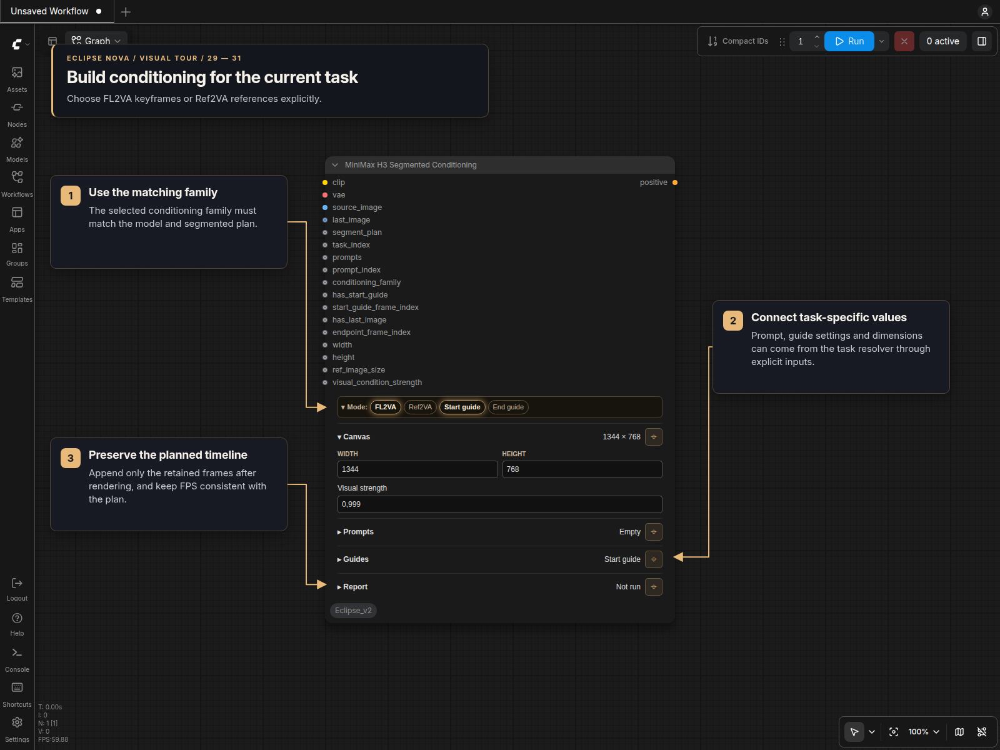
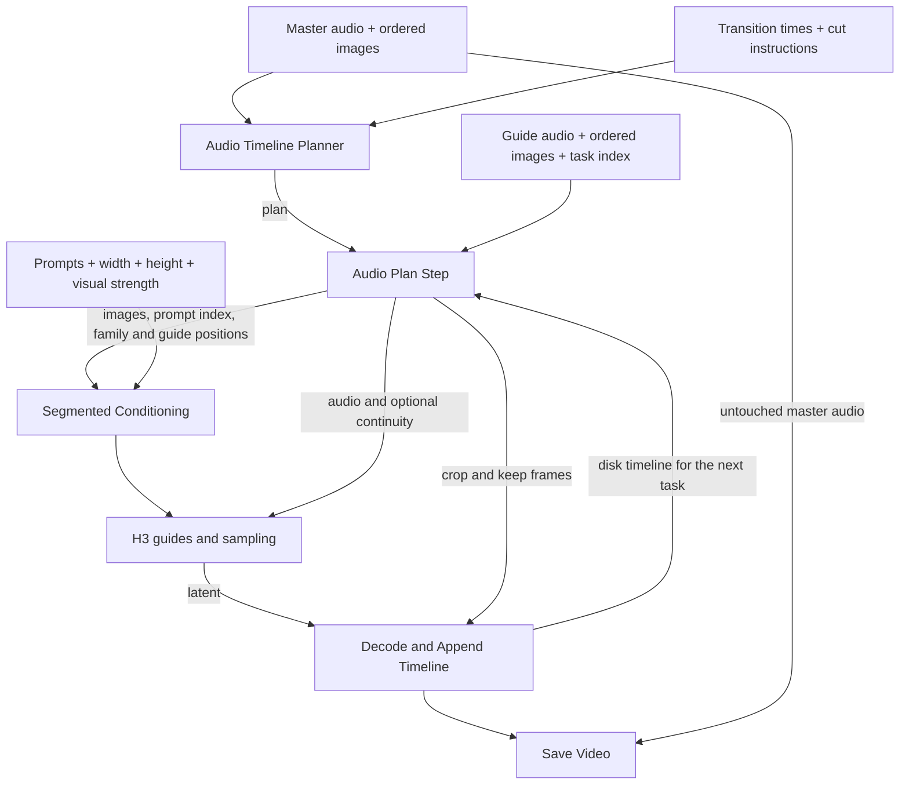

# MiniMax H3 Audio Timeline Nodes

The MiniMax menu under **🌒 Eclipse Nova → MiniMax** contains three panels:
Audio Timeline Planner, Audio Plan Step and Segmented Conditioning.
They use the segmented planning engine and support FL2VA and Ref2VA workflows.

## Redesigned panels

The panels use the shared Nova theme in standard canvas and Nodes 2.0. Mode bars
collapse to a selection summary; sections can be collapsed or pinned open. Text
areas retain their own sizes, and Report shows the last execution. Settings are
stored by name, independently of the visible sections.

| Panel | Layout | Optional overrides |
| --- | --- | --- |
| Audio Timeline Planner | FL2VA/Ref2VA and Activity gaps in Mode; Transitions, Render, Technical seams, Cut instructions, Activity gaps and Report. | `manual_transition_times`, `technical_cut_instruction` |
| Audio Plan Step | Compact Task and Report sections. | `task_index` |
| Segmented Conditioning | FL2VA/Ref2VA and guide switches in Mode; Canvas, Prompts, Guides and Report. | `prompts`, `prompt_index`, `conditioning_family`, `has_start_guide`, `start_guide_frame_index`, `has_last_image`, `endpoint_frame_index`, `width`, `height`, `ref_image_size`, `visual_condition_strength` |

Connected non-`None` values override the corresponding panel setting. Zero,
false and empty text are valid overrides; `None` uses the saved local value.
Prompt and cut-instruction lists stay together for task selection and cycling.
The planner and Plan Step share the `MINIMAX_H3_SEGMENT_PLAN` format. The
segmented engine's output order, audio slicing and image ordering are preserved.

Selecting Ref2VA in the segmented planner sets Warm reset, First only and
Original image continuity. Selecting Generated continuity uses plain seams.
Camera cuts require a non-zero FL2VA warmup; selecting them restores a two-second
warmup if it was zero. Connected conditioning flags and indexes should come
from Plan Step together, so the family and guide positions agree.

### DiskTimeline workflow connections

The inspected `MiniMaxH3_LipSync_V4_N2_Captions_DiskTimeline` workflow uses the
segmented planner at the root and a Plan Step / Segmented Conditioning pair in
each of its Base and Extension subgraphs. The new schemas preserve these paths:

- The planner accepts the connected transition-times string and cut-instruction
  list, alongside the master audio, ordered images, guide audio and Wav2Vec features.
- The extension loop supplies `task_index` to Plan Step. The disk `timeline`
  input remains available as an alternative to accumulated `previous_frames`.
- Plan Step supplies the source/last images, prompt owner, conditioning family,
  guide flags and guide positions, and reference size to Segmented Conditioning.
- Shared dimensions and visual strength override the conditioning panel's local
  values. `segment_plan` and its separate `task_index` still supply camera-cut
  context; `task_index` and `prompt_index` serve different purposes.

Use the Nova node IDs for the planner and both resolver/conditioning pairs.
Original Eclipse workflow files are not converted automatically.

## Segmented timeline

- **MiniMax H3 Audio Timeline Planner** creates a strict
  `MINIMAX_H3_SEGMENT_PLAN` schema-version-1 plan plus a tensor-free analysis
  manifest.
- **MiniMax H3 Audio Plan Step** resolves one task into the exact native-rate
  audio slice, optional generated continuity, original source/endpoint images,
  frame indices, crop, prompt owner, and conditioning family.
- **MiniMax H3 Segmented Conditioning** builds either native-style FL2VA
  positional keyframes or one persistent Ref2VA active-image reference. It never
  mixes the two payload families.

Recommended graph defaults are FL2VA, `warmup_reset`, a two-second hidden
warmup, `first_only`, and `original_image_reset` at technical splits. Stitch
retained decoded frames directly, trim to the exact planned frame count, and
mux the untouched master audio once at the end. No crossfade should hide a
failed transition.

## Visual tour

The master audio defines duration. Ordered images define timeline states;
optional guide audio and transition times refine the plan. Match the planner's
conditioning family to the model. Warmup and hidden endpoints consume render
capacity even though their frames are discarded from the final timeline.

Plan Step supplies guide inputs and exact frame ranges for each task. Connect the
generated latent and VAE to Decode and Append Timeline, using Plan Step's crop
and keep values. Pass its disk timeline into the next task when generated
continuity is enabled.

## Planner inputs and outputs

The master `audio` determines the complete duration. `conditioning_audio` is an
optional native-rate guide source, such as a vocal stem; it must match the
master duration within one 24 FPS frame. Wav2Vec `audio_encoder_output` is used
only to place transitions or eligible single-image technical seams near
activity gaps.

Original `image_batch` entries are timeline states. Connect
`manual_transition_times` from **String Multiline [Eclipse Nova]** and keep the
comma-separated value on one line. A disconnected or blank input distributes
images evenly; otherwise provide one strictly increasing second value per image
after the first. Transition frame `T` always belongs to the destination interval.

The planner controls are:

- `conditioning_family`: `fl2va_keyframes` or
  `ref2va_active_reference`.
- `segment_strategy`: `hard_cut`, `first_last_bridge`, or `warmup_reset`.
- `warmup_seconds`: hidden generated context before a warm-reset visible range;
  default `2.0`.
- `reset_anchor`: `first_only` or the hidden
  `same_first_last_experimental` endpoint.
- `technical_split_source`: default `original_image_reset`, or optional
  `generated_continuation` at technical seams only.
- `technical_seam_style`: `plain_reset` (default) or the opt-in
  `intentional_camera_cut`. The latter is valid only with
  `original_image_reset`.
- `technical_cut_instruction`, shown in the **Cut instructions** section:
  connect a scalar string, **String Multiline [Eclipse Nova]** `string_list`, or
  **Wildcard Processor [Eclipse Nova]** `list`. Each non-empty list item is one
  complete direction. Eligible intentional technical seams consume directions
  chronologically and cycle when the list runs out. A disconnected or blank
  input uses the existing camera-angle default. The
  [Wildcard Processor guide](Wildcard_Processor.md#minimax-h3-lipsync-technical-cut-directions)
  shows this connection in the DiskTimeline variant of the
  [MiniMax H3 LipSync workflow](https://civitai.com/models/2935228/minimax-h3-lipsync).
- `ref_image_size`: `match` or `max` for Ref2VA reference geometry.
- `max_render_frames`: the upper legal `17k+5` render length from 124 through
  362 frames. Warmup and hidden endpoints consume this capacity; a 48-frame
  warmup leaves about 314 visible frames in a maximum render.

Planner outputs are `plan`, `extension_task_count`, `total_frames`,
`base_keep_frames`, `analysis_manifest`, and `report`. The JSON manifest embeds
no tensors. It records planned image transitions, every image/technical seam,
half-open retained ranges, prompt owners, each intentional seam's selected
technical-cut prompt index, guide positions, and expected source ownership for
external analysis.

### Prompt ownership

Use **String Multiline [Eclipse Nova]** and connect its `string_list`
output to the segmented conditioner. The list output ignores blank lines.
Non-empty lines map to source images in order. If a task's image index has no
matching line, the conditioner uses the first prompt, so one line applies to
every image.

Each H3 task receives one complete prompt. A bridge from A to B uses prompt A;
prompt B begins only in the B-owned task at `T`. Prompts do not change within a
task. The segmented conditioner optionally accepts `segment_plan` and `task_index` so
it can append the technical-cut instruction to the exact eligible task. Both
inputs must be connected to enable this behavior. Workflows that leave them
disconnected keep the previous prompt behavior.

`visual_condition_strength` is a global `0.0`–`1.0` control with default
`0.999`. At exactly `0.999`, Eclipse omits the override and preserves ComfyUI's
native H3 conditioning path. Every other valid value is passed explicitly as
`minimax_visual_cond_noise_aug` for both FL2VA keyframes and Ref2VA reference
blocks.

This value controls seeded noise on the VisualVAE condition; it does not alter
Qwen visual tokens or audio conditioning, and it is not a direct motion control.
`1.0` removes that conditioning noise and creates the strongest visual anchor,
which may also increase static behavior or reference-like flashes. Lower values
add progressively more seeded noise and may loosen visual adherence. Compare
values with identical inputs, seed, frame count, model, LoRA, and sampling
settings. The segmented workflow version `2.0.2` exposes one shared root Float
control wired through both task subgraphs.

### FL2VA behavior

FL2VA tasks tokenize the active original image as `<Picture 1>`. Tasks with a
real or experimental endpoint tokenize `[source, destination]` in that order.
The source is stretched to the generation canvas, while the endpoint uses
aspect-preserving cover resize and center crop. Positional images are
VAE-encoded into `minimax_keyframes` at the local indices supplied by Plan Step.

- `hard_cut` starts the destination task at `T`, places its exact source guide
  at local frame 0, and retains that frame. A hard cut should therefore contain
  one intentional A-to-B discontinuity; a second unrelated `T` to `T+1` jump is
  a failure.
- `warmup_reset` starts from the destination's original image before `T`, maps
  its hidden audio context to the actual preceding master-audio range, discards
  the warmup, and exposes a generated destination-owned frame at `T`.
- `first_last_bridge` gives the A-owned task an ordered A/B pair and places B at
  `T` as the first discarded endpoint frame. A separately warmed, B-only task
  supplies the visible generated frame at `T`.

The default also regenerates long technical segments from their active original
image. The technical-seam choices have distinct goals:

- `generated_continuation` aims for visual continuity by supplying the preceding
  22 generated frames, but repeated chaining can accumulate generation drift.
- `plain_reset` independently regenerates from the active original image and can
  visibly reset framing at a same-image technical split.
- `intentional_camera_cut` keeps that independent reset, source guide at hidden
  local frame 0, and full warmup crop, then asks H3 to turn the first visible
  generated frame into a deliberate editorial change of angle or shot size. It
  does not transform, crop differently, or paste the source image.

The intentional instruction is never added to task 0, image transitions,
first/last bridges, or generated-continuation tasks. `generated_continuation` is
never used to cross an image transition.
Global frame 0 in the default FL2VA path retains the first original source.
`same_first_last_experimental` adds only a discarded same-source endpoint and
never replaces a real bridge destination.

### Ref2VA behavior and checkpoint boundary

Ref2VA requires matching Ref2VA diffusion weights and supports
`warmup_reset` with `first_only` original-image technical resets. Hard cuts and
first/last bridges require FL2VA. Generated-continuation keyframes and
same-first/last endpoints are also rejected in Ref2VA mode, preventing an
unsupported mixed `minimax_refs` plus `minimax_keyframes` payload.

For every task, the conditioner exposes only the active original image as
non-positional `<Picture 1>`. It preserves aspect ratio and never upscales:
`match` limits the image toward the generation canvas area, while `max` permits
up to a 2048-pixel short edge at higher encoder and sampling cost. The image is
passed to the text/vision tokenizer through `minimax_ref_items`, VAE-encoded
into an immutable `minimax_refs` image block, and remains available throughout
the task. Future timeline images are never references. A concise `<Picture 1>`
role sentence is prepended only when the selected prompt does not already name
that picture.

Ref2VA is intended to preserve identity, texture, or composition semantically;
it does not provide an exact target-frame position. Because it has no positional
opening keyframe, its global frame 0 is generated after the planned hidden
warmup rather than copied from the source.

### Plan Step output contract

Plan Step returns these positions and names exactly:

1. `audio_slice`
2. `continuity_clip`
3. `has_continuity`
4. `source_image`
5. `has_start_guide`
6. `start_guide_frame_index`
7. `last_image`
8. `has_last_image`
9. `endpoint_frame_index`
10. `render_frames`
11. `crop_start_frames`
12. `keep_frames`
13. `prompt_index`
14. `conditioning_family`
15. `ref_image_size`

It rejects legacy plans, malformed ranges, invalid render lengths, inconsistent
audio slices, mismatched image batches, and accumulated-timeline drift.

### Transition and quality analysis

`tools/analyze-minimax-h3-segmented-timeline-v2.py` accepts a rendered video,
the original timeline images, the segmented manifest, an output directory, and an
optional local Hugging Face CLIP-Vision directory. It writes a JSON report, per-
frame CSV, trace plots, and narrow/wide diagnostic contact sheets.

The analyzer compares every frame with both H3 source normalizations and records
CLIP cosine similarity when supplied, low-resolution NCC, SSIM, RGB difference,
edge similarity, luminance/color, sharpness, entropy, adjacent-frame change, and
repeat similarity. Source traces use a median window, a configurable winning
margin, and a six-frame stable-state requirement. Planned repeated A-to-B-to-A
states are resolved by expected interval; unplanned returns within a B interval
remain failures.

Reason codes cover `BACK_SWITCH`, `OSCILLATION`, `SOURCE_FLASH`,
`TRANSIENT_STATE_FLASH`, `GENERATED_SOURCE_GENERATED_FLASH`, `DOUBLE_JUMP`,
`WEAK_TECHNICAL_CUT`, `EARLY_SWITCH`, `LATE_OR_MISSING_SWITCH`,
`UNEXPECTED_CUT`, `BLACK_WHITE_FLAT_FLASH`, `MOTION_STALL`, and
`QUALITY_COLLAPSE`. `EXPECTED_TECHNICAL_CUT` records the one allowed
`T-1`-to-`T` discontinuity at an intentional seam. A second robust jump at
`T`-to-`T+1` that is also material relative to the planned cut remains
`DOUBLE_JUMP`; ordinary first-frame settling is not a second cut. A requested
cut without a measurable change is `WEAK_TECHNICAL_CUT`. Source flashes,
ownership errors, stalls, and unrelated cuts remain failures. Adjacent
discontinuities use rolling
median plus median absolute deviation limits. Literal source flashes additionally
require strict absolute NCC, SSIM, and RGB-difference thresholds. Every threshold
is stored in the report.

Automated metrics identify candidates and enforce structural failures, but live
H3 acceptance still requires visual inspection. Identity similarity alone cannot
decide whether motion, expression, or a model-chosen transition looks natural.

## Separate audio roles

The master audio remains authoritative for duration and output timing. A
separate conditioning source, such as a raw vocal stem, supplies H3 guide slices
and may also be used to produce Wav2Vec activity features. Guide slices preserve
that source's native sample rate.

Vocal-stem conditioning can reduce reactions to instruments, but it is not an
absolute lip lock. Separation bleed, visual prompting, and model behavior can
still produce mouth motion during quiet or instrumental passages.
