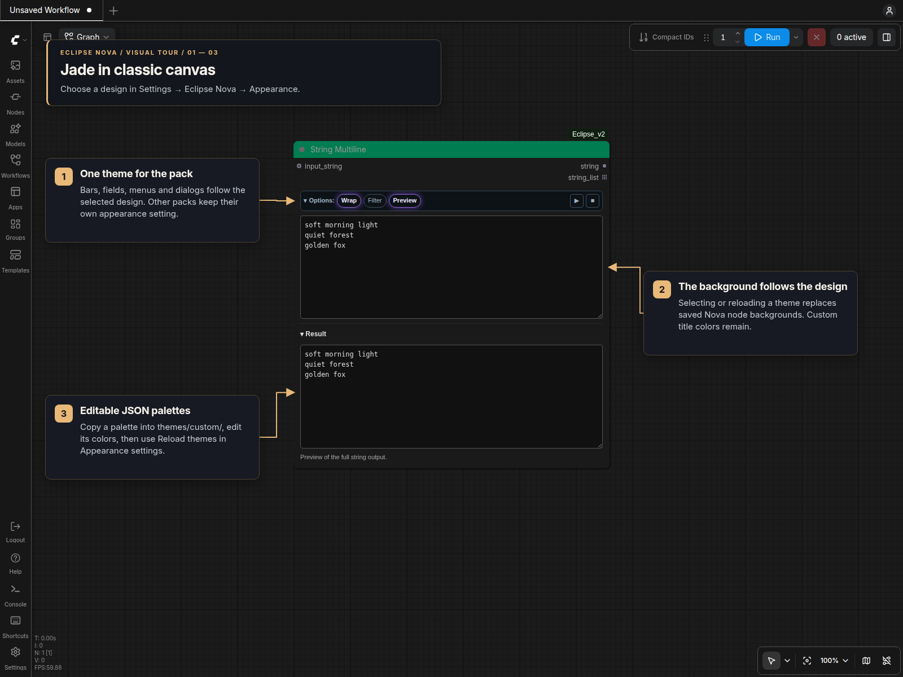
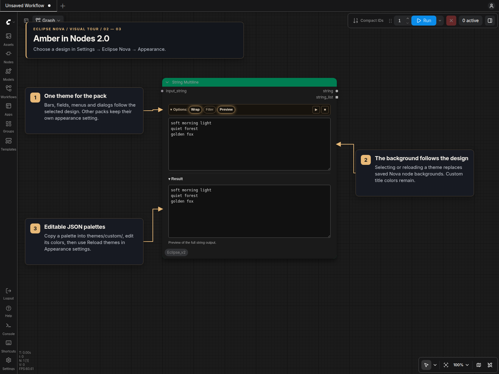
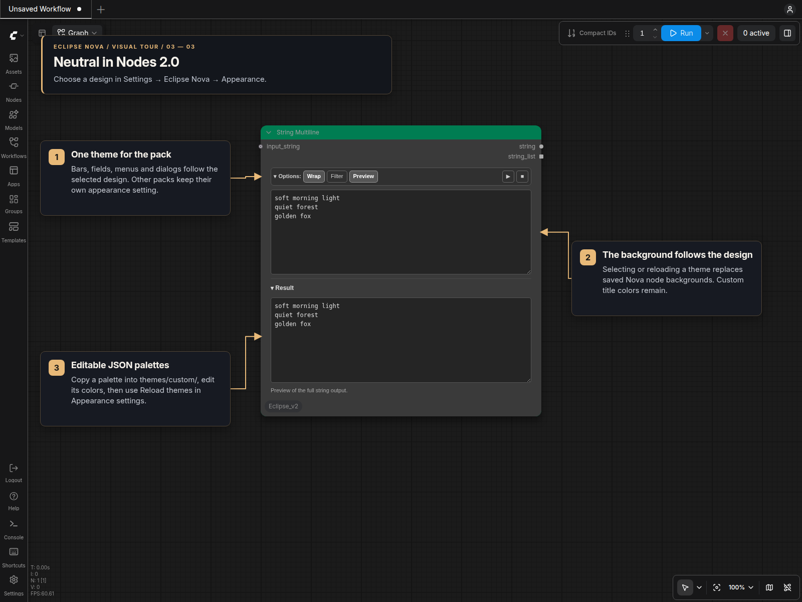

# Node designs

Choose **Settings → Eclipse Nova → Appearance → Node design**. The setting works
in classic canvas and Nodes 2.0. Neutral is
the default for new installations; existing saved theme choices are preserved.

| Bundled theme | Background | Automatic title | Optional group color | Controls |
| --- | --- | --- | --- | --- |
| Jade | RGB 26 (`#1a1a1a`) | RGB 46 (`#2e2e2e`) | RGB 60 (`#3c3c3c`) | Jade accents, purple selection glow |
| Neutral (default) | RGB 58 (`#3a3a3a`) | RGB 78 (`#4e4e4e`) | RGB 80 (`#505050`) | Gray controls, no glow |
| Ocean | RGB 26 (`#1a1a1a`) | RGB 46 (`#2e2e2e`) | RGB 60 (`#3c3c3c`) | Blue accents and glow |
| Amethyst | RGB 26 (`#1a1a1a`) | RGB 46 (`#2e2e2e`) | RGB 60 (`#3c3c3c`) | Purple accents and glow |
| Amber | RGB 26 (`#1a1a1a`) | RGB 46 (`#2e2e2e`) | RGB 60 (`#3c3c3c`) | Warm yellow-gold (`#e8b978`) accents and glow, matching the Eclipse README tour |
| Neutral Jade | RGB 58 (`#3a3a3a`) | RGB 78 (`#4e4e4e`) | RGB 80 (`#505050`) | Jade accents, purple selection glow |
| Neutral Ocean | RGB 58 (`#3a3a3a`) | RGB 78 (`#4e4e4e`) | RGB 80 (`#505050`) | Blue accents and glow |
| Neutral Amethyst | RGB 58 (`#3a3a3a`) | RGB 78 (`#4e4e4e`) | RGB 80 (`#505050`) | Purple accents and glow |
| Neutral Amber | RGB 58 (`#3a3a3a`) | RGB 78 (`#4e4e4e`) | RGB 80 (`#505050`) | Warm yellow-gold accents and glow |

The Neutral color variants use Neutral’s node background and automatic title
(`#4e4e4e`) with the original palette’s controls and selection styling. All
three Nova packs include the same variants, so Eclipse’s **Link Nova themes**
can select them together. With Eclipse’s **Theme groups** enabled, their
group color is Neutral’s `#505050`.

Each gray RGB value applies to all three channels. Automatic titles use a +20
offset from the bundled theme's background. Custom title and background colors
stay unchanged. Node types no longer force category colors or black backgrounds.

The palettes are JSON files in `themes/`. They style panels, searchable menus and editor windows.
Nodes with untouched theme defaults follow the selected background and title;
nodes with native ComfyUI controls keep those native controls.

**Theme regular nodes** and **Theme groups** are separate options in the same
Appearance settings, both off by default. Enable the first to apply the background
and automatic title colors to untouched defaults on other nodes. Enable the second
to match group colors to the theme. Both apply immediately, including inside subgraphs. Turning
an option off restores the previous colors, including after saving and loading
the workflow; manual title and background overrides remain intact.

**Link Nova themes → Link themes** keeps installed SmartLLM Nova and Smart Model
Loader Nova packs on Eclipse's selected theme. It applies the current selection
immediately, follows later selections and theme reloads, and stays linked across
restarts. Linking is optional and off by default. Click **Unlink themes** to
return to independent choices; each pack keeps its current selection.

Each pack still saves and applies its own preference through its settings control.
A custom theme must be available under the same filename in every linked pack.
If a pack lacks that theme or cannot save it, Eclipse shows a message and leaves
that pack's selection unchanged. After correcting the problem, click **Reload
themes** in Eclipse to apply the linked selection again.

## Visual examples

The same String Multiline editor is shown in both renderers. The remaining
[visual tour](Visual_Tour.md) uses Amber for its yellow-gold controls.

### Jade in classic canvas

### Amber in Nodes 2.0

### Neutral in Nodes 2.0

## Existing workflows and colors

Selecting or reloading a design updates panel controls and untouched theme
defaults. **Custom node titles and backgrounds are preserved**, including inside
subgraphs and after workflow reload. Float, routing and pipe nodes are no longer
recolored according to their type.

Saved colors without an automatic-theme marker are kept as they are, including
black and colors that happen to match a bundled palette. Existing black nodes
can be recolored normally. Nodes without saved colors use their constructor or
theme defaults. Node values, connections, collapsed sections and outputs are
unchanged.

The chosen theme ID is saved as `node_design` in this repo's private `config.json`.
The two optional scopes are saved as `theme_regular_nodes` and `theme_groups`.
The optional theme link is saved as `link_nova_themes`.
These preferences take precedence over browser settings at startup and apply across
workflows. Changes are event driven: no file watcher, recurring canvas scan or
per-node theme request.

## Theme files and updates

Bundled palettes are shipped as `.defaults/themes/*.json.example`. Startup copies
each default into the user-owned `themes/` folder once. Existing files are kept
exactly as they are, including custom edits and malformed files. Updates do not
replace a theme or restore a deleted one, even if the bundled default changes.
A newly bundled filename can be installed once without restoring older deletions.

The extraction record is `.theme-defaults.json` in this repository. Theme reloads
only read files. To restore a removed palette, copy its `.json.example` from
`.defaults/themes/` into `themes/` and remove the `.example` suffix yourself.

## Create or edit a theme

1. Copy `themes/jade.json` (or another bundled theme) to
   **`themes/custom/my-theme.json`** in this repo.
2. Change `label`, the colors under `node`, and the values under `tokens`.
   Keep the complete structure and `version: 1`.
3. Click **Reload theme files → Reload themes** in this pack's Appearance
   settings. Select your theme under **Node design**.
4. After editing the selected JSON file again, use **Reload themes** to apply it.

The filename without `.json` is the saved ID. Use lowercase letters, digits,
hyphens and underscores, with at most 64 characters. `label` is the displayed
name. You can edit a theme directly in `themes/` or override it in `themes/custom/`
with its original filename; for example, `custom/jade.json` overrides
`themes/jade.json`. The whole `themes/` folder is ignored by Git. Reads never
rewrite theme files.

The same complete JSON format works in Eclipse Nova, SML2 and SmartLLM Nova.
Copy a theme into each repo where you want it available, then select it separately
or enable **Link Nova themes**. Theme files remain local to each pack.

## Editable fields

| Field | Purpose |
| --- | --- |
| `node.background` | Node body and panel/dialog surface |
| `node.title` | Default automatic title color |
| `node.routing_background` | Retained for shared theme-file compatibility; Eclipse does not force routing backgrounds |
| `node.category_titles` | Retained for shared theme-file compatibility; Eclipse does not apply category colors |
| `tokens.accent` | Main control accent |
| `tokens.control-*` | Button backgrounds and borders |
| `tokens.input-*`, `tokens.select-*` | Text fields and selectors |
| `tokens.bar-*`, `tokens.pill-*`, `tokens.selected-*` | Mode bars and selected options |
| `tokens.menu-*`, `tokens.dialog-*`, `tokens.backdrop` | Menus, dialogs and shadows |
| `tokens.text`, `muted`, `label`, `error`, `warning`, `success`, `danger` | Text and status colors |
| `tokens.row-bg`, `divider`, `option-bg`, `ratio-bg`, `muted-accent` | Rows, separators and secondary accents |
| `tokens.color-scheme` | `dark` or `light` for native controls inside panels |

Node colors require six-digit hex values, such as `#243544`. Color tokens accept
hex colors with optional alpha (`#00ffcc55`) or `transparent`. `pill-radius` accepts
`0` or a pixel value. Shadow tokens accept `none` or up to four comma-separated
shadows, each with three nonnegative pixel lengths and a hex color, such as
`0 0 10px #975bff99`. Arbitrary CSS and URLs are not accepted.

Optional group colors are derived from `node.background`, interpolating each
channel between the body/group pairs 26→60 and 58→80.

Malformed, oversized or unsupported files are skipped with a visible message;
valid themes remain available. If the selected file is missing or invalid, Neutral
is shown temporarily without overwriting the saved selection. Restore the file
and reload, or explicitly choose another theme. A malformed custom override
leaves the bundled version available.
