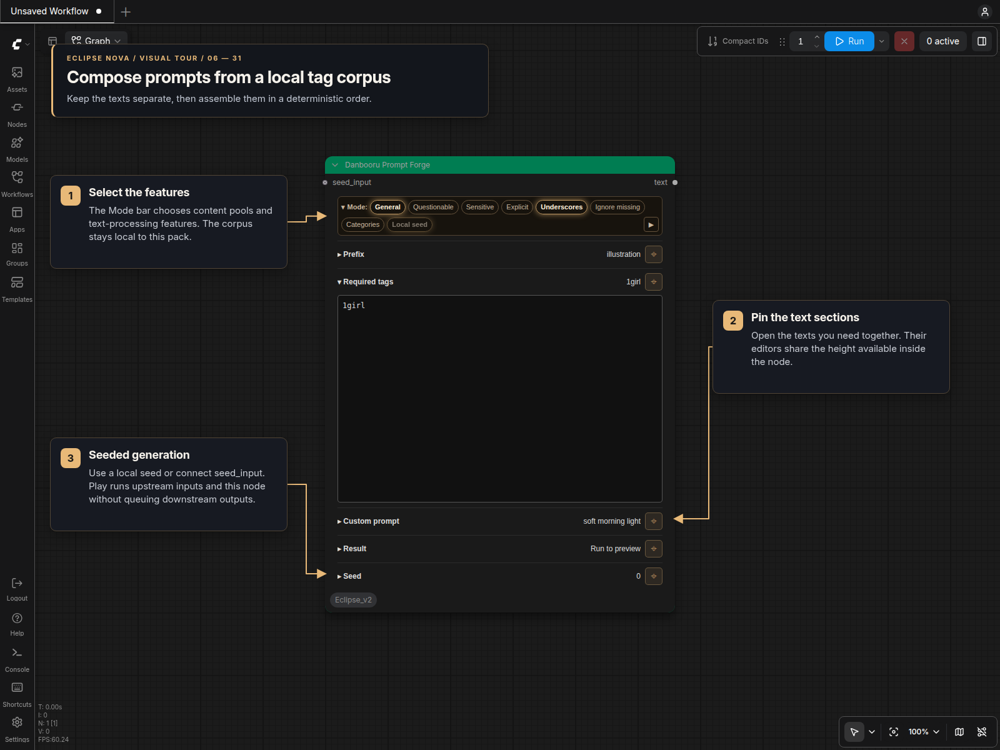

# Prompt Forge panel

**Danbooru Prompt Forge** is available under **🌒 Eclipse Nova → Danbooru**.
It uses the shared node design in standard canvas and Nodes 2.0.

## Mode bar

The collapsible **Mode** bar contains independent switches:

| Switch | Behavior |
| --- | --- |
| General, Questionable, Sensitive, Explicit | Select the offline rating pools to use; enable at least one |
| Underscores | Replace underscores with spaces in the finished prompt when enabled |
| Ignore missing | Ignore required tags absent from all selected pools when choosing a taglist; keep those explicit tags in the output |
| Categories | Filter generated tags using the categorized corpus and show Category exclusions |
| Local seed | Use the local seed and show its section; disable to use connected `seed_input` |

New nodes start with General, Underscores and Local seed enabled. Collapsing the
bar shows a summary and retains its selections.

**Play (▶)** stays on the right, including when Mode is collapsed. It opens
Result and runs this node and its required upstream inputs once through ComfyUI's
native partial execution. Downstream nodes are not requested. Participating seeds
follow their normal queue policy; seeds on unrelated Nova nodes stay unchanged.
The same scoping applies to ComfyUI's selected-node Run command and subgraphs.

## Text sections

**Prefix**, **Required tags**, **Custom prompt** and **Category exclusions** each
have a collapsible section. Pin a section to keep it open while editing another.
The closed header shows a short text preview. Text areas accept comma-separated
or newline-separated tags. Open text fields share the available node space; a
single field fills it. Resize the outer node to change that space, or drag a
field's lower-right handle to adjust its share without enlarging the node. The
split is saved with the workflow and retained across executions and renderer
changes. At small sizes, controls scroll inside the panel.

The output order is Prefix → Required tags → Custom prompt → generated tags.
Duplicate tags keep their first occurrence. Category exclusions affect generated
tags; explicit text remains. Disabling Categories keeps its text for later use.

These texts live in the panel; they do not add input sockets. Workflow saving,
cloning, undo/redo and renderer changes retain the text, switches and sections.

The collapsible **Result** section displays the last generated prompt in a
read-only, resizable field. Its text survives workflow reloads. Press Play or
queue the workflow after editing to update it; the section itself does not add an
input socket or change the generated text.

## Seed

The **Seed** section sits at the bottom. It has the shared exact 64-bit seed
field, small minus/plus actions, Randomize each run, Use last queued seed and
Create fixed random seed buttons. The shortcuts `-1`, `-2` and `-3` select random,
increment and decrement respectively. Seed changes for the next run happen only
after a queue is accepted; saving or cloning the node does not advance them.

Local seed ignores a connected `seed_input`. After connecting that socket, turn
Local seed off to use the incoming value and hide the local controls. Turning it
back on restores the local value and policy. Without a connection, Local seed
stays enabled; disconnecting an active seed input restores local mode.

The node has one `text` output and can execute without an output connection.
Generation uses the existing local `prompts/tag_lists/` corpus and does not make
network requests. See the [Danbooru corpus guide](Danbooru_Prompt_Forge.md) for
rating files and custom categories.
