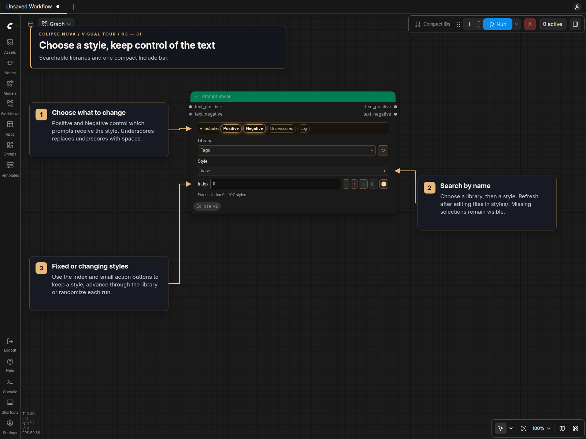

# Prompt Styler

**Prompt Styler** applies a named style to positive and negative prompt text. Its compact themed panel works in standard canvas and Nodes 2.0, with one collapsible Include bar and no sections.



## Quick start

1. Connect your prompt to `text_positive`, and optionally connect `text_negative`.
2. Choose a **Library**, then search for a **Style**.
3. Use **Positive** and **Negative** in the Include bar to control which outputs are styled.
4. Connect the two `STRING` outputs to your prompt-processing or encoding nodes.

The `base` style adds no style text. Turning Positive, Negative and Underscores off preserves both input strings exactly.

## Include controls

| Option | Default | Effect |
|---|---|---|
| Positive | On | Apply the selected positive template. |
| Negative | On | Prepend the style's negative text to your supplied negative prompt. |
| Underscores | Off | Replace underscores with spaces in both output prompts, including style text. When disabled, leave underscores unchanged. |
| Log | Off | Write the style and prompt details to the ComfyUI console. |

Underscores works independently of Positive and Negative. For example, enabling it changes `red_fox` to `red fox`; disabling it preserves `red_fox`. Other spaces, punctuation and line breaks are left unchanged by this option.

Collapse Include to show a compact summary. Collapsing changes only the presentation, and the workflow remembers that state.

## Styles and libraries

| Library | Contents |
|---|---|
| Tags | Comma-separated tag templates and matching custom styles. |
| Natural language | Sentence-based templates and matching custom styles. |
| Custom | Entries from your additional style files. |

Both selectors support search and keyboard navigation. The refresh icon beside Library rereads the style files and updates this node's lists. There is no need to restart ComfyUI after editing a style file.

Selections are saved by name. Reordering files or templates does not select a different style. A deleted or renamed style stays visible as **unavailable**; refresh and select its replacement. Execution reports the missing selection rather than silently using another style. Each node retains its own settings and library selections.

## Index actions

Indexes start at zero and wrap within the active library. Picking a style updates its index. The small **− / +** buttons choose the previous or next style and make it a fixed selection.

| Enter in Index | Behavior |
|---|---|
| `0` or higher | Select a fixed style by index. |
| `-1` | Choose a random style for each queue, avoiding the last style when alternatives exist. |
| `-2` | Use the displayed style, then advance after each accepted queue. |
| `-3` | Use the displayed style, then move backward after each accepted queue. |

The three icon buttons select **Random style each run**, **Use last queued style**, and **Choose fixed random style**. Hover over them for their names. Use last locks the last queued style into a fixed selection.

Saving, cloning, previewing the API prompt, and rejected queue requests do not advance the index. Queued workflow metadata records the actual style used with a fixed policy, so it can reproduce that choice. The live node keeps its automatic policy for the next queue.

Direct API requests can use a fixed named style or the random policy. Increment and decrement advance in the frontend after queue acceptance; API-only clients must advance their own selections.

## Custom style files

Put CSV, JSON, or CSV-formatted TXT files in this pack's `styles/` folder. The supplied defaults are extracted from `.defaults/styles/` on startup; edit or add files in `styles/`.

CSV example:

```csv
name,prompt,negative_prompt
"my-portrait","portrait of {prompt}, soft studio lighting","blur, harsh shadows"
```

JSON example:

```json
[
  {
    "name": "my-portrait",
    "prompt": "portrait of {prompt}, soft studio lighting",
    "negative_prompt": "blur, harsh shadows"
  }
]
```

Use unique names. JSON entries need all three fields; `negative_prompt` may be an empty string. CSV requires `name` and `prompt`; an omitted negative column is treated as empty.

The `{prompt}` placeholder inserts your positive text. A template without the placeholder supplies the complete positive prompt. Negative style text is combined with the optional `text_negative` input.

Files beginning with `tag_based_` or `natural_lang_` go into the corresponding library. Other files appear under Custom and are also classified into Tags or Natural language from the template suffix. Select the intended prefix when you want an explicit library choice.

Click **Refresh style files** after adding or changing a file. If a style is unavailable, check its filename, format, library and name. Include options and unavailable selections remain saved when the workflow reloads.
