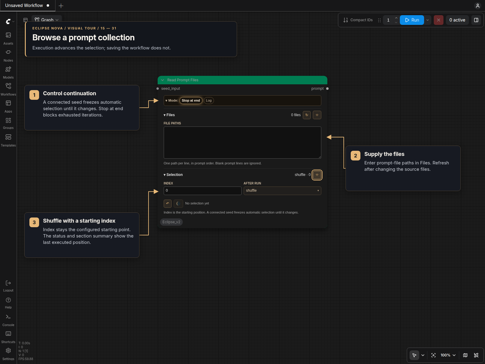

# Read Prompt Files

`Read Prompt Files [Eclipse Nova]` turns the non-empty lines from one or more text files into a single indexed prompt source. Use a fixed index for repeatable selection, choose an After run policy for automatic navigation, or connect `seed_input` to synchronize prompt changes with the rest of a workflow.

## Panel controls



Both standard canvas and Nodes 2.0 use the same themed panel.

- **Mode:** toggle Stop at end and Log; collapse the bar to its active-options summary.
- **Files:** enter one file path per line. Quotes and `~` are accepted; files retain their listed order. The unwrapped text area can be resized vertically. Refresh marks the files for reloading and restarts selection on the next run; ordinary file edits are detected automatically.
- **Selection:** choose a zero-based Index and an After run policy. Restart returns to the configured starting position. The section header shows the last resolved index (for example, `shuffle · 5817`); the Index field retains the configured starting position. The moon button fixes the last displayed index. Pin sections to keep more than one open.

| After run | Behavior |
| --- | --- |
| `fixed` | Reuse Index; an out-of-range index uses the nearest available prompt. |
| `next` / `previous` | Start at Index, then move forward/backward once per execution. |
| `random` | Choose a prompt each eligible execution. |
| `shuffle` | Choose every prompt once, in random order. |

Stop at end blocks downstream execution after Next, Previous or Shuffle exhausts the sequence and disables automatic queuing in the browser. Disable it to repeat. To traverse backward from the end, set Index to the last prompt position. Missing or unreadable files are skipped; no readable prompts produces an empty string.

The optional **seed_input** keeps automatic selection unchanged while the connected value stays the same; changing it advances once. Selection runs on the server, including API submissions, and is independent per node and workflow. Opening, serializing or inspecting a workflow does not advance it. File changes, a different starting index/policy, or Refresh/Restart reset the sequence. A page reload preserves shuffle progress when the same workflow/node is restored and ComfyUI remains running. The last displayed index survives workflow save/reload, while automatic iteration starts fresh after a server restart. Local automatic choices also freeze for Image Selector confirmation.

The `prompt` output remains a single string. Execution settings live in one `configuration` widget; section pins, disclosure and the last displayed selection are saved separately as editor state. There are no background file polls or canvas-wide searches.

## Inputs and output

| Name | Type | Description |
| --- | --- | --- |
| `seed_input` | `INT`, optional input | Gates automatic advancement by the connected value. |
| `prompt` | `STRING` output | The selected non-empty line. |

File paths, Index, After run, Stop at end and Log are panel controls. For API submissions their values are stored together in `configuration`.

The `prompt` output can connect directly to text encoders, prompt processors, save nodes, or any other compatible input. Use **Show Any**, or ComfyUI’s **Preview as Text**, to inspect the resolved line.

## File handling

Enter one file per line:

```text
/path/to/prompts/subjects.txt
"/path/with spaces/styles.txt"
/path/to/prompts/lighting.txt
```

- Blank path rows and blank prompt lines are ignored.
- Paths must resolve to readable files on the ComfyUI server.
- Lines are not split as CSV; each complete non-empty line is one prompt.
- Editing a listed file changes its modification time and invalidates the cached list automatically.
- Adding, removing, or reordering paths also rebuilds the combined sequence.
- The Files section's Refresh button reloads the list and restarts selection on the next execution.

## Common setups

Sequential generation:

1. List the prompt files in the desired order.
2. Set Index to `0` and After run to `next`.
3. Leave Stop at end enabled for a finite run, or disable it to loop.

Stable seed-driven variation:

1. Set After run to `random` or `shuffle`.
2. Connect the same seed source used by the sampling branch to `seed_input`.
3. Change the seed when a new prompt should be selected; keep it fixed while tuning other values.

Targeted reuse:

1. Queue a random or navigation mode.
2. Note the last index shown in the Selection section.
3. Click the moon button (Use last index) to keep that exact prompt as a fixed index.

## Troubleshooting

- An empty output usually means no listed path resolved to a readable file or every file was empty.
- If a fixed index exceeds the available range, the backend clamps it to the nearest valid prompt.
- When file contents change, the next execution updates the list and its prompt count. Refresh can restart it explicitly.
- Enable Log to print the selected prompt to the server console.
