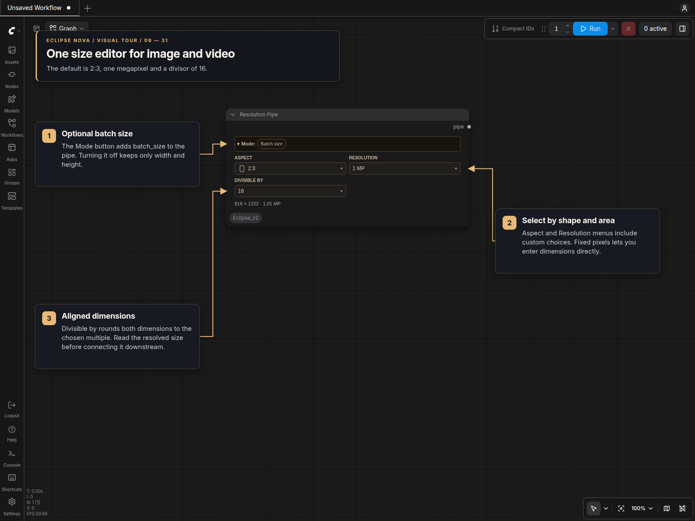

# Resolution Pipe

One compact size editor for image and video workflows, using the same themed controls as [Smart Folder](Smart_Folder.md).

Find it under **🌒 Eclipse Nova → Settings → Resolution Pipe**. It works in standard canvas and Nodes 2.0.

## Controls



| Control | Behavior |
| --- | --- |
| **Mode → Batch size** | Includes a batch-size field and `batch_size` in the output pipe. Off by default. Disabling it retains the value in the workflow for later use. |
| **Aspect** | Square, horizontal, vertical or custom ratios, grouped with small shape previews. In Fixed pixels mode it displays the ratio calculated from width and height. |
| **Resolution** | Base pixel-area presets such as `1024²`, megapixel presets, or Custom. |
| **Custom size** | Megapixels with an aspect ratio, or Fixed pixels with independent width and height. |
| **Divisible by** | Align both dimensions to 8, 16, 32, 64 or a custom positive integer. Choose the value required by your model. |

The default is **2:3 at 1 MP, divisible by 16**, resolving to **816 × 1232**. The readout always shows the effective dimensions and megapixels. For example, `1024²` at 16:9 with divisor 32 gives **1376 × 768**. A base size represents pixel area, not a fixed edge length.

For a video frame size such as **576 × 1024**, select **Resolution → Custom → Fixed pixels** and enter the dimensions. The same controls serve both images and video; there is no Image/Video selector.

Custom pixel, megapixel and ratio drafts survive changes between sizing modes. Workflow loading preserves the saved dimensions. Invalid values prevent execution and are not replaced silently.

## PIPE output

With Batch size off:

```json
{"width": 816, "height": 1232}
```

With Batch size on and set to 3:

```json
{"width": 816, "height": 1232, "batch_size": 3}
```

Use **Concat Pipe Multi** to combine the dimensions with an existing dictionary pipe. With the merge or overwrite strategy, connect this node after the pipe whose dimensions you want to replace. When Batch size is off, that pipe's batch value is preserved.

This node supplies initial dimensions and optional batch size. Latent format and creation belong to Smart Model Loader or the appropriate latent node.

[Smart Folder](Smart_Folder.md) · [Eclipse Nova](../README.md)
