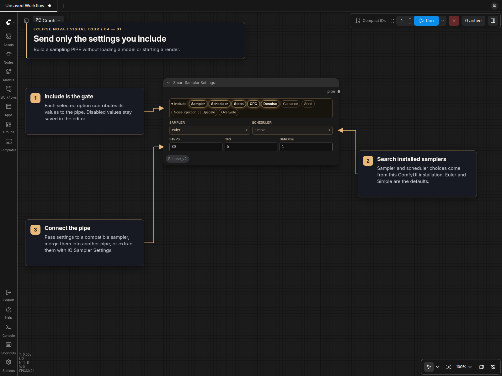
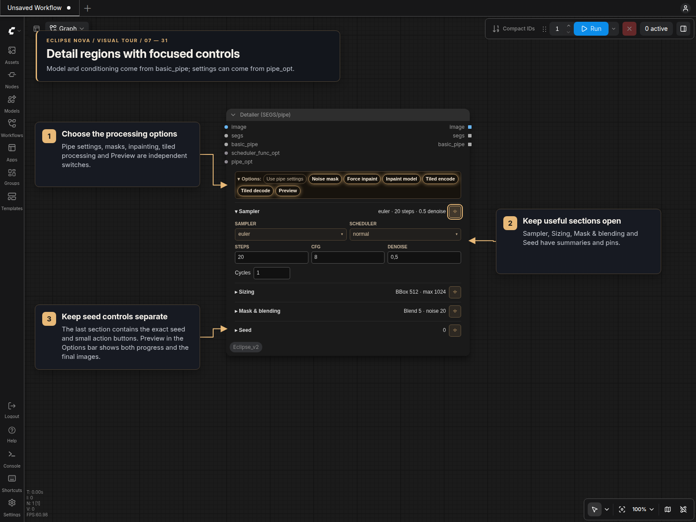

# Sampler panels

**Smart Sampler Settings**, **Eclipse KSampler (Kargim)** and **Detailer (SEGS/pipe)** use the new Eclipse Nova layout in classic canvas and Nodes 2.0. Themed controls and collapsible option bars follow the panel approach inspired by DaSiWa. Choose the palette in [Node designs](Node_Design.md); the panel uses that design’s node background.

## Smart Sampler Settings

Use **Include** to select exactly which parameters enter the output `PIPE`. Sampler, scheduler, steps, CFG and denoise start enabled, with **Euler** and **Simple** selected by default. Guidance, seed, noise injection, upscale and overwrite policy can be enabled independently.

Disabled settings keep their values in the workflow editor, so enabling them again restores the values you entered. They contribute no pipe keys while disabled. Collapsing Include only folds the bar; it does not change the selected settings.

- **Sampler / Scheduler:** searchable menus populated from this ComfyUI installation. Unavailable saved selections stay visible rather than being replaced silently.
- **Noise injection:** includes both `sigmas_denoise` and `noise_strength`.
- **Upscale:** includes `upscale_value` for a compatible downstream node. This settings node does not upscale images itself.
- **Overwrite:** the Include button directly enables `_allow_overwrite=True`, letting direct inputs take priority in **IO Sampler Settings**. Turning the button off omits the policy from the pipe. There is no separate checkbox.

Connect the output to **IO Sampler Settings** to extract individual values, or combine it with a model/context pipe using a pipe merge node.

## Eclipse KSampler (Kargim)

The sampler provides seven outputs: pipe, model, VAE, positive, negative, latent and image. Model, VAE, conditioning, latent and image can be supplied directly or through a pipe.

The Options bar contains four independent switches:

| Option | Effect |
|---|---|
| Use pipe settings | Supplied pipe sampling values take priority over local controls. Missing pipe values use the local values. Direct model, VAE and conditioning connections keep priority. |
| Tiled decode | Uses tiled VAE encoding/decoding and enables the tile-size field. |
| Alpha | Off by default: decoded RGBA images return RGB. Enable to retain decoded transparency. Applies to normal/tiled decoding, the image output, pipe image and final preview. |
| Preview | Shows live sampling previews and the final decoded image. Disabling it still returns the decoded image through the output. |

Local sampler controls stay visible when pipe priority is enabled. An available image is encoded before sampling; otherwise the sampler uses the available latent. The node requires a model, VAE, positive/negative conditioning and an image or latent at execution time.

Guidance, noise-injection and upscale pipe values need compatible consumers; Kargim uses standard sampling.

The final preview fills the remaining node space and resizes with the node in classic canvas and Nodes 2.0. For batches, click a thumbnail to enlarge it, click the enlarged image to advance (wrapping after the last image), and use **Close preview** to return to the grid. Live frames and final images share one viewer. Live-preview latents are reduced before decoding to limit memory use; final outputs retain full resolution. A preview-only OOM disables live frames for the current run without discarding sampling.

## Detailer (SEGS/pipe)

The new [Advanced Detailer](Integrated_Detailer.md) uses image/pipe sockets with IO Detailer or IO KSampler. It accepts external detections or internal YOLO, automatically detecting the checkpoint's detection or segmentation type from one model selector spanning both folders. It can then apply SAM2 and edge refinement. The existing SEGS-input node below remains available.

Connect an **image**, **SEGS** and a **BASIC_PIPE** containing the model, CLIP, VAE and positive/negative conditioning. An optional scheduler-function input is also available. The node supports per-frame segment selection and coordinate scaling. Its image, SEGS and BASIC_PIPE outputs are lists.

Connect an optional **pipe_opt** to supply sampler settings from Smart Sampler Settings, a model loader or a context pipe. Enable **Use pipe settings** to take `sampler_name`, `scheduler`, `steps`, `cfg`, `denoise` and `seed` from that pipe. Missing or `None` values keep their local panel settings. The toggle starts disabled; model and conditioning continue to come from **basic_pipe**.

Controls are grouped into four collapsible sections. Each header summarizes its current values. Opening a section closes other unpinned sections; pin a section to keep it open alongside another. Section state is saved in the workflow and does not affect processing.

| Section | Controls |
|---|---|
| Sampler | Searchable sampler/scheduler menus, steps, CFG, denoise and cycle count. Includes the Detailer's additional schedulers. |
| Sizing | Guide size, maximum size, and whether the guide applies to the bounding box or crop region. |
| Mask & blending | Blend feather and noise-mask feather. |
| Seed | Exact seed value, − / + and seed actions. The last section, after Mask & blending; its header shows the seed or queue policy. |

The **Options** bar enables pipe-setting priority, noise masking, forced inpainting, inpaint-model processing, tiled encoding, tiled decoding and preview independently.

**Preview** shows live sampling of the current region and fills the available node space in both renderers. It shows or hides the live frame immediately, without another queue. Turning it off also disables preview generation for subsequent runs. The live preview clears when sampling finishes; the detailer does not create a separate final-image preview.

Completed images remain available through the outputs in their original order and dimensions. Images with no matching segments pass through unchanged. Connect a downstream preview or save node to inspect the completed images.

## Seed controls

The seed field preserves exact unsigned 64-bit values. Small **− / +** buttons adjust it by one. The three icon buttons randomize each run, reuse the last queued seed, or create a new fixed random seed.

The shortcuts `-1`, `-2` and `-3` select random, increment and decrement modes. Saving, cloning or inspecting a workflow does not advance the seed. Accepted queues advance local seed modes; rejected submissions leave them unchanged. When the sampler uses a seed supplied by the pipe, its last-seed action is updated after execution.

These panels have no preset controls. Values, disabled drafts and bar disclosure state are stored in the workflow. They do not require Smart Model Loader or its frontend helpers to be installed.
