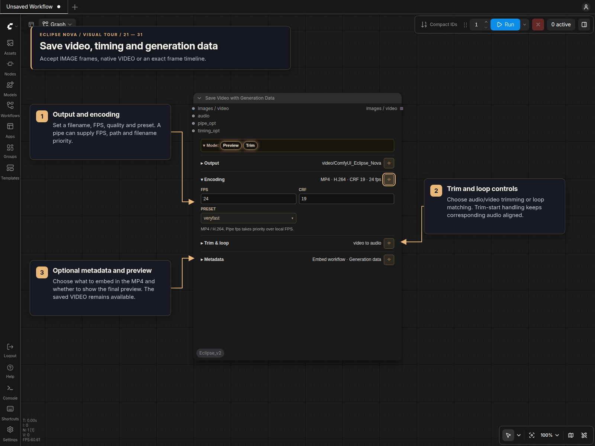

# Save Video with Generation Data [Eclipse Nova]

**Save Video with Generation Data** combines the video-saving functions in a
themed panel for classic canvas and Nodes 2.0. It saves IMAGE frames, native VIDEO,
or an [exact frame timeline](Frame_Timeline.md) as MP4/H.264, with audio, trimming,
loop matching, workflow metadata and generation data.

This is the single Eclipse Nova video saver, registered as
`Save Video Data [Eclipse Nova]`.

## Panel



The collapsible **Mode** bar contains **Preview** and **Trim**, both enabled by
default, and **Audio input**, initially off. Disabling Preview still saves the file. Disabling Trim leaves ordinary
IMAGE frame and audio lengths unchanged. A single image with audio is always
held for the complete soundtrack.

Enable **Audio input** to replace native VIDEO's soundtrack with the connected
AUDIO. It starts at video time zero and preserves the video's duration and frame
timing: longer audio is trimmed, and shorter audio is padded with silence. Missing
or invalid replacement audio raises an error. IMAGE and frame-timeline sources
already use the audio input and keep their existing behavior.

Four collapsible sections keep controls compact. Pin a section to keep it open
while opening another. Settings, pins and disclosure choices are saved with the
workflow; node resizing changes the preview area without changing video pixels.

| Section | Controls |
| --- | --- |
| Output | Output path and filename prefix, with placeholders. |
| Encoding | FPS, CRF and H.264 encoding preset. |
| Trim & loop | Duration alignment, loop matching metric, search range, start trimming and blend length. |
| Metadata | Embed workflow, generation data, prompt removal, LoRA tags and workflow JSON. |

Controls follow the connected source. Native VIDEO and `timing_opt` use source
timing, so local FPS and Trim controls are inactive. Exact frame timelines allow
duration trimming but not loop matching. Loop controls appear for loop modes;
blend length appears for `loop_match_blend`. Inactive choices remain saved.

## Inputs and output

Connect the required **images / video** socket. Optional sockets are:

- **audio**: soundtrack for IMAGE or frame-timeline input; replaces native VIDEO audio when **Audio input** is enabled.
- **pipe_opt**: generation metadata and output settings.
- **timing_opt**: exact timing paired with IMAGE frames from [Split Video](Load_Video.md).

The output is a list containing the processed IMAGE frames/batch, frame timeline,
or original VIDEO. With **Audio input** enabled for VIDEO, the returned VIDEO
points to the saved file containing the replacement soundtrack. The saved MP4
appears in the resizable preview when enabled.

### Pipe priority

Non-`None` pipe values take priority over the local panel without changing its
saved settings. The fields are:

| Pipe field | Effect |
| --- | --- |
| `fps` | Frame rate for ordinary IMAGE input; otherwise source timing is used. |
| `filename_prefix` | Filename or nested prefix, including placeholders. |
| `output_path` | Destination directory. |
| `path` | Smart Folder destination, used when `output_path` is absent or `None`. |

Eclipse pipes use **`fps`** as their single frame-rate field. IO Generation Data,
IO Context Image and IO Context Video carry FPS and output naming values. Smart
Folder video output and Pipe Out Smart Folder use the same `fps` key.

Missing or `None` fields use the local controls. An empty output path selects
ComfyUI's output directory. Relative paths are below that directory; absolute
paths and absolute filename prefixes can target another location. For external
saves, Preview uses a unique copy in ComfyUI's temporary directory. Disabling
Preview avoids that copy.

The default prefix is `video/ComfyUI_Eclipse_Nova`. Invalid filename characters
are sanitized. Counters and JSON sidecars use the same resolved name.

### IMAGE with source timing

Connect `timing` from Split Video to `timing_opt` when sending its IMAGE frames
through an upscaler. Connect its AUDIO directly to `audio`. The saver preserves
each frame's duration, including mixed frame rates, using the processed images'
dimensions. Source timing overrides local and pipe FPS, trimming, loop matching,
and the single-image audio hold.

Frame count and order must match the timing. A count mismatch produces an error;
reordering the same number of frames cannot be detected. VIDEO and FrameTimeline
already carry timing and cannot also use `timing_opt`.

### Native VIDEO

VIDEO retains its dimensions, frame rate and duration, including upstream crop
or trim. By default it retains its soundtrack and ignores separate AUDIO.
**Audio input** replaces that soundtrack, including for silent videos; connect
the already trimmed audio excerpt that should begin at the video's start.
IMAGE trim/loop settings are ignored.
CRF and preset still control H.264 export. Connect one VIDEO; multiple videos or
mixed IMAGE/VIDEO collections are rejected.

File-backed VIDEO exports stream without collecting the complete frame sequence.
Source metadata is replaced according to the selected metadata options. Failed
exports remove partial files while preserving the source.

Audio replacement also streams the encoded video packets and small audio chunks;
it does not expand the full video into an IMAGE batch. The saved preview and
VIDEO output use the same replacement soundtrack. An upstream Preview Video
still plays its own incoming VIDEO, before Save's replacement is applied.

### Single image with audio

Connect a cover image and soundtrack without a Repeat Image Batch node. The saver
holds the image for the complete audio duration, rounded up to the next frame at
the selected FPS. This applies regardless of Trim or loop mode. Output frames
share the original image storage; downstream nodes that concatenate or copy them
may still allocate a full batch. One image without audio remains one video frame.

## Metadata

| Option | Default | Effect |
| --- | --- | --- |
| Embed workflow | on | Embed ComfyUI prompt/workflow data in MP4 tags. |
| Generation data | on | Write A1111-style generation parameters from the optional pipe. |
| Remove prompts | off | Blank prompts in generation parameters only. |
| LoRA tags | off | Append pipe LoRA names and strengths to positive generation parameters. |
| Workflow JSON | off | Write a workflow sidecar beside the MP4. |

Generation parameters include positive/negative prompts, sampler, scheduler,
steps, CFG, seed, denoise, CLIP skip, dimensions, model/VAE names, and available
short SHA-256 hashes for models, VAEs, LoRAs and embeddings. Hashing uses existing
integrity sidecars and the shared cache. LoRA and embedding references are read
from prompts and pipe LoRA names.

Prompt removal takes priority over LoRA tag insertion. It does **not** remove
text from embedded workflows or JSON sidecars. Without a pipe, generation data
is omitted; embedding the workflow and saving JSON still work. ComfyUI's global
metadata-disable setting suppresses MP4 tags but allows explicitly selected JSON
sidecars.

## Filename placeholders

Placeholders are expanded after the optional PIPE is read. Longer names are
resolved first, so `%denoise` and `%clip_skip` cannot be partially consumed by
short date tokens.

| Placeholder | Value |
| --- | --- |
| `%today`, `%date` | Local date as `YYYY-MM-DD` |
| `%time` | Local time as `HHMMSS` |
| `%Y`, `%y` | Four- or two-digit year |
| `%m`, `%M` | Month |
| `%d`, `%D` | Day |
| `%H`, `%S` | Hour and second |
| `%basemodel` | First PIPE model basename without its extension |
| `%model` | First PIPE model value |
| `%seed` | Seed |
| `%sampler_name` | Sampler name |
| `%scheduler` | Scheduler |
| `%steps` | Step count |
| `%cfg` | CFG scale |
| `%denoise` | Denoise, or guidance when denoise is absent |
| `%clip_skip` | CLIP skip |

Date and time placeholders work without a PIPE. Any empty generation placeholder
falls back to its readable name without `%`; for example, `%seed` becomes `seed`.

Examples:

```text
video/%today/%basemodel_%seed
video/%Y-%M-%D/%sampler_name_%scheduler_%steps
```

The resolved prefix is used consistently for the MP4 counter, output filename,
preview response, and `.json` sidecar. The video saver uses the
same image-style four-digit counter without a trailing underscore:
`<resolved-prefix>_0001.mp4`.

## Trim and loop modes

These modes apply to ordinary IMAGE frames. Exact frame timelines support the
first four duration modes.

- `none`: preserve video and audio lengths.
- `video_to_audio`: shorten the frame batch to the audio duration.
- `audio_to_video`: shorten audio to the video duration.
- `shortest`: shorten both to the shorter duration.
- `loop_match`: trim at the tail frame that best matches the start.
- `loop_match_blend`: find the loop point and crossfade the tail toward the start.

Loop matching supports NCC, MSE, luminance MSE and gradient MSE. **Trim start**
searches both the head and tail for a closer pair and trims audio to the same
source interval. Matching preserves input frames; blending changes a separate
output tensor.
