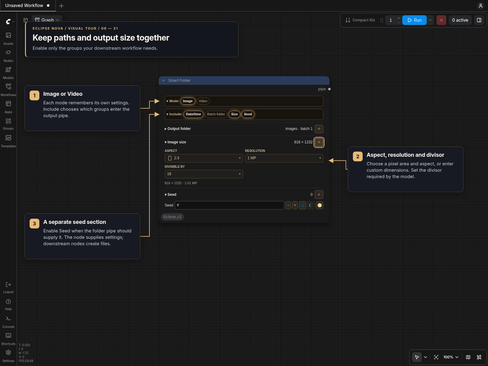

# Smart Folder

Smart Folder builds an output path and optional image/video settings in one `PIPE`. Its themed panel works in classic canvas and Nodes 2.0.

The **Mode** bar switches between Image and Video. **Include** enables Date/time, Batch folder, Size and Seed, plus the video-specific groups. Both bars can collapse to their selected values. Sections show a summary when closed; pin a section to keep it open while editing another. **Seed is always the last section** when enabled.

The node uses one configuration widget. Disabled groups keep their values in the workflow, and Image and Video remember separate root folders, dimensions and video settings. Saving, cloning and changing renderers preserve those values. No background polling or file catalog requests are needed.

## Output folder

The root folder is relative to ComfyUI's output directory. Nested paths accept `/` or `\`. Date/time can come before or after the root folder, and the batch folder comes last:

```text
output/images/2026-10-12/batch_1/
```

Date/time uses `strftime` notation, such as `%Y-%m-%d`. Batch folder names accept `{}` or `{0}` for the number and `{0:03d}` for zero padding. Set **After queue** to `increment` to advance the batch number after an accepted submission. **Batch size** is always included in the pipe.

This node supplies a path; downstream save nodes create the folders and files. After execution, Output folder shows the last generated path.

## Image and video size



The sizing controls follow Smart Model Loader's latent section:

| Control | Behavior |
| --- | --- |
| **Aspect** | Grouped square, horizontal and vertical ratios with small shape icons, or a custom ratio. |
| **Resolution** | Pixel-area presets such as `1024²`, megapixel presets, or Custom. A base size represents area, so `1024²` at 16:9 does not mean a fixed 1024-pixel edge. |
| **Custom size** | Choose Megapixels with an aspect ratio, or Fixed pixels with independent width and height. |
| **Divisible by** | 8, 16, 32, 64 or a custom integer. Both dimensions align to this multiple. |

The readout shows the effective width, height and megapixels. For example, `1024²`, 16:9 and a divisor of 32 resolve to **1376 × 768**. Fixed pixels show their calculated aspect instead of an editable aspect menu. Changing sizing modes retains custom drafts; merely reopening a workflow does not recalculate its dimensions.

Image starts with **2:3 at 1 MP, divisible by 16**, resolving to **816 × 1232**. Video starts with **576 × 1024** in Fixed pixels mode with divisor 32. Size is initially disabled. Invalid sizes are reported rather than silently replaced during execution. Choose the divisor required by the consuming model. Smart Folder supplies the initial dimensions; Smart Model Loader controls the latent format and creation.

## Video sections

Video always includes frame rate. Additional Include buttons enable:

| Group | Settings and behavior |
| --- | --- |
| **VHS** | Frame load cap, Skip first frames and Select every nth. A cap of 0 means no limit. |
| **Context** | Context length; initially enabled in Video mode. With VHS enabled, adds Skip contexts and its After queue control. |
| **Loop** | Loop count and overlap. Enables Context and prevents disabling it while Loop is active. |
| **Duration** | Duration metadata in seconds, shown beside frame rate. It does not calculate frame counts. |

With VHS, Context and a positive Loop count, the effective frame load cap is `Context length × Loop count`; the manual cap is retained but disabled. With VHS and Context, effective skipped frames are `Skip first frames + Context length × Skip contexts`. The collapsed Frame loading summary shows these effective values.

Context skips increment only when VHS and Context are enabled and the submission is accepted. A failed submission, workflow save or clone does not advance counters.

## Seed

Enable **Seed** in Include to add the bottom section and put a seed into the pipe. The compact row has an exact 64-bit seed field, small −/+ buttons, Randomize each run, Use last queued seed and Create fixed random seed actions.

The shortcuts `-1`, `-2` and `-3` select random, increment and decrement behavior. Accepted queues remember the actual seed and advance the next value; failed submissions leave it unchanged. Saving or cloning the workflow does not consume a seed. Disabled Seed is omitted from the pipe.

## Pipe connections

Connect the output to **Pipe Out Smart Folder** to expose individual values, or use **Concat Pipe Multi** to combine it with another dictionary pipe. The pipe contains:

- Always: `path`, `batch_size`.
- Size enabled: `width`, `height`.
- Video: `fps`, plus enabled VHS, Context, Loop and Duration values.
- Seed enabled: `seed`.

Use the width, height and batch size outputs when extracting dimensions from the pipe. Model-specific latent creation belongs in Smart Model Loader or the appropriate latent node.

[Sampler panels](Sampler.md) · [Eclipse Nova](../README.md)
