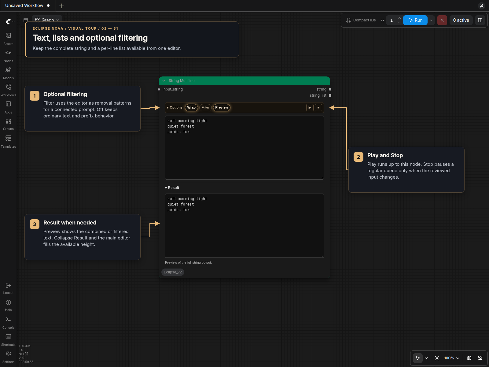

# String Multiline

**String Multiline [Eclipse Nova]** is the text editor under
**🌒 Eclipse Nova → Text**. Its themed panel provides both string and list outputs
in one node, with optional prompt filtering, result preview and queue interruption.

Resize the node to set the available editing space. When both fields are visible,
Text and Result share that space; their lower-right handles adjust the split
without enlarging the node. Hiding or collapsing Result lets Text fill the space.
Reopening Result restores the split, which also survives queueing, workflow reloads
and renderer changes. Long text scrolls inside its field without changing the
node's dimensions. **Wrap** changes how long lines display;
it never inserts line breaks or changes either output. Collapse Options to keep
the toolbar small. Wrapping, disclosure and node size are saved with the workflow.
The editor uses the selected Eclipse Nova design in standard canvas and Nodes 2.0.

**Preview** shows a collapsible, read-only Result section. With no input
connection, ordinary text updates immediately. A connected `input_string` is
resolved when the workflow runs: Result shows the combined input and editor text,
or the filtered prompt when Filter is enabled. It displays the full string output,
including its whitespace and blank lines. Multiple mapped results appear on
separate lines. Preview and the last executed result are saved with the workflow.

**Stop** interrupts the current workflow after this node produces its outputs.
Queue again without changing the inputs to continue downstream using ComfyUI's
cached result. Changed text, settings or upstream inputs stop again on execution;
clearing the execution cache also requires a new run. Stop works independently of
Preview. Both switches default off.

**Play (▶)** on the right of Options runs this node and its required upstream
inputs once. It enables Preview and opens Result. Downstream nodes are not
requested, so Stop can stay off. The existing **Stop (■)** toggle sits beside
Play and keeps its normal-queue behavior; Play does not change it. Collapsing
Options hides Stop and shows its state in the summary, while Play remains
accessible, including inside subgraphs.

Partial runs advance seeds and automatic choices only on their requested branch.
Other Nova nodes retain their values. This also applies to ComfyUI's selected-node
Run command. Any enabled Stop upstream still applies during execution.

**Filter** defaults off. With it disabled, the connections work as follows:

| Connection | Behavior |
| --- | --- |
| `input_string` | Optional prefix. Prepended verbatim to the full string, with one separating space when both inputs contain text. Trimmed before each list item. |
| `string` | Complete text, retaining whitespace, blank lines, line endings and literal wildcard syntax. |
| `string_list` | Trimmed non-empty lines, in their original order, with the optional prefix added to each item. |

For example, entering `first` and `second` on separate lines with a connected
prefix of `portrait` produces `portrait first\nsecond` as the full string and
`["portrait first", "portrait second"]` as the list.

An empty editor with a prefix returns that prefix. With neither text nor a
prefix, the outputs are `""` and `[""]`, keeping downstream list mapping valid.
With Filter off, no wildcard expansion, underscore conversion or prompt cleanup is applied.
Use [Wildcard Processor](Wildcard_Processor.md) when expansion is wanted.

Enable **Filter** in Options to use the editor as removal patterns for the prompt
connected to `input_string`. Separate patterns with commas or newlines. Matching
ignores case and treats spaces and underscores as equivalent; each `*` matches
exactly one word. For example, `*hair` matches
`long hair` or `long_hair`, while `**hair` matches `very long hair`. Tag prompts
lose whole matching tags; prose loses matching words or phrases with punctuation
cleanup. Escaped and unescaped parentheses match equivalently.

Both outputs contain the filtered prompt: `string` is the complete result and
`string_list` contains its trimmed non-empty lines. An empty pattern field passes
the source through unchanged. A missing source or fully removed prompt returns
`""` and `[""]`. Turning Filter off retains the editor text and restores normal
text/prefix behavior. The Filter selection is saved with the workflow and shown
in the collapsed Options summary.

Either output can feed Wildcard Processor's `substitutions` input. Enter quoted
assignments such as `SUBJECT:"a traveler"` and `PLACE:"forest"` on separate lines
or comma-separated on one line. The processor combines every assignment into one
substitution set before expanding the prompt. Keep Filter off when composing
these assignments.
