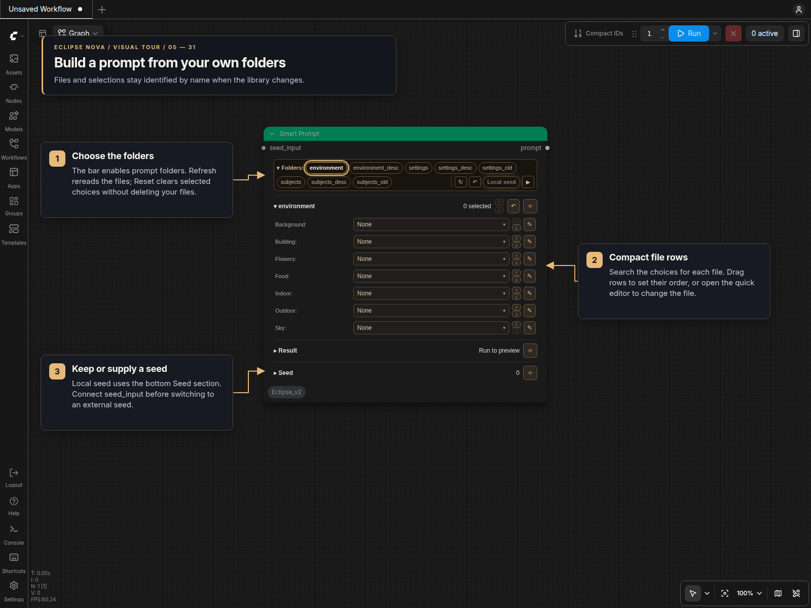
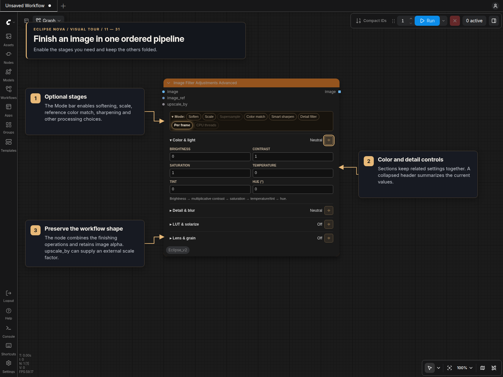
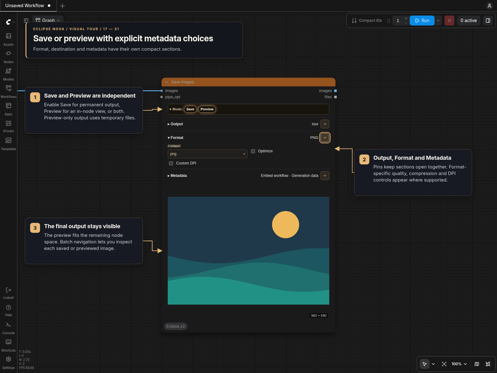
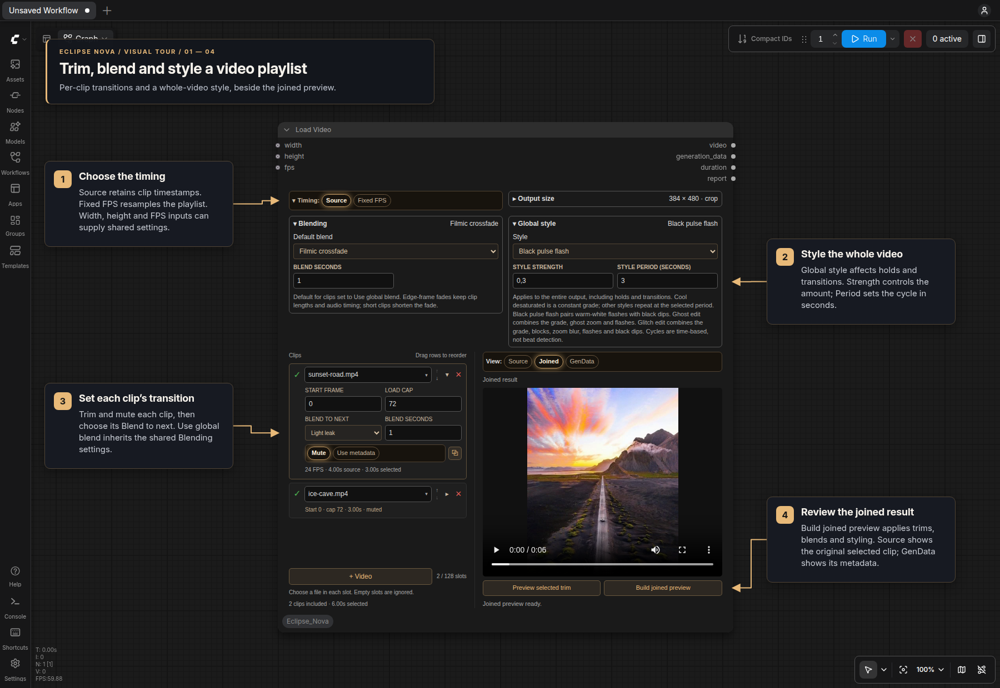
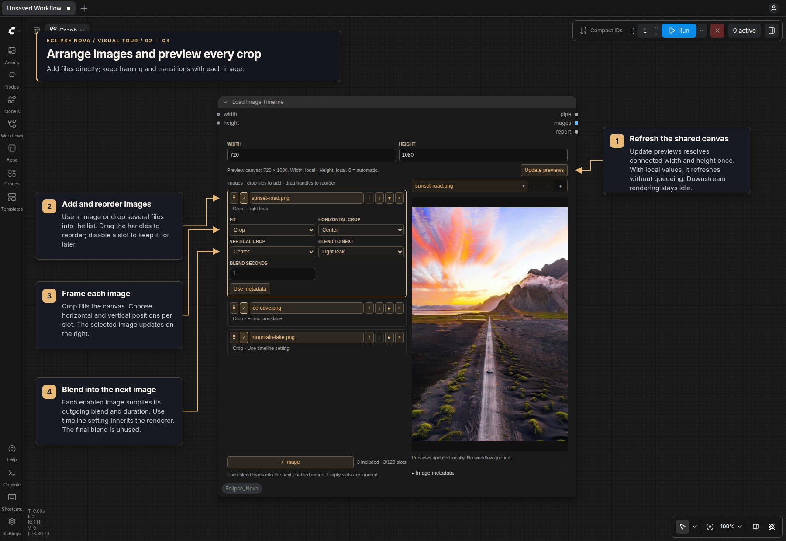
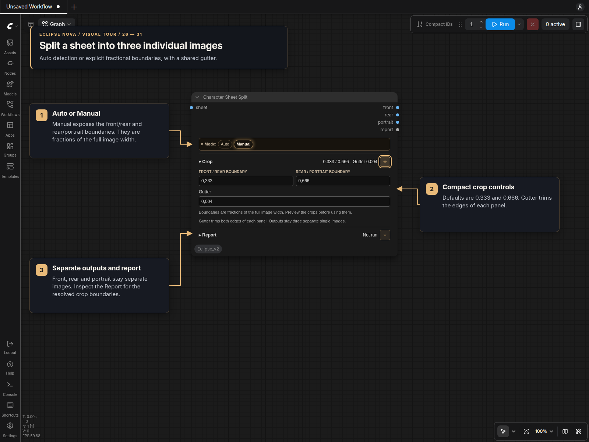
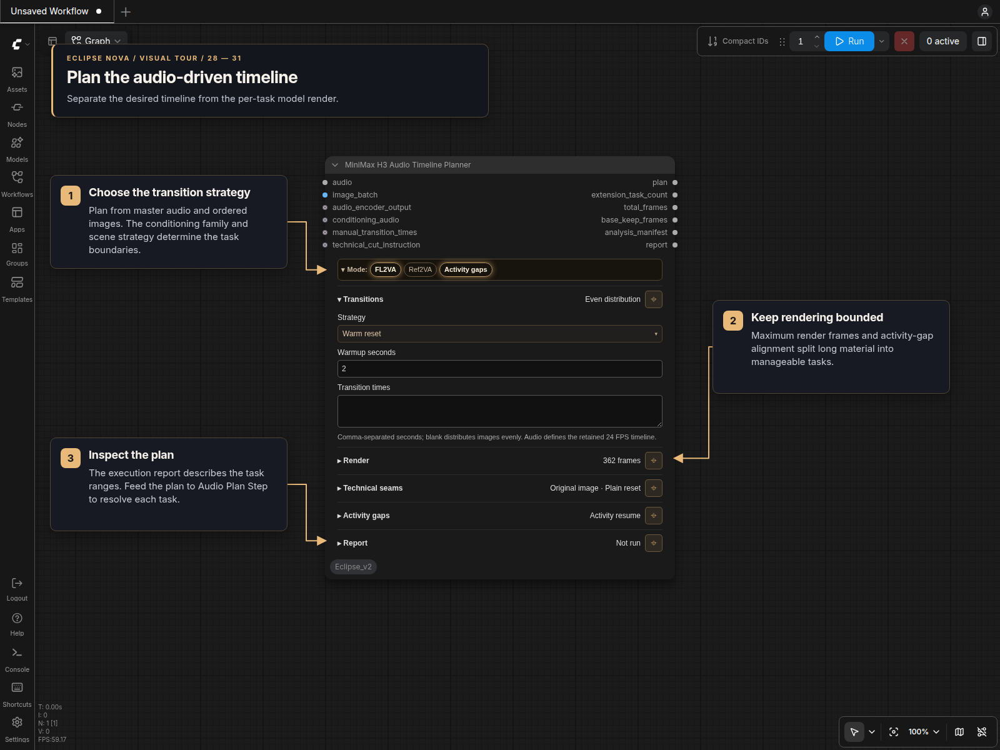
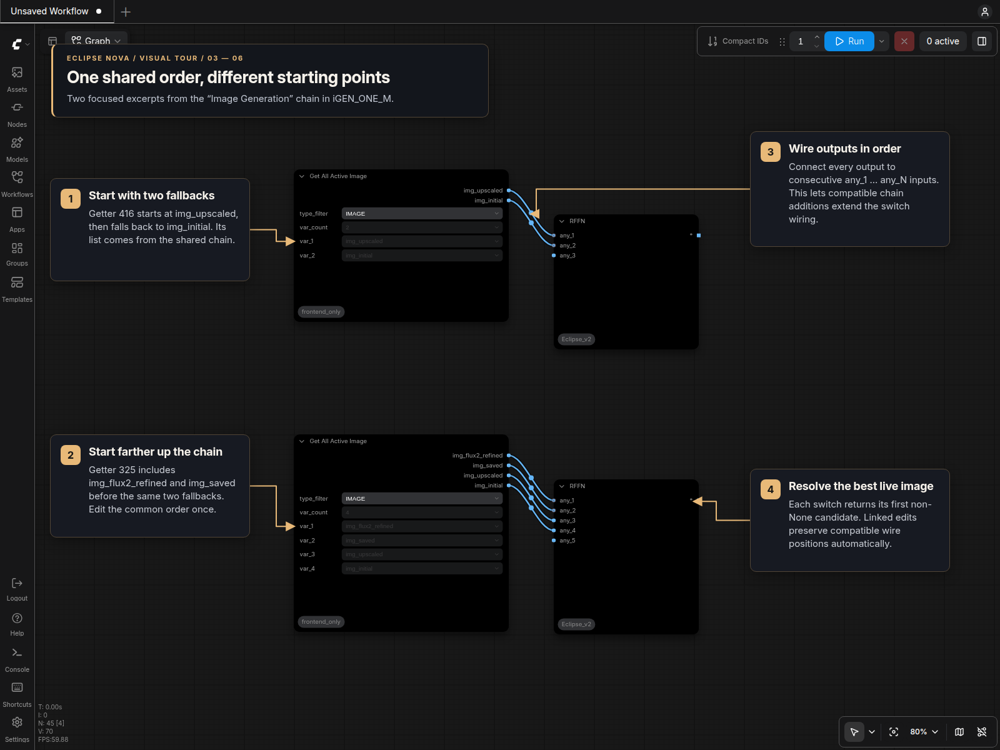

# Eclipse Nova visual tour

These screenshots capture real panels in running ComfyUI. The Load Video and
Load Image Timeline scenes use ComfyUI **0.42.1** with frontend **1.55.18**;
earlier scenes were captured with 0.38.0 and frontend 1.53.10. Most use **Amber**,
the yellow-gold theme used throughout this tour. **Neutral is the default.**
The media examples use small sample files; model-dependent controls are shown
without loading models.

Open an image to inspect it at full size. Each section links to the guide with
settings, inputs and workflow examples.

## One design in both renderers

The same panel works in classic canvas and Nodes 2.0. Collapsible bars show the
active choices, section pins keep selected groups open, and the node size bounds
resizable text and previews. [Node designs](Node_Design.md) covers the
bundled palettes and custom JSON themes.

## Build and inspect prompts

[Smart Prompt](Smart_Prompt.md) reads your own folders and files. Enable folders,
choose entries and drag their order. Refresh updates the library; the quick
editor changes the underlying text file.

[Wildcard Processor](Wildcard_Processor.md) expands seeded choices in Populate
mode. Fixed keeps an editable result. Prompt and Result share the available node
height; folding one gives the other more space. Play executes this node with its
required upstream inputs.

Also see [String Multiline](String_Multiline.md) for optional filtering, result
preview and Stop; [Prompt Styler](Prompt_Styler.md) for named styles; and
[Prompt Forge](Prompt_Forge_Panel.md) for an offline tag corpus with separate text
sections.

## Choose settings and dimensions

[Smart Sampler Settings](Sampler.md#smart-sampler-settings) sends only the values
enabled in Include. Disabled settings stay in the editor for later reuse. Pass
the resulting pipe to a compatible consumer or extract individual values.

[Smart Folder](Smart_Folder.md) combines an output path with optional size, seed
and video settings. [Resolution Pipe](Resolution_Pipe.md) provides just the size
and optional batch count. Both offer aspect, resolution and divisibility choices
with custom dimensions.

[Eclipse KSampler and Detailer](Sampler.md) have pipe-priority controls and
live/final previews. The KSampler’s Alpha option keeps transparency when enabled;
it defaults off for RGB output.

## Load, adjust and review images

[Load Image](Image_Loaders.md#load-image) keeps the preview within the chosen
node size. Its file picker contains grid/list views, Refresh and Delete.
Metadata reveals **Generation settings**, where you choose the sampler values,
prompts and seed to add to its pipe.

[Image Filter Adjustments Advanced](Image_Adjustments.md) groups the finishing
stages in processing order. Enable optional stages and pin the sections needed
for the current edit.

[Image Resize](Image_Resize.md), [Text/Image FX](Image_FX.md) and
[media tools](Media_Tool_Panels.md) use the same controls. Use
[Image Selector / Comparer](Image_Review.md) to choose and compare results, or
[Image Preview](DOM_Previews.md) for image/mask review with an optional Stop
checkpoint. [Batch selection and slicing](Batch_Selection_Slice_Dice.md) keeps
filenames aligned with the images you choose.

## Save outputs and reuse metadata

[Save Images](Save_Images.md) separates Output, Format and Metadata. Save and
Preview toggle independently; the final preview fits the remaining node space.
Pipe destination values can override the local path and filename controls.

[Save Prompt](Save_Prompt.md) uses matching Output/Format sections for
TXT/CSV/JSON captions. [Read Prompt Files](ReadPromptFiles.md) controls iteration
through prompt collections. [Save Video with Generation Data](Save_Video_Data.md)
adds encoding, trim and loop controls for video output.

## Work with audio and video

[Load Video](Load_Video.md) places editable clip slots beside a player. Each clip
has its own trim, audio, metadata and transition choices. Shared Blending supplies
defaults; Global style affects the complete output. Source timing retains original
timestamps; Fixed FPS resamples onto one frame grid. Build the joined preview to
review trims and effects together.

[Load Image Timeline](Image_Timeline_Video.md#load-image-timeline) adds images
directly as reorderable slots. Set each crop and outgoing blend, refresh the shared
canvas, and optionally select one image's generation metadata. Its PIPE retains
these choices through IO Image Timeline into the video renderer.

The [full image timeline tour](Image_Timeline_Video.md#load-image-timeline) also
shows metadata selection and the connected loader → IO → renderer flow.

[Load Audio](Load_Audio.md) auditions files or incoming audio and accepts start
and duration overrides. [Lyric Captions](Lyric_Captions.md) keeps full-song
alignment separate from clip-relative export. For recording and output, see
[System Audio Recorder](System_Audio_Recorder.md), [Upscale Video](Upscale_Video.md)
and [Save Video](Save_Video_Data.md).

## Prepare characters and datasets

[Character references and sheets](Character_Reference_Nodes.md#visual-tour)
cover role-specific preparation, assembly and individual panel crops. Connected
text and dimension inputs can override the local panel values. Reports describe
the resolved roles or crops after execution.

[Character Shot Planner](Character_Shot_Planner.md#visual-tour) keeps identity,
scene and selection controls separate, with persistent reservations and aligned
prompt/seed/shot-ID lists. All character tools are under **Eclipse Nova → Character**.

## Plan exact video timelines

The three [MiniMax panels](MiniMax_H3_Audio_Planner.md#visual-tour) separate the
timeline plan, per-task resolution and conditioning. Keep the conditioning family
and FPS consistent, then append only the retained frames.

[Frame timeline tools](Frame_Timeline.md#visual-tour) append and trim stored
frames without concatenating all prior scenes into an image batch. Their tour
also shows the base-only route when no extension tasks are needed.

## Route by shared priorities

[Get First / Get All Active](GetFirst_GetAllActive.md#visual-tour) retain their
specialized routing controls. Shared chains provide one priority order with
per-getter starting points and exclusions; the tour includes the actual editor
and member-options dialogs.

Try the [model-free shared-chain example](../Workflows/README.md), or read
[Set/Get and Bridge](Set_Get_Bridge.md) for named channels and mode control.

[All guides](README.md) · [Installation and overview](../README.md)
